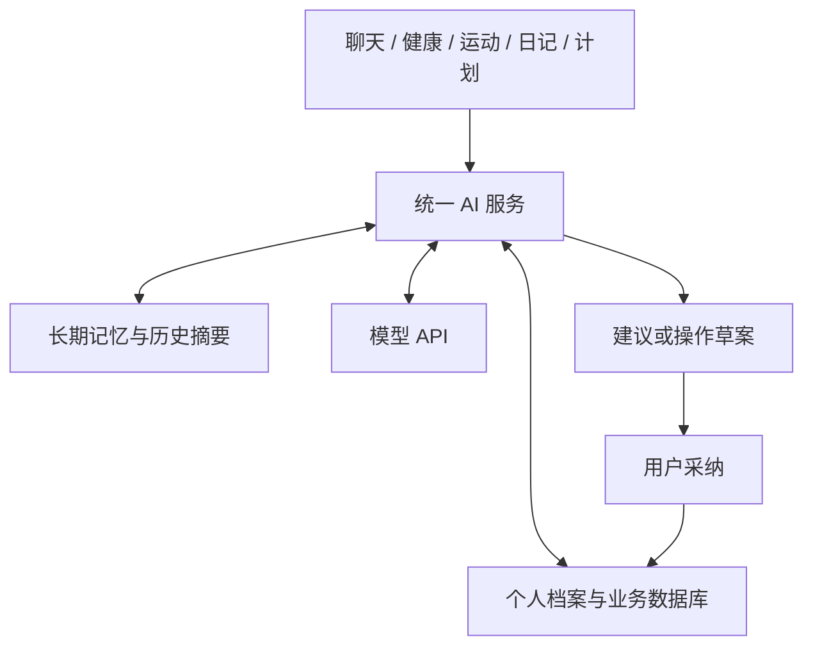

# AI 管家开发计划

> 本文档是项目当前的开发计划，后续讨论以此为基础持续修改。
> 当前处于需求与方案讨论阶段，尚未开始实现。

| 项目 | 内容 |
| --- | --- |
| 软件名称 | AI 管家（暂定） |
| 文档版本 | v0.146 |
| 创建日期 | 2026-10-26 |
| 最后更新 | 2026-11-03 |
| 当前阶段 | 产品范围与技术方案确认 |
| 首版平台 | 网页应用，兼顾手机与电脑 |
| 初期用户 | 开发者本人，验证后再考虑推广 |

## 1. 项目目标与已确定事项

通过接入 AI 模型 API，建立一位能够结合个人生活记录，参与日常规划与决策的 AI 管家。

首要价值已明确：逐渐了解并记住用户的生活背景，结合现状给出贴合个人情况的建议。计划安排和执行辅助围绕这一目标展开。

核心功能包括聊天、健康指标记录与观察、健身与运动、日记、通用计划与持续记录。各模块共用同一位 AI 管家的身份、个人档案、记忆与业务数据，让其他模块的信息能够影响当前建议。

典型场景：用户询问今天如何运动，AI 可以结合近期健康记录、历史训练、相关日记与正在执行的计划生成建议；用户采纳后，保存或更新相应计划；持续追加的记录继续影响后续建议，不额外拆分子任务。

已由用户明确的方向：

- 产品至少支持手机与电脑双端使用；第一版采用同时适配两端的网页，不要求原生客户端。
- 手机端导航选择 A：底部五个入口为首页、聊天、计划、日记、我的；健身在计划内设专门入口，个人资料、身体数据、管家记忆及设置通过我的进入，首页保留身体数据快捷入口。各模块复用相同业务能力及数据。
- 电脑端导航选择 A：左侧直接列出首页、聊天、计划、健身、日记、个人信息、管家记忆、设置八个入口，个人信息包含身体数据；健身与手机端一样复用健身分类通用计划，不新增独立训练体系。
- 个人信息的页面组织选择 A：分为“个人资料”和“身体数据”两个标签页，首页身体数据快捷入口直达身体数据标签；手机仍通过我的进入相应内容，电脑仍通过个人信息进入，不增加一级导航。
- 新身体状态录入选择 A：身体数据页提供统一的“记录身体变化”入口，可选择发生变化的一项或多项，只提交所选指标；未选项保留原值和各自更新时间。原记录纠错另设操作，仍按指标独立执行新增间隔及纠错窗口。
- 手动多指标提交失败处理选择 A：本次选中项全部通过校验并成功写入才一起保存；任一项不符合规则或保存失败，本次均不生效，提示失败项并保留输入，用户可调整选择后重新提交。不因整批提交将各指标的独立计时改为整份状态锁定。
- 首页计划区选择 A：展示进行中的计划，按预期完成时间由近到远排列，可显示少量条目并提供查看全部计划入口；长期计划在进行中期间持续符合展示条件，不限于今天开始或到期，不新增每日任务对象。
- 首页交互草图的信息顺序与主要入口已获认可：顶部日期问候与聊天入口、近况总结及分析历史、管家建议、进行中计划、最近身体记录、日记入口。作为后续页面流程基础，其他页面的完整交互及具体视觉参数继续细化。
- 先供个人使用，验证后再考虑推广。
- 先在本机开发、运行和验证；代码跑通后希望将系统分享到 GitHub，供他人下载源码、自备数据库与模型 API 配置、运行各自的个人实例。项目需便于复现运行，仓库公开范围和许可证待确认；服务器部署保留为后续选项。
- 所有功能围绕同一位 AI 管家展开，数据与上下文能够按需互通。
- 维护本开发文档，允许后续随时调整计划。
- 后端采用 Java + Spring Boot，沿用用户已有的 Spring Boot 开发经验和本地开发环境。
- 业务数据库采用 MySQL，沿用用户已有的数据库使用经验。
- UI 采用温和、安静、有生活与陪伴感的风格，首页选择“生活总览”草图，沿用草木绿与暖米色的配色方向；具体设计参数在细化中调整。
- AI 根据用户现状提出计划建议，用户可直接采纳并应用、修改后采用，或不采纳；健身、运动及每日工作安排由用户最终主导。
- 管家适度主动：默认每天北京时间上午 10:00 自动触发一次综合分析，允许在设置中修改每日时刻或关闭定时分析；也在新建、延期等重要计划变化后后台自动分析，普通记录合并处理，用户可手动发起分析。首版提醒仅在网站内展示，具体调度实现待细化。
- AI 创建或调整计划、运动方案与个人记忆时，先展示草案，经用户确认后保存或修改。
- 聊天中 AI 提出单个新计划时采用方案 A：以完整草案卡片展示名称、分类、起止时间及详情，提供“确认创建”和“调整”入口；可直接确认保存，或进入预填的独立计划表单修改后保存，不要求每次先跳转表单。直接确认成功后留在主聊天，卡片显示“已创建”并提供“查看计划”入口；通过独立表单保存仍进入计划详情。
- 新旧资料冲突时，AI 回答优先使用用户本人已明确保存或确认的最新正式资料；AI 如需修改关联长期记忆或其他资料，必须展示具体修改内容，经本人同意后执行。用户主动保存表单属于对该次直接修改的确认，不自动授权 AI 连带修改其他记忆。
- AI 修改草案的确认采用方案 A：仅在本人点击页面确认按钮后执行，聊天中的口头同意不直接触发正式资料写入；用户手动表单保存仍是直接操作，已授权的自动摘要及到期状态流程按原规则运行。
- 长期记忆采用主动提炼候选的方式：AI 可从交流和记录中提出值得记住的内容，经用户确认后保存；用户也可主动要求记住。首版提供独立的“管家记忆”页面，支持查看、手动新增、修改和删除。
- 已确认长期记忆独立保留，删除其来源记录不联动删除该记忆；用户需在记忆管理中单独修改或删除。首版暂不提供长期记忆归档入口，保留完整有效记忆，自动维护背景摘要并按需查询详情；后续可以调整，不改变其他模块已有的归档规则。
- 来源归档采用 A：此前已确认的独立记忆继续有效，可供 AI 日常参考并纳入记忆背景摘要；来源原文、图片及其阅读摘要仍按归档规则排除，不通过记忆来源链接绕过。需要改变记忆时由用户单独管理，AI 修改仍须确认。
- 每条长期记忆保留当前版本和最近 10 个旧版本，超过上限清理最早旧版本；历史版本首版仅供查看，不提供一键恢复，需要改回时通过普通编辑完成并保留新的变更历史；AI 日常以当前有效版本为准。
- 删除长期记忆后，不根据同一批旧资料重复提出相同记忆候选，适用于聊天、日记等所有来源；用户主动要求或出现新的相关信息时可以重新考虑，仍需确认后保存。
- 整条管家记忆删除选择 A：首版不提供回收站或单条恢复，当前内容及其保留的旧版本一并退出业务查看和 AI 记忆读取；同步处理背景摘要与检索，不通过历史版本继续引用。来源原始资料仍按原有规则管理，防重复提炼规则保留。
- 首版依靠用户人工提供数据：初次聊天介绍自己、手动制定计划、填写身体指标等；不依赖设备或日历自动同步。
- AI 默认可以跨所有模块参考用户已提供的有效资料；首版不实现单个模块的屏蔽开关，但归档计划不再由 AI 默认直接读取。
- 健身计划既可由用户依据身体指标与 AI 沟通后获取推荐，也可由用户自行制定。
- 首版健身与运动采用方案 A，作为“健身”分类通用计划的专门入口，复用计划详情、进展文字、身体指标与照片；训练安排以文字表达，不另做动作库、组数次数、跑步距离时长等结构化训练功能。
- 计划包含目标与预期完成时长；用户可以在同一计划下持续追加按天记录的进展、身体指标和照片，类似一本围绕目标的日记本。
- 计划下记录采用轻量自由随笔，支持文字和图片，内容随意，不要求有进展或特定意义，不另设身体指标表单。正式身高、体重等身体数值在个人信息栏的身体数据区域更新；随笔偶尔提到数值不自动同步。“计划随笔”为说明性名称，最终页面命名待定。
- 同一计划一天可以新增多条材料记录；进行中允许补记过去发生的进展，记录发生时间与系统真实提交时间分别保留，补记时间范围仍待细化。
- 第一版不引入子任务概念，不将计划额外拆分成周任务或每日子任务；日常更新作为记录管理。
- 所有领域共用通用计划对象，通过固定分类和文字详情表达内容；分类确定为“健身、工作、学习、生活、其他”，首版不允许用户新增分类。
- 每份计划只能选择一个固定分类；用户已认可当前表单：标题、分类、开始与预期完成时间必填，详情选填、可后补。后续需求变化时仍可调整。
- 新建与编辑计划使用独立页面，保存成功后进入该计划详情，手机电脑采用相同流程；当前字段排布、未保存离开提醒及输入错误后保留内容已获认可。编辑仍受计划当前状态及开始时间锁定规则约束，具体视觉参数与服务端校验边界在实现时明确。
- 允许提前创建未来才开始的计划，开始前状态为“未开始”，到开始时刻自动转为“进行中”；到结束时刻按既有规则自动转为“已完成”，进度不随状态自动改变。
- 新建计划采用时间方案 C，不支持补录：开始时间只能为当前或未来，不允许补建过去已经开始或已结束的计划；这是新建校验，不因已有计划的开始时间自然变成过去就阻止正常保存。
- 未开始时可以调整开始时间，进入进行中后锁定原开始时间，仍允许调整预期完成时间；已完成或已废弃的内容编辑须先恢复到允许编辑的状态，恢复目标按原开始时间是否已到判断。
- 未开始时允许修改计划信息、新增、编辑和删除文字图片材料，但禁止修改进度。
- 未开始计划提前完成选择 A：允许直接标记为已完成，保留原定开始与预期完成时间，另记实际完成时间；不要求先转为进行中，不自动修改进度。完成后沿用内容只读规则，后续原定开始时刻不会把已完成计划自动转回进行中。
- 提前完成计划恢复选择 A：恢复时原定开始时间尚未到，则恢复为未开始，保留原定起止时间和进度，到开始时刻再自动进行中；恢复后可编辑信息及随笔，仍不能修改进度。如已归档，恢复时须同次解除归档，不产生未开始且已归档的组合。
- 未开始计划废弃选择 A：允许直接废弃并保留原进度，内容转为只读；以后恢复时，原开始未到则恢复未开始，已到则恢复进行中，原期限已过须同次延期。已归档时恢复须同次取消归档，与已完成计划的恢复规则一致。
- 计划进度采用实际完成度，由用户填写 0～100%；AI 可结合记录提出进度调整建议，经用户确认后更新。图形形式在 UI 阶段确定，首版仍不拆子任务或引入可勾选 step；计划状态与进度独立，到期自动完成或手动点击完成都保留原进度，填写 100% 也不自动结束计划。
- 新建计划进度默认 0%，首版只接受 0～100 的整数百分比，不支持小数；未开始不能改进度，进行中允许上调或下调并保留变更历史。
- 计划进度历史操作选择 B：提供恢复历史百分比入口，展示当前值与目标值并经用户确认后，按一次新的进度修改保存；已有历史保留，记录本次恢复时间及前后值。仅进行中可操作，不恢复计划详情、随笔、图片或状态，管家记忆历史仅查看的规则不变。
- 进度允许在进行中调低，更新时保留变更时间、原值和新值，供用户及 AI 回顾；用户以实现难度为条件优先选择历史方案 A，当前评估为常规后端功能，首版采用 A，不降为仅保留最新值的 B。
- AI 可以由用户手动触发或在约定时间综合读取全局数据，包含进行中和已完成的计划及其材料，推测当前状态并提出建议。
- 为提高 AI 阅读效率维护数据摘要文档，必要时回查原始历史；对既有记录的整理压缩可以自动更新，新增个人记忆、修改个人资料与调整计划仍需确认。摘要粒度与更新时机待细化。
- 计划到期且用户没有额外操作时，按约定自动视为“已完成”；用户可提前完成，也可选择延期或废弃。
- AI 建议集中在首页的“管家建议”列表中查看；针对具体建议发起讨论时进入主聊天，带入该建议及相关背景，不为每条建议另建独立讨论。
- 主聊天首版暂按一条长期连续对话设计，不提供新建多个会话入口；这是控制首版范围的方案，可在后续调整。聊天输入仅支持文字和图片，暂不加入语音。
- 管家个性化采用 A：首版提供管家名字、预设交流风格、回答详略三个设置，由后端保存并在各模块共用。名字默认小管家且可修改；风格可选温和陪伴、理性直接、轻松自然，默认温和陪伴；详略可选简洁、适中、详细，默认适中。当前问题明确要求详细说明时仍可展开，业务权限不随风格改变。
- 聊天生成操作选择 A：首版支持停止当前生成，以及重新生成上一条回复；重新生成时保留原回复，不覆盖或删除历史消息。停止或重新生成都不代表确认采纳正式业务修改，也不撤销此前已成功采纳的操作。
- 聊天生成期间发送规则选择 A：可以继续编辑下一条消息，但须等待当前回复结束，或手动停止当前生成后，才能点击发送；不自动排队发送、不因输入而自动打断，也不并行生成回复。手动停止保留已经生成的内容。
- 聊天回复失败的重试方式选择 A：保留已发送消息和已有回复内容，显示失败状态及可理解的原因，由用户点击“重新生成”手动重试，不自动重新调用模型。每日分析已确认的有限自动重试规则不变。
- 双端主聊天更新选择 A：手机与电脑共用服务器上的同一份记录，进入聊天页或手动刷新时读取已保存的最新消息；首版不向另一端逐字实时同步回复，也不因此增加未发送输入的跨端同步。
- 聊天后台生成规则已统一确认：切换站内页面、刷新、关闭网页或手机锁屏均不视为停止；只要后端服务及该次生成正常运行，就继续生成并保存，重新进入聊天时读取原任务结果或状态，不重复生成。用户点击“停止生成”才主动取消；服务故障、超时等失败仍按失败处理，不伪装成功，也不自动重试聊天或执行正式业务修改。
- 首版不支持用户删除聊天记录；关键词搜索和按日期定位仅覆盖尚未压缩的聊天消息，已压缩部分不参与搜索。压缩后仍完整保存原始消息，用户可以向上翻看，AI 可以按需回查；压缩不删除原文。
- 已发送聊天消息的编辑选择 A：首版不提供编辑入口，文字或图片需要更正时发送新消息说明，保留原消息。重新生成只新增关联回复，不用于改写用户已发送内容；更正中的正式资料或记忆变更仍须按原规则确认。
- 已采纳或已关闭的管家建议保留历史列表；一条建议包含多项操作时允许逐项选择采纳，只执行选中的操作，本次采纳成功提交后未选中项视为不采纳，立即作废并保留历史。建议具有时效性，历史建议不能再次执行；尚未回应的建议在相关数据变化或被新建议替代时作废，不设固定时长。
- 多项采纳失败处理选择 A：本次选中操作全部成功才提交，任一项校验或执行失败则整批不执行，已开始的业务修改回滚；展示原因，由用户调整选择后重新确认。失败本身不代表采纳成功或明确拒绝，仍有效的草案可重试，已过时作废的建议不能恢复执行。
- AI 删除权限选择 A：首版删除正式记录及材料由用户在各模块页面手动操作，AI 可以提出清理建议，但不提供可执行的删除草案或删除工具；聊天请求或确认按钮不能赋予 AI 删除权限。各模块已有删除限制保持有效，已约定的系统自动维护另行执行。
- 针对已有计划的日常安排采纳落点选择 B：确认后在对应计划下新增一条文字随笔，原计划详情保持不变；随笔表示安排，不代表已执行或完成，不自动更新进度、不生成子任务，也不写入独立日记。
- AI 需要具备查看并理解计划相关照片和文字的能力，结合相关资料形成建议；首版模型选型需验证图片理解能力。
- 每份计划必须有开始时间和预期完成时间，不支持无期限计划；长期保持某个习惯不作为计划管理，也不因此新增习惯模块。
- 首版所有模块统一采用北京时间 Asia/Shanghai（UTC+8），不提供个人时区设置，不随设备时区切换；日记的今天、年龄计算的当前日期、计划时间、每日分析及历史日期筛选使用同一业务时区。
- 计划开始时间和预期完成时间可精确到分钟；数据库字段类型、内部时间精度及存储转换方式在数据设计阶段确定，不把业务时区选择等同于选定数据库存储类型。
- 进行中计划的内容和已提交进展记录允许修改、删除；后续摘要与分析需使用更新后的有效资料。已完成、已废弃计划内容整体只读，需先按恢复规则恢复到可编辑状态再维护；归档与整份计划删除作为独立管理操作处理。
- 已完成和已废弃的计划不能新增进展记录；两者可通过状态操作恢复，再按目标状态权限编辑和追加。原开始未到时恢复未开始，已到时恢复进行中，原期限已过须同次延期；到期自动完成也可通过延期恢复。
- 支持删除整个计划及其材料，首版不提供恢复或回收站功能；归档保留历史，日常 AI 分析排除该计划及其摘要。用户明确要求回顾时，允许在该次请求中临时读取，不自动取消归档。
- 支持用户主动取消计划归档，恢复 AI 日常可参考范围，单独取消归档不改变完成或废弃状态。归档计划执行恢复时采用方案 A，同一次操作取消归档并恢复目标状态，过期时必须同时设置新的未来完成时间；原开始未到时目标为未开始，已到时为进行中。
- 进行中的计划不允许归档；归档适用于已完成、已废弃计划。方案 A 为当前选定方向，方案 B（保留摘要供日常参考）仅为实现遇到实际困难时的备选，目前不启用。
- 个人信息中称呼、性别、生日必填，系统根据生日计算年龄；职业、作息、兴趣爱好、MBTI、星座、血型、自我介绍选填。
- 首次建立个人资料采用方案 A：先用简短表单填写称呼、性别和生日，再进入系统；其他信息之后通过聊天或表单补充，不以先聊天采集作为必填资料建立方式。
- 每套实例首次使用时创建一个主人账号与密码，之后手机、电脑使用同一账号登录，访问同一份个人资料、计划、日记与聊天；首版不提供开放注册或多人账号体系。
- 忘记密码选择 A：在运行后端的电脑上通过本地工具重置主人密码，保留现有业务数据；首版不接入邮箱绑定、验证码或邮件找回，具体工具形式在技术设计时确定。
- 登录保持选择 A：同一设备自登录成功起保持 7 天，手机与电脑的登录会话分别计时；到期后需要重新登录，主动退出使当前设备会话立即失效，不影响其他设备仍有效的登录。
- 密码修改与重置后的会话处理选择 A：设置页支持验证旧密码后修改密码；网页修改或本地重置成功后，所有设备的既有登录会话失效，包括当前设备，须用新密码重新登录。仅修改认证数据，保留业务数据及模型配置；普通主动退出仍只影响当前会话。
- 模型 API 配置采用网页设置方案，主人登录后填写和修改 API 地址、API Key 与模型名称，由后端保存并调用；首版只维护一套当前配置，切换模型时修改原配置，不做多套配置保存与切换列表。支持的接口类型仍待明确。
- 首次可以跳过模型 API 配置，先使用日记、通用计划和身体数据等手动记录功能；进入聊天或 AI 分析功能时提示完成配置，不以模型配置作为使用基础功能的前置条件。
- 首次完成模型配置后的分析选择 A：定时功能开启、今天的设定时刻已过且当日每日分析尚未完成时，按最新资料安排当天一次后台补做，不追补配置前各天；未到时等待正常时刻，关闭定时则不自动触发，与其他每日任务入口统一防重。
- 模型首选 GPT 系列，首版通过 OpenAI 官方 API 接入；具体型号待验证确定，暂不承诺第三方兼容接口。用户暂未设定具体月度调用预算，费用控制规则待明确。
- 备份与恢复选择方案 B：首版在网页内提供手动备份和恢复入口。备份内容选择 A，包含全部业务数据与图片及已归档内容；恢复方式选择 A，整体替换现有业务数据，回到备份时的状态，不合并现有记录。账号凭据与模型配置选择 A，不包含在备份中，恢复时保留当前实例的登录账号、API Key 与模型配置；自动定期备份未纳入当前确认范围。
- 备份文件保存方式选择 A：通过浏览器下载到当前操作的手机或电脑，恢复时从网页选择备份文件上传给后端；本机运行时不需要额外的云服务器或云存储，不提供服务器备份列表作为首版必需能力。
- 可阅读导出选择 A：首版暂不提供单篇日记、单份计划等内容的 Markdown、PDF 或其他阅读文件导出，保留已确认的完整业务备份与恢复；可阅读导出列入后续候选。
- 身体数据首版固定为身高、体重、体脂率、疾病，不支持用户自定义项目；疾病是选填的自由文本，用于记录用户自述的当前患病情况，供 AI 参考。
- 身体数值首版固定单位：身高 cm、体重 kg、体脂率 %，不提供单位切换，具体输入精度和校验在接口设计时明确。
- 身体数据仅旧历史可归档，当前最新有效记录始终保留供 AI 参考；由用户手动触发，支持按日期范围批量处理，首版不自动归档。旧历史沿用 A 规则，日常分析排除归档内容及摘要，明确回顾时临时读取。
- 身体记录删除采用 A：当前最新有效记录不能直接删除，旧历史允许删除或归档；删除旧历史不改变当前值，也不重置最新记录对应的新增间隔，首版不提供删除恢复。旧历史支持取消归档，恢复 AI 历史参考，不改变当前有效值。
- 身体数据展示采用方案 A：当前值、历史列表及数值指标趋势折线图；身高、体重、体脂率分别查看变化，疾病说明以文字历史展示。历史列表和趋势图默认只包含未归档记录，用户可打开“包含已归档”查看完整历史，不因此取消归档或改变 AI 日常读取范围。
- 用户已认可身体数据交互示意的主要布局、统一录入、原记录纠错及归档查看入口，作为后续开发依据；具体日期筛选、输入精度与后端校验边界继续设计，不代表真实后端已实现。
- 身体数据表示用户当前状态，有变化时按需更新，不要求每日记录；每个指标独立计算最小更新间隔，首版系统预设暂为 8 小时，不提供用户自行调整入口。
- 身体数据时间采用 A：首版只更新当前状态，由系统记录新状态提交时间，不提供过去测量记录的补录或测量时间填写入口；历史列表和趋势图按状态记录时间呈现，不将提交时刻描述为实际测量时刻。
- 更新身体数据时只修改变化字段，其他字段沿用原值，不要求重复填写；未变化字段的有效更新时间不随本次提交被刷新。
- 身体数据区分“新增状态记录”和“修改原记录”：纠错在原记录上进行，不生成一条新的状态记录，不受新增间隔限制，但受最大可修改时限约束；超时不能修改原记录，只能按新增规则更新状态。
- 身体记录的修改截止时间固定为首次创建时间加 5 分钟，修改原记录不重置创建时间，也不延长截止时间。
- 日记是独立板块，可记录不关联任何计划的日常内容；同一天最多一篇，可以持续补充同一篇内容。
- 日记首版字段选择 A：系统日期、正文和图片，不增加标题与标签；列表展示日期及正文开头。只能新建当天日记，不能为过去空缺日期补建；已有历史日记按归档及编辑规则允许修改和补充。
- 日记由用户撰写，第一版不提供 AI 代写；AI 可以读取和理解日记，自动阅读摘要不等同于代写或改写日记原文。
- 日记允许删除，首版不提供恢复功能；支持归档并沿用 A 规则，日常 AI 分析排除归档篇及其摘要，明确要求回顾时临时读取。
- 日记支持用户主动取消归档，恢复 AI 日常参考；归档期间不能修改或补充文字、增删图片，须先取消归档再编辑。取消归档保留原日记日期与记录身份，不新建一篇日记。
- 手动查找资料选择 A：计划关键词仅搜索标题和详情，支持分类与状态筛选，随笔文字不参与计划关键词匹配；日记支持日期定位与正文关键词搜索。归档搜索范围选择 A，默认仅未归档内容，切换归档区后单独搜索归档内容，不套用聊天历史仅搜索未压缩消息的限制。
- AI 资料来源展示选择 B：引用本人资料时，只显示来源名称和对应记录时间，首版不提供点击跳转；后台保留来源关联，用于建议有效性检查及修改、归档、删除后的同步处理，不扩大 AI 读取权限。
- 图片保存方式选择 A：聊天、日记与随笔保留上传原图，另外生成网页预览图，原图不被预览压缩结果替换；图片保存在运行后端的电脑上，不依赖额外云存储，备份包含原图及关联信息。
- 日记与随笔手动编辑的保存方式选择 A：点击保存后才提交正式记录，离开编辑页时提示未保存内容；输入过程不自动保存为正式资料，未提交内容不参与后台 AI 分析。身体数据仍按原有规则手动提交，AI 草案确认成功后新增随笔的流程保持不变。
- 日记与随笔双端编辑冲突以先成功保存的版本为准：同一旧版本在另一端提交时拒绝覆盖，提示记录已更新并保留未保存内容；读取最新版本后仍可继续正常编辑，不是第一次保存后永久锁定记录。同日新建日记竞争也只保留先成功创建的一篇。
- AI 可从计划材料中感知可能的身体数据变化并提出更新建议，由用户决定是否更新；不因计划中出现数值就自动同步到身体模块。
- 恢复原期限已过的计划时，必须同时设置新的未来完成时间，再恢复进行中，避免再次触发到期自动完成。
- 定时分析默认每天北京时间上午 10:00 自动触发一次，用户可在设置中修改为另一个每日时刻，或暂时关闭；仍只允许每天一个时刻。此设置只控制定时分析，手动与重要变化触发的分析入口仍保留。
- 主动重新开启定时分析选择 B：若今天的设定时刻已过且每日分析尚未完成，安排后台补做；未到时等待正常时刻。当天任务已排队、执行中或成功时不重复创建，失败及中断复用原任务按后续确定的策略处理，不限制手动分析。
- 修改每日分析时刻选择 A：定时功能开启时，保存后按新时刻判断；今天的新时刻已到或已过且每日分析未完成，则安排后台补做，未到则等待新时刻。当天已排队、执行中或成功不重复创建，关闭状态仅修改时刻不触发分析，不重置当天任务记录。
- 每日分析失败处理选择 A：临时故障自动有限重试，仍失败时站内提示并允许手动重试；密钥无效或缺少配置等需要修正的问题直接提示，不持续自动重试。复用原每日任务，失败不标记成功，具体次数与间隔在技术设计时确定。
- 因后端服务未运行而错过定时分析时，恢复后按最新状态补做一次；即使错过多天，也不逐天补跑历史分析。
- 首版仅在网站内展示新建议、未处理数量和复盘结果，不接入邮件、微信等站外提醒；网站内具体提示样式后续细化。
- 每日定时分析的结果形式选择 A：简短近况总结加按需生成的建议；成功分析后，即使没有需要调整的事项，也保留简短结果，不只显示完成状态。历史保留方式选择 A，保留每日分析结果并支持按日期回看，新结果不覆盖旧结果；单独展示，不自动写入用户日记，具体页面布局待设计。
- 需求通过分轮访谈逐步明确，先讨论全局定位与边界，再细化各模块和具体功能；当前优先完成需求梳理。

**状态约定：**“已确认”表示用户明确提出或结合讨论确定；“建议”表示当前推荐方案，尚未最终确定；“待定”表示信息不足。后端已确定为 Java + Spring Boot，业务数据库已确定为 MySQL；其余技术组件、首版细节与开发顺序按各章节状态维护。

## 2. 基本功能

| 模块 | 目标能力 | 第一版建议范围 |
| --- | --- | --- |
| 聊天 | 自然对话，结合个人数据回答并协助决策 | 首版暂采用单条连续主对话，文字与图片输入；流式回复、停止生成、重新生成上一条回复并保留原回复、历史消息、跨模块查询与建议依据 |
| 管家建议 | 集中查看、讨论并处理 AI 提出的建议 | 首页待处理建议与已处理历史；针对具体建议进入主聊天；支持修改、逐项采纳或关闭 |
| 健康 | 记录固定身体数据与历史，为个人化建议提供依据 | 当前值、历史列表及身高体重体脂率的趋势折线图；疾病说明用文字历史，保留时间来源，旧历史支持 A 规则归档 |
| 健身与运动 | 制定个性化计划，围绕目标持续记录并调整 | 健身类通用计划的专门入口，训练安排用文字表达，复用计划详情、进展文字、身体指标和照片；无独立结构化训练功能，不拆子任务 |
| 日记 | 独立记录生活，为回顾和个人理解提供材料 | 系统日期、正文、图片，无标题标签；当天最多新建一篇，已有历史篇可修改，不补建过去空缺日期；可删除且首版不可恢复，可归档及取消归档，归档篇须先取消归档再编辑 |
| 计划与进展（名称待定） | 以通用对象管理任意领域的计划，并持续记录过程 | 目标与预期时长、分类、文字详情、状态和可追加的材料；分类含“其他”，首版不采用子任务层级 |
| 个人档案与记忆 | 保存个人信息并保持持续理解 | 称呼、性别、生日必填，年龄由生日计算；其余已列资料选填；独立记忆页面支持查看、手动新增、修改、删除，AI 提炼候选须确认后保存 |
| 基础管理 | 支撑长期可靠使用 | 登录、模型配置、网页手动完整备份与恢复；可阅读导出后置 |

首版身体数据范围已固定为身高、体重、体脂率及选填疾病说明。第一版的“健康监控”理解为人工记录、历史查看与辅助分析，实时采集、设备同步与异常通知属于后续讨论范围；不默认加入睡眠、心率等其他指标。

### 2.1 首次建立资料与计划（资料表单流程已确认，其余待细化）

首次使用先通过简短表单填写称呼、性别和生日，再进入系统；年龄根据生日计算。其他选填信息可在之后通过聊天或表单补充，通过 AI 提出资料修改时仍遵守确认规则。用户可以在第一次与 AI 聊天时继续介绍自己，逐步建立生活背景、偏好和目标。用户可以从第一天起自行制定计划，并手动填写身体数据；健身计划可以通过身体指标与聊天沟通由 AI 推荐，也可以自行制定。

这里的“手动导入”目前指通过聊天或功能表单人工提供信息，尚未确定文件上传、批量导入或具体文件格式的需求。首次使用创建主人账号，必填个人资料通过表单建立，不依赖 AI 聊天采集；模型 API 在登录后的网页设置页维护，允许跳过配置先使用基础记录功能，使用聊天或 AI 分析时再提示配置。账号、资料表单与设置入口的具体页面衔接继续细化。

聊天内容作为当前对话和相关历史材料被参考，与 AI 提炼为长期记忆是两个步骤；后者仍遵守先展示草案、经用户确认后生效的规则。

### 2.2 计划与持续记录（已明确方向，细节待定）

用户选择手动查找方案 A：计划列表提供关键词搜索、按固定分类及计划状态筛选，用户无需依赖 AI 聊天即可查找计划。关键词范围选择 A，仅匹配计划标题及详情，不匹配随笔文字、图片或阅读摘要。用户明确随笔不属于计划本身的主体信息；随笔作为与计划关联的独立附加记录，继续沿用已有的关联、AI 参考及状态权限规则，不因本次搜索范围选择而改为独立日记或新模块。

归档搜索范围选择方案 A：计划默认列表及搜索仅包含未归档计划，切换到归档区后可单独对已归档计划使用同样的标题详情搜索、分类及状态筛选，不默认混合两类结果。搜索或打开结果不取消归档、不改变计划状态，也不恢复 AI 对归档原文及其阅读摘要的日常读取；用户明确要求 AI 回顾时仍沿用原规则。首版不扩展为图片内容识别搜索或语义搜索。

所有领域共用同一种计划对象，围绕一件事或一个目标，具有用户设定的预期完成时长。用户举例：设定一个为期一个月的体型训练目标，将分类设为“健身”，在文字详情中描述具体内容，再逐日补充身体指标、身材照片和其他进展，像维护一本计划日记。

内容定位按用户最新说明修正：计划下的记录是轻量自由随笔，支持文字与图片，可表达心情、想法、零散信息或随手上传照片，不要求每条都有进展意义或证明目标完成。此前使用的“进展记录”“材料记录”均指这一类附属内容，不意味着正式进展报告。“计划随笔”可作为讨论时的说明性名称，最终页面命名未定；它挂在某份计划下面，独立日记仍是另一个板块。用户已确认这里不另设身体指标表单，正式身体数值在个人信息栏更新。

- 计划包含目标，并且必须填写开始时间和预期完成时间；不创建无期限计划。新建选择方案 C：开始时间只能是当前或未来，不允许补录过去已经开始或结束的计划。用户输入和展示可精确到分钟，业务时区统一为北京时间；当前时间的分钟边界判定及到期检查方式在数据与接口设计时统一。
- 不支持补录属于新建规则，已有计划的原开始时间随着执行自然落在过去，不应因此无法正常编辑保存。开始时间仅在未开始时可调整，进入进行中后锁定，不允许随其他计划信息一并修改；预期完成时间仍可调整，具体时间边界在接口设计时统一。
- 允许提前创建未来开始的计划，开始前显示“未开始”，到开始时刻仍处于未开始的计划自动转为“进行中”；未开始期间允许修改计划信息、新增、编辑和删除文字图片材料，但不能修改进度。可直接完成或废弃，不直接套用进行中全部权限；提前开始的页面入口在交互设计时细化，沿用未开始允许调整开始时间的既有规则。
- 用户选择提前完成方案 A：未开始计划可以直接标记为已完成，保留原定开始与预期完成时间，另记实际完成时间，不强制先进入进行中，也不改写原进度。完成后内容整体只读，允许的归档及整份删除仍按原规则处理；到原定开始时刻不自动重新开始已完成计划。
- 用户选择恢复方案 A：提前完成后，若恢复时原定开始时间仍未到，则恢复为未开始，保留原定开始与预期完成时间及进度，不把开始时间改为当前。恢复后按未开始权限允许编辑信息与文字图片，禁止修改进度；到开始时刻仍为未开始时再自动转为进行中。若开始时间已到，按既有规则恢复进行中；若预期完成时间已过，仍须同时设置新的未来完成时间。
- 用户确认未开始计划可直接废弃，恢复采用同一套时间判断：原开始未到则恢复未开始，已到则恢复进行中，若原预期完成时间已过则必须同次延期至未来。废弃不删除计划或材料、不自动修改进度；废弃期间内容只读，到原定开始或结束时刻不自动启动或改为已完成。
- 若该提前完成计划已经归档，执行恢复时同次取消归档并恢复未开始，沿用恢复操作的整体校验与保存原则；不能留下未开始且仍归档的状态。单独取消归档继续只解除归档标记，不撤销完成。
- 计划使用系统固定分类：“健身、工作、学习、生活、其他”，帮助 AI 理解内容；每份只能选一个，首版不提供用户新增分类功能。
- 计划有文字详情，用于表达具体目标、背景与内容；用户已认可当前表单的标题、分类、起止时间必填，详情选填、之后可补充。字段顺序沿用 10.5 的已认可草图。
- 用户选择表单页面方案 A：新建或编辑计划进入独立页面，保存成功后进入该计划详情，不采用列表或详情上的弹窗表单。编辑表单读取已有计划信息，进行中不允许改开始时间；已完成或已废弃须先按既有规则恢复到可编辑状态，不能通过直接进入表单绕过限制。
- 表单只负责计划主体信息；新计划进度由系统设为 0%，状态按开始时间确定，不要求创建时填写随笔或拆分子任务。保存成功后可在详情继续新增关联随笔，编辑主体信息不自动改进度或覆盖已有随笔。
- 用户已认可表单未保存时离开或取消需要提醒，输入校验失败显示原因并保留已填内容；保存失败同样保留输入，成功才进入详情。前端提示不能替代后端对时间、状态及数据权限的校验。
- 计划下持续追加自由文字与图片随笔，例如零散文字、照片或随手写下的身高体重，同一计划一天允许新增多条。进行中时允许修改和删除已有记录，已完成时随计划整体只读；首版不设置正式进展模板或结构化身体指标输入表，不套用独立日记一天最多一篇的规则。
- 计划仍在进行中时允许补记过去的进展，例如今天记录昨天的训练；用户填写发生时间，系统保留真实创建提交时间，两者分别管理。补记可追溯的最早时间、是否可改发生时间等边界待明确；补记材料不等同补建历史计划，也不能绕过已完成和已废弃不可新增的状态限制。
- 第一版不创建子任务，不引入“月目标 → 周任务 → 每日子任务”的层级或自动拆解。
- 每天新增的内容属于进展记录，不是单独需要完成的子任务。
- 计划进度已选择方案 A：用 0～100% 表达用户填写的实际完成度，新建默认 0%，首版只接受整数，不支持 40.5% 等小数；AI 可结合记录提出调整建议，经用户确认后更新，同样遵守整数范围。用户手动填写属于直接操作，不另要求 AI 审批；具体图形在 UI 设计时选定。
- 进度不按时间经过比例或步骤完成数量自动计算；首版不引入可勾选 step，保留不拆子任务的原约定。
- 到期处理已选择方案 A：即使实际进度不足 100%，仍按原规则自动标记“已完成”，保留原进度，不自动改为 100%，也不新增“已到期”状态。需要继续时可通过延期恢复进行中，之后再更新进度。
- 手动操作同样选择方案 A，状态与进度独立：点击“完成计划”不修改进度；将进度填写为 100% 也不自动结束计划，用户需要另行执行完成操作。AI 不应仅凭进度 100% 推断计划状态已经完成。
- 进行中的实际进度允许调低，例如从 60% 改为 40%，不要求只能递增。每次实际进度变更保留修改时间、原值和新值，供用户与 AI 回顾；更新当前值并保存一条变更记录属于常规后端实现，按用户“难度不大选 A”的条件采用历史方案 A，不仅覆盖最新值。初始值和精度已确定为默认 0% 及整数，历史的界面与维护方式仍待细化；不自动沿用长期记忆的 10 版上限或身体指标的 8 小时及 5 分钟规则。
- 进度历史的保留不放宽状态权限：未开始禁止修改进度，已完成和已废弃内容只读。用户选择历史恢复方案 B，首版提供恢复到历史百分比的快捷入口；历史条目单独删除未纳入本次确认范围。
- 恢复历史百分比前，展示当前百分比及用户选择的目标百分比供确认。例如当前为 70%，选择历史中的 50%，确认后当前变为 50%，新增本次“70%→50%”记录，旧记录保留；恢复不回填历史修改时间，也不删除该历史值之后发生的变更。
- 恢复复用正常进度修改的校验和保存规则：目标为 0～100 的整数，后端检查计划归属、当前为进行中及所选历史属于该计划，当前值更新与新增历史一并提交，并防止重复请求生成重复变更。恢复只针对百分比，不恢复计划详情、随笔、图片、起止时间或状态；具体历史选择界面在交互设计时明确。
- 照片作为记录内容保存，AI 需要能够查看和理解计划相关照片与文字，并结合记录形成建议；具体照片分析形式、多张对比和展示方式待细化。
- 这种计划结构统一适用于健身、工作、学习和其他生活目标；不同分类不另设互不关联的计划体系。
- AI 可以给出综合建议，包括具体当日活动建议。针对已有计划的补充安排，用户选择方案 B：采纳后在该计划下新增一条文字随笔，保留原详情，不因此生成子任务或额外的独立计划。
- 例如“今天练背 45 分钟”采纳后保存为安排文字，不表示训练已经执行、实际进度已增加或计划已完成。AI 阅读时应区分安排、建议与用户实际反馈，不把采纳安排当作完成证据；不因此为轻量随笔新增必填模板或子任务状态。
- 新增随笔仍遵守计划状态权限：未开始与进行中允许新增，已完成或已废弃须先由用户按规则恢复到可编辑状态；采纳不能自动绕过恢复、归档或修改限制。新目标创建计划及明确修改原计划详情的草案，仍按各自已授权操作和确认规则处理，不将本次选择扩展为所有建议都只能写随笔。
- 随笔材料按时间持续累积，作为通用记录清单；用户的“Object 清单”描述的是产品结构，不要求每项是具有固定业务含义的数据对象，具体数据库与附件存储实现后续设计。AI 可参考随笔了解背景，不能把任意一条随笔都解读为计划已取得进展，调整进度仍需确认。
- 用户手动编辑随笔采用保存方案 A：点击保存才创建或修改正式随笔，离开编辑页且仍有未保存修改时提示；未提交的文字与图片选择不进入后台 AI 的业务读取范围。提交时仍检查计划当前状态及权限，失败时保留当前编辑内容供处理，不将页面输入视为已保存。
- 同一条随笔被手机和电脑基于同一版本编辑时，以后端先成功保存的提交为准，另一端的旧版本提交拒绝覆盖并提示冲突，保留其编辑内容。读取最新版本后可重新编辑提交；不同随笔仍是独立记录，不因其中一条先保存而禁止其他随笔保存。
- 未归档计划可按需供 AI 参考，包括未来尚未开始的计划，已完成计划也不会仅因结束而退出参考范围。到达预期结束时间且没有额外操作时，系统自动将有效执行中的计划设为“已完成”；用户可以提前完成、延期或废弃。已完成、已废弃计划可通过状态操作恢复：原开始未到则恢复未开始，已到则恢复进行中，原期限已过须同次延期；到期处理不覆盖用户已废弃的状态。
- 已完成计划的内容整体只读，包括计划属性、已有记录的文字、指标和照片，不能新增、修改或删除部分内容。需要编辑时先按时间条件恢复为未开始或进行中，再按目标状态权限维护；状态恢复及独立的整份计划删除操作是另外允许的管理操作。
- 已废弃计划内容整体只读，不能新增、修改或删除计划内容及进展材料，也不能修改进度；须先按时间规则恢复为未开始或进行中，再按目标状态权限维护。归档和删除整份计划仍是允许的独立管理操作，不等同于编辑其中内容。
- 用户允许删除整个计划及其材料，首版不提供恢复或回收站功能；物理清理及备份处理在技术设计时明确，不将无恢复入口等同于所有备份立即清除。归档保留历史记录，日常 AI 分析不读取该计划及其摘要，与废弃和删除不同；用户明确要求回顾时可临时读取。仅已完成、已废弃计划可以归档；支持单独取消归档，原完成或废弃状态不变；执行计划恢复时，将取消归档合并为同一次操作，不要求先分两步处理。
- 恢复进行中时，若原预期完成时间已过，必须同时设置新的未来完成时间，将期限调整与状态恢复作为同一次完整操作。暂停尚未确认为需求。

计划到期自动完成是用户已明确的业务规则，由程序执行，不需要 AI 判断或逐次确认；用户已确认到期自动完成不修改实际进度，例如可同时呈现“已完成”和“60%”。建议保留完成来源（用户提前完成／到期自动完成），让 AI 区分“计划已结束”与“目标实际达成”，避免仅凭到期状态推断用户已经获得预期结果。

归档读取边界（已选方案 A）：

- 保留原始历史供用户查看，日常 AI 分析排除该计划及其摘要，不通过摘要间接参与日常建议。
- 用户明确要求回顾归档计划时，允许该次请求在指定范围内读取原始材料及摘要，无需先取消归档。
- 临时回顾不自动取消归档，也不恢复该计划在后续日常分析中的可读性；不能由 AI 自行扩大读取范围。
- 摘要需能按计划来源处理归档内容；临时回顾材料与历史聊天引用也要遵守后续读取边界，具体实现与验证在设计阶段细化。
- 用户表示如 A 实现不便可考虑 B，但当前按 A 规划，未改为保留归档摘要参与日常分析的 B 方案。
- 用户已确认首版保留取消归档功能：由用户主动操作，解除归档标记，让计划及材料重新参与 AI 日常参考；原完成或废弃状态不变，内容仍只读，编辑需另行执行计划恢复。实现可复用来源关联与摘要、检索同步机制，预计不需要新增独立服务；同步正确性需在实现时验证，不能只改前端显示或仅数据库标记而忽略摘要及检索。
- 用户对归档计划恢复执行选择方案 A：恢复操作同时解除归档，页面需明示这两个变化及目标状态；原开始未到时恢复未开始，已到时恢复进行中，适用于已完成及已废弃计划。若预期完成时间已经过去，必须一并提交新的未来完成时间。操作成功后按目标状态重新允许编辑并进入 AI 日常可参考范围；校验失败时不能只取消归档或只修改部分状态，具体事务及同步机制在技术设计时实现。

AI 还可以建议跨模块更新：例如根据计划随笔提到的身体数值，询问是否更新个人信息模块中的对应资料；只有用户采纳后才执行，不因随笔中出现新数值而静默覆盖个人资料。新身体状态按用户确认后的提交时间记录，来源材料描述的过去时点与本次状态更新区分，具体来源关联及冲突处理待设计。

此前建议的每日任务清单不代表已确定的任务拆解机制；后续页面和数据设计以本轮明确的计划与记录结构为基础。

“长期保持运动习惯”这类无明确期限的持续意愿不作为一份计划；它是否作为个人背景或偏好记录，在相关模块需求中另行明确，不默认增加习惯追踪功能。

#### 2.2.1 计划运行逻辑总览（用于当前需求复核）

计划通过手动填写或确认 AI 草案建立，各领域复用同一对象与单选分类。未来开始的计划先处于未开始，到时进入进行中；其下可持续积累内容自由的随笔与照片，实际完成度另由用户填写或确认 AI 建议后更新，首版不拆分子任务。

| 状态 | 进入方式及核心规则 |
| --- | --- |
| 未开始 | 到开始时刻仍为未开始则自动转为进行中；允许调整开始时间、修改计划信息及文字图片，禁止修改进度；可直接手动完成或废弃，进度不变，直接完成保留原定起止时间并另记实际完成时间 |
| 进行中 | 原开始时间锁定，可修改其他计划信息与预期完成时间、维护进展及整数进度；可主动完成、延期或废弃 |
| 已完成 | 可由未开始或进行中手动完成，也可到期自动完成；保留原进度，内容整体只读，原定开始时刻不重新启动；恢复时原开始未到则恢复未开始并保留原定时间，否则恢复进行中，过期须同时延期 |
| 已废弃 | 可由未开始或进行中主动废弃，保留原进度，内容整体只读；恢复时原开始未到则恢复未开始，已到则进行中，过期须同时延期；归档及删除整份计划仍独立处理 |

状态与进度分别管理：填写 100% 不结束计划，手动或自动完成、废弃及恢复均不自动改写进度。已完成或已废弃计划恢复时，原开始未到则恢复未开始，到时再自动进行中；原开始已到则恢复进行中，原期限已过时须同次将预期完成时间改到未来。归档是独立管理标记，仅用于已完成或已废弃计划；明确回顾时可临时读取，单独取消归档只恢复日常参考，归档计划执行恢复则同次解除归档。删除整份计划及材料与归档、废弃分别处理，首版不提供删除后的恢复功能。

AI 通过手动请求、重要变化后的后台分析、普通更新的合并处理及每日定时分析了解计划。AI 创建或调整计划、进度或跨模块资料先提建议，用户确认后执行；建议当前有效时可逐项采纳，本次采纳成功提交后未选中项作废，选中项任一失败则整批不执行，相关数据变化或替代建议使未回应的旧建议失效，处理历史保留。

待补齐：状态操作的页面交互、进度历史维护界面、删除物理清理与备份、时间边界、发生时间补记范围及图片限制。随笔的轻量文字图片输入、无专用身体指标表单均已确认，已确认的同日多条、补记与状态权限继续适用；不继续围绕随笔增加复杂业务含义或结构化字段。这里列出的待定项不构成已经同意的新功能。

### 2.3 计划照片与文字理解（首版能力已明确）

- 用户可以在计划中追加照片和文字，AI 不仅保存附件引用，也需要在相关分析中理解图片内容。
- 图片解读需结合所属计划的分类、详情、记录时间及用户补充说明，不能只看孤立图片。
- 沿用普通记录合并处理、手动分析、固定时段复盘与重要变化后台分析的介入机制；不因新增图片而默认每张上传后立刻产生独立建议。
- 图片理解结果属于衍生分析，需与人工录入的身体指标和其他原始资料区分；修改个人资料仍经用户确认。
- 首版图片格式、数量、体积、失败提示以及是否支持历史照片对比，后续细化。

### 2.4 个人信息（首版字段已确定）

页面组织已选择 A：个人信息内提供“个人资料”和“身体数据”两个标签页，个人资料展示并维护本节字段，身体数据展示并维护 2.5 的指标、历史与趋势。首页身体数据快捷入口直接打开后者；标签分组不改变字段、更新间隔、归档或 AI 读取规则。

必填：称呼、性别、生日。年龄作为展示信息，由系统根据生日计算，不要求用户直接输入年龄。

选填：职业、作息、兴趣爱好、MBTI、星座、血型、自我介绍。

- 用户可人工填写，也可通过聊天提供信息，再由 AI 提议填入对应字段，经用户确认后保存。
- 上述清单描述个人信息字段，不等同于 AI 长期记忆的全部范围；身体指标的状态更新历史另行管理。
- 年龄随北京时间当前日期和生日动态计算，避免只存一个逐年过期的年龄数值；生日作为日期处理，不因设备时区变化而改变，具体格式及输入校验在设计阶段明确。
- 首次必填资料通过简短表单填写，其余字段可稍后补充；字段具体输入控件、未知选填值的表示及表单提示后续细化。
- MBTI、星座和血型按用户提供的信息记录，不因为未填写而默认推定具体值；如 AI 提议补充仍需用户确认。

### 2.5 身体指标历史与归档（方向已明确）

- 正式身体数值由个人信息内的“身体数据”标签页维护，计划随笔不再提供另一套专门指标录入表单；展示范围已选择当前值、历史列表及趋势折线图，新增状态采用统一入口。当前指标排布、录入表单及原记录纠错入口按 10.7 已认可的草图作为开发依据，具体日期筛选和输入校验边界继续设计。
- 用户选择新增状态录入方案 A：点击“记录身体变化”进入统一表单，选择发生变化的一项或多项并填写对应内容，只提交所选指标；未选项不新增记录，不改变原值、创建时间或最后修改时间。一次可只更新体重，也可同时更新体重和体脂率，不要求重填全部身体数据。
- 统一表单只用于新增身体状态，不能因原记录仍在 5 分钟窗口内就自动转成纠错；纠正原记录仍为独立操作。每个被选指标分别检查其 8 小时新增间隔，用户已选择多项提交方案 A，所有选中项作为一个提交整体。
- 手动多指标提交任一项校验不通过或保存失败，本次全部不保存；不得只新增部分指标历史或刷新部分当前值及时间。页面指出失败项及原因并保留输入，用户可取消失败项后重新提交其余项。例如体重不足 8 小时而体脂率可新增时，首次整体拒绝；取消选择体重后可仅提交体脂率，不能把体重限制扩展为体脂率也不能更新。
- 后端需保证所选项的校验、当前状态及新增历史一致提交，失败时回滚已开始的业务写入。手动表单采用的整批提交规则不改变 AI 多项建议已确认的独立采纳与处理状态规则，也不授权表单自动调整其他指标。
- 固定项目为身高、体重、体脂率和疾病；首版不提供用户自定义项目。
- 身高、体重、体脂率为数值指标，单位固定为 cm、kg、%，首版不提供单位切换；允许只更新变化字段，其他沿用原值，输入精度与数值校验在接口设计时明确。
- 疾病为选填自由文本，与其他身体数据一起表达用户当前状态，有变化时再更新，不作为必须每天填写的测量备注。
- 身体数据是一份当前状态，不是每日打卡；由用户按实际变化与需要更新，同时保留状态变化历史。用户区分纠正原记录与记录新状态，不将每次纠错都保存为新的业务状态；具体表结构后续设计。
- 最小更新间隔按身高、体重、体脂率、疾病等各字段分别计时，不按整份状态锁定；更新体重不影响另一个指标的更新时间或可更新资格。
- 用户只修改发生变化的字段，其余保留原值及各自更新时间；不能把一次局部更新解释为整份资料都已重新确认。
- 不要求固定每日或每周更新；第一版各指标最小新增间隔暂统一预设为 8 小时，但分别计时，用户不能自行调整。
- 纠错属于对原记录的修改，不产生新的一条身体状态历史，不受新增状态的最小间隔限制；但必须在允许的最大修改窗口内操作。
- 超过最大修改时限后不允许修改原记录，需要记录新状态时按新增流程处理，并继续遵守对应指标的最小新增间隔。
- 最大修改时限为首次创建后的 5 分钟，截止时间固定为创建时间加 5 分钟，修改不延长截止时间。该规则只针对身体数据，不自动扩展到计划和个人资料。
- 用户提出可根据对应指标的最新记录计算下一次允许新增时间。设计方向为该用户该指标最近新增记录的创建时间加 8 小时，不能使用最后修改时间；排序、归档和并发细节在数据设计中落实。
- 历史较多时支持归档，保留历史供用户查看；旧历史也允许由用户删除，首版不提供恢复或回收站，物理清理与备份方式在技术设计中明确，删除与归档分别处理。
- 用户选择身体删除规则 A：每个已录入指标的当前最新有效记录既不能归档，也不能直接删除；旧历史允许删除或归档，必须始终保留当前状态供用户及 AI 参考。后端需落实单条及批量操作约束，不能仅依赖页面限制。
- 身体历史归档沿用 A 规则：日常 AI 分析不使用归档记录及其摘要，明确回顾时按当前请求临时读取。归档由用户手动触发，支持按日期范围批量处理，首版不执行自动归档；任何范围都保留各指标当前最新有效记录，后台仍需校验，不能因范围命中而将当前值归档。
- 支持用户主动取消身体旧历史归档，让该历史及相关摘要重新进入 AI 日常可参考范围；只恢复历史可见性，不将它设为当前身体值，也不重置创建时间、修改窗口或新增间隔。摘要与检索同步需遵守原有来源关联规则。
- 当前确认值是每个已录入指标保留的最新有效状态，归档、取消归档或删除旧历史均不改变或回退当前值，也不刷新其更新时间。当前最新有效记录保留，8 小时新增间隔仍按它的创建时间计算，不因删除旧记录重置或绕过；5 分钟原记录纠错规则不变。不为未录入项目自动生成默认身体数值。
- 首版展示已选择 A：当前值、历史记录列表及趋势折线图。身高、体重、体脂率分别查看数值变化，疾病说明按文字历史展示，不强行绘制数值曲线。历史列表和趋势图的归档范围选择 A：默认仅未归档记录，用户主动打开“包含已归档”后同时显示符合查看条件的归档历史，并标注归档状态；关闭后恢复未归档范围。该开关仅改变用户查看范围，不取消归档，不改变当前值、时间或 AI 日常读取范围；具体日期筛选和图表布局继续设计。
- 身体数据时间采用方案 A：首版只记录当前状态更新，不提供历史测量补录或手动填写测量时间的入口，新状态提交成功时由系统生成创建记录时间；纠错另保留最后修改时间，不改原创建时间。历史列表及数值趋势图按状态记录时间呈现，标签不得将它声称为实际测量时刻。8 小时新增间隔和 5 分钟纠错窗口继续锚定创建时间；来源材料如描述过去测量，保留来源关系即可，不因此新增一条历史测量记录或把来源时间当新记录创建时间。
- 计划内材料中的数值不自动更新身体模块；AI 感知可能的变化后提出建议，经用户确认才更新。建议应保留来源和时间，后续确认间隔限制如何作用于这些更新。
- 计划材料与已确认的身体状态变化应有可追溯关联；归档时如何处理交叉引用，需在相关需求及数据设计中统一。

### 2.6 独立日记（基本组织方式已确定）

- 日记首页以日期列表为主，按日记所属日期从新到旧排列，显示日期和正文开头。点击条目进入对应日记，页面提供“写今天”入口，并支持正文关键词查找、按日期定位和进入归档区。
- 点击已有日记先进入阅读页，显示日期、完整正文和图片。未归档日记可点击“编辑”进入编辑页，手动保存成功后返回该篇阅读页。已归档日记在阅读页提供取消归档入口，取消归档后可以编辑。
- 用户选择字段方案 A：首版只提供系统确定的日记所属日期、正文及图片，不提供独立标题或标签字段；列表显示日期与正文开头预览。正文开头预览从已保存内容截取，不需要 AI 另写标题或摘要，具体预览长度及排版在界面设计时确定。
- 日记是独立板块，用于记录生活、心情、想法等，不必关联任何计划。
- 同一天最多一篇，不采用一天创建多条随手记的模式；用户可持续补充该篇日记。
- 计划中的进展材料和独立日记是两类内容，不因表达方式类似就自动互相复制或要求关联。
- 日记正文必填，图片选填。新建和编辑时，正文须至少包含一个非空白字符。前后端均执行此校验，图片数量、格式、大小及展示方式后续细化。
- 只能新建当天的日记；过去某日如果从未创建日记，之后不能补建，也不能创建未来日期日记。
- 过去已经创建且未归档的日记允许修改和追加文字、图片；修改不创建新的一篇日记，仍保持原所属日期。已归档日记需先取消归档再编辑。
- 日记所属日期与实际创建、修改时间需区分，不允许通过改所属日期绕过禁止补建历史日记的规则；当天按北京时间日期界定，每天北京时间 00:00 切换到新日期，不随手机或电脑的时区改变。
- 日记由用户撰写，首版不提供 AI 生成日记草稿或自动代写；AI 仍可读取、理解并整理内部阅读摘要，不自动改写日记原文。
- 用户选择保存方案 A：手动点击保存后才正式创建或更新日记，不在停止输入后自动保存正式内容；离开编辑页时，如有未保存内容则提示。保存失败时保留当前编辑内容并说明原因，不能显示为已保存，既有正式记录仍按上次成功保存的版本使用。
- 打开编辑页或输入内容不等于创建正式日记；提交时仍遵守只能新建当天、一天最多一篇及归档编辑限制。未提交内容不参与后台 AI 分析，不因输入或选择图片触发正式资料变化；该选择不自动增加离线草稿、跨设备草稿同步或崩溃恢复能力。
- 双端编辑冲突按用户明确的先提交为准处理：以先在后端成功保存的版本为正式结果，不按设备点击时间判断；后提交的旧版本不得覆盖，提示记录已更新并保留本端未保存内容，由用户查看最新版本后继续编辑，不自动合并两端内容。
- 同一天两端同时新建日记时，仅先成功创建的一篇成为正式日记，后提交不能创建第二篇或直接覆盖先前内容；提示已有当天日记，用户读取该篇后按正常编辑规则补充。具体提示与界面在交互设计时细化。
- 允许删除日记，首版不提供回收站或恢复功能；过去日期的日记删除后，不能通过新建接口重新补建该日期。
- 支持归档并沿用 A 规则：保留历史供用户查看，日常 AI 分析不使用该篇原文、图片及其摘要；用户明确要求回顾时临时读取，不自动取消归档。
- 用户确认支持主动取消归档，取消后恢复该篇及相关有效摘要的 AI 日常参考范围；原日记日期和记录身份不变，不因此创建新日记或绕过过去空缺日期不可补建的规则。
- 用户选择先取消归档再编辑：归档期间不能新增、修改或删除篇内文字及图片，包括当天日记的继续补充；取消归档后按日记原有规则编辑。后端执行同样的限制，不能只依赖页面禁用。
- 归档操作的具体页面交互在界面设计时细化；删除整篇日记继续按既有删除规则处理，不把篇内编辑限制扩展为禁止整篇删除。标题和标签不纳入首版，正文关键词搜索及日期定位按既有规则提供。
- 手动查找采用方案 A：支持按日记所属日期定位及按正文关键词搜索，不要求通过 AI 查询；日期按北京时间解释。归档范围选择 A，默认仅查未归档篇，切换到归档区后可对归档篇单独按日期及正文关键词查找。搜索不解除归档、不恢复 AI 日常读取或改变编辑权限，也不因内部阅读摘要更新而停止正文搜索。
- 日记补充后相关摘要应反映最新有效内容，沿用普通更新合并处理原则，不因每次输入都触发独立 AI 建议。
- 身体数据的 5 分钟修改窗口与 8 小时新增间隔不适用于日记；日记按是否归档执行上述编辑权限，不套用计划的完成或废弃状态。

### 2.7 主聊天（首版暂定范围）

- 用户对多会话的选择取决于实现成本；当前先按一条持续的主对话设计，不提供新建会话入口，后续可以调整。
- 用户选择双端更新方案 A：两端读取同一主聊天，进入聊天页或手动刷新时加载服务器上已保存的最新消息，不要求另一端实时出现新消息或逐字同步回复。此规则针对另一端的数据更新，不取消当前发起端已有的流式显示；未发送输入的跨端同步不纳入本次选择。
- 两端共用的生成状态和单次生成限制由后端统一检查，不能只依赖某一端发送按钮的状态；刷新或另一端读取记录本身不触发新的模型生成。站内切页、刷新、关闭网页及手机锁屏统一采用后台继续生成规则。
- 用户选择站内切页方案 A：AI 正在回复时可直接切换到计划、日记等其他模块，后端继续当前生成并保存回复，返回聊天后读取已保存内容及当前生成状态，不因切页重新发起模型调用。若返回时仍在生成，继续遵守只能等待或手动停止后再发送的规则；切页本身不停止、不重试，也不确认任何正式业务修改。
- 用户同意将同一规则扩展到刷新、关闭网页和手机锁屏：只要后端服务及该次生成正常运行，就继续完成并保存，重新进入时读取原生成的结果及状态。页面连接断开不自动停止或重试模型调用；点击“停止生成”是主动取消入口，后端生成与前端显示连接需分开管理。
- 后台继续生成依赖本机后端服务运行，不承诺电脑关机、后端进程关闭、模型故障或超时后仍能完成；这些情况需反映真实的中断或失败状态，不能标记成功或因重新打开页面自动再生成。具体状态持久化、分段保存及进程中断恢复判定在技术设计时落实，不把此规则扩展为聊天自动重试。
- 支持文字和图片输入，AI 需要理解聊天中上传的实际图片内容；首版不加入语音输入或语音通话。
- 用户选择生成操作方案 A：首版提供停止当前生成、重新生成上一条回复两个操作。重新生成保留原回复，在同一主聊天中关联新的回复结果，不新建会话，也不以重生成为由覆盖或删除原消息；不默认扩展为任意历史回合的分支编辑功能。
- 用户选择发送规则 A：当前回复生成中，输入区仍可编辑下一条消息，发送按钮暂不可用；等当前回复结束或用户手动停止后恢复发送，仍由用户点击提交，不自动发送提前输入的内容。一次只生成一条回复，不提供排队或发送新消息自动打断的功能。
- 用户主动停止时，保留已经生成的回复内容并标记停止状态；等待输入的下一条消息不因停止而清空或自动提交。停止请求与生成结束存在先后竞争时，由后端记录的生成状态决定，具体请求及反馈在接口设计时落实。
- 用户选择聊天失败方案 A：回复生成失败时保留已发送的用户消息和已经生成的回复内容，明确显示失败状态及原因，由用户点击“重新生成”手动重试，不自动重复调用模型。重试关联原有提问，不重复发送一条相同的用户消息；原有失败回复仍保留，不把部分内容标记为完整成功。
- 手动重试沿用已有重新生成及业务确认规则：读取当前允许访问的资料，不自动执行、撤销或再次采纳正式业务修改；仍不得并行生成。此选择只针对聊天，不改变每日分析的有限自动重试。浏览器连接中断与后端生成失败的区分在接口设计时落实，不能因连接断开自动发起第二次模型生成。
- 停止或重新生成不执行正式业务更改，不等同于用户点击草案确认；此前已经成功采纳的修改也不会因停止或重新生成而自动撤销。新回复中的建议仍按原有有效性、逐项选择、本人确认及整批提交规则处理，不借重生成恢复已作废建议。
- 重新生成仍遵守最新正式资料优先和当前来源读取边界；原回复作为历史保留，不自动变成新的已确认事实。停止后保留已生成内容的规则已确认，具体样式、生成状态、重生成版本切换与后端并发请求控制，在聊天交互与接口设计时细化。
- 从管家建议进入时，在同一主对话中带入该建议与相关背景，不另建会话。
- 单条持续对话指用户看到的聊天形式，不表示每次模型请求都发送全部历史；仍通过近期消息、摘要及按需历史检索组织上下文。
- 用户选择 C：首版不支持删除聊天记录，不提供单条、按轮删除或清空聊天的用户操作。
- 用户选择已发送消息编辑方案 A：不提供修改已发送消息的入口，已发送文字和图片不能通过编辑或替换附件改写；需要纠正时发送一条新消息说明，原消息继续保留。该限制不影响发送前正常编辑输入内容，也不影响已确认的重新生成上一条回复功能。
- 新的更正消息作为带有时间的新信息供 AI 理解，但不能直接覆盖已保存的正式资料或已确认记忆；需要更新时仍先展示草案并由本人点击确认。AI 阅读历史时应识别前后更正关系，不把已明确纠正的旧说法继续当作当前事实。
- 支持对尚未压缩的聊天消息进行关键词搜索与按日期定位；已纳入聊天上下文摘要的部分不参与这两类搜索，不通过搜索摘要变相提供已压缩内容搜索。
- 用户选择 A：压缩后原始消息仍完整保存在 MySQL，聊天页面可以向上翻看，AI 在摘要细节不足时可以按需回查。上下文压缩仅调整模型读取的内容，不删除原始消息，也不因 AI 回查而自动让该部分恢复用户搜索。
- 未压缩部分的搜索限制仅适用于用户查找聊天历史的功能，不扩大至其他模块或 AI 对允许访问资料的按需检索。
- 聊天上下文摘要概括一段对话，与从各模块已确认记忆生成的个人背景摘要分开管理；个人背景摘要更新不应直接决定哪些聊天消息退出用户搜索。
- 压缩范围应有明确标记；建议只有新摘要成功保存后，相关消息才转为已压缩，失败时不提前移出搜索范围。阈值、触发时机、摘要展示、聊天归档及图片限制等细节待确认，多会话不作为首版必须实现的功能。

### 2.8 健身与运动（首版范围已确认）

- 用户选择方案 A：以“健身”分类的通用计划作为核心，提供专门查看入口，复用同一套计划与进展材料，不建立另一套独立训练计划体系。
- AI 结合身体指标及聊天给出文字形式的训练安排；针对已有健身计划的日常安排，用户确认后新增该计划下的一条文字随笔，保留原计划详情，也支持用户自行填写。随笔中的安排不代表训练已完成，不自动调整进度；新目标创建计划或明确修改详情仍按相应草案单独确认。
- 用户可通过进展文字、身体指标和照片记录训练情况、感受及变化，遵守通用计划的时间、状态、编辑及归档规则。
- 首版不做动作库、按动作填写重量组数次数、跑步距离时长专用表单或计时器；这些内容可以写入文字记录，但不单独建结构化训练数据模型。

### 2.9 主人账号与登录（首版方向已确认）

- 每套自行运行的系统只有一个主人账号，首次使用时创建用户名和密码；之后使用系统需要登录，不提供开放注册或额外用户创建入口。
- 手机、电脑登录同一套系统时使用同一账号，共享其中的计划、日记、身体资料与聊天历史；不同人自行运行的实例分别维护各自账号和数据。
- 登录用户名与个人资料中的称呼在界面上区分；首版支持主人在登录后的设置页验证旧密码并设置新密码，具体输入校验及页面交互在设计时明确。
- 用户选择登录保持方案 A：同一设备的登录会话从登录成功时起有效 7 天，手机与电脑分别计时；首版按固定期限处理，不因日常访问自动顺延。关闭网页或浏览器不等同于主动退出，在会话仍有效时再次打开可继续使用；到期后需要重新登录。
- 提供主动退出入口，退出后当前设备的会话立即失效，再次访问需要登录；其他设备未到期的会话保持有效。有效期限和退出状态由后端校验，不能只由前端控制；会话持久化、浏览器存储方式及服务重启时的处理在认证技术设计中明确。
- 忘记密码采用方案 A：用户在运行后端的电脑上执行本地密码重置工具，为现有主人账号设置新密码，保留该账号及全部业务数据，不通过删库、重建账号或恢复旧备份找回登录能力。首版不增加邮箱绑定、验证码或邮件找回流程。
- 本地重置工具的运行方式、身份校验与使用说明在技术设计时明确，不开放任意未登录用户可直接调用的网页重置接口；重置只更新认证所需数据，不更改业务记录归属、模型 API 配置或附件。重置后旧密码失效，所有既有登录会话按下述已确认规则失效。
- 用户选择会话处理方案 A：网页修改密码或本地重置成功后，所有设备的既有登录会话一并失效，包括执行网页修改的当前设备；手机、电脑须以新密码重新登录，不继续沿用原有 7 天会话。新登录从本次登录成功起重新计时，用户名、业务数据、附件、模型配置及已保存的每日分析设置保留。
- 密码变更与全体旧会话失效需由后端保证，不能只清除当前浏览器的登录状态；具体会话版本或吊销机制在认证设计时确定。旧密码验证失败或密码修改未成功时，不修改密码或使其他会话退出。普通主动退出继续只影响当前会话，不与密码变更的全部退出规则混淆。
- 初次账号创建、个人资料填写及模型配置的页面衔接在首次使用流程设计时明确，不因账号方案确认而提前选定认证框架或技术实现。

### 2.10 模型 API 设置（网页入口与单套配置已确认，兼容范围待定）

- 用户选择方案 A：首版通过 OpenAI 官方 API 接入 GPT 系列，具体型号待接入验证时确定；第三方兼容接口不作为首版必需支持范围。具体 API 协议及适配方式在技术验证时确定。
- 用户暂未设定具体月度调用预算；当前不锁定金额，费用显示、调用用量记录及额度限制是否纳入首版，后续另行确认。
- 用户选择方案 A：主人登录后，通过网页设置页填写 API 地址、API Key 与模型名称，之后可以在网页修改，不要求通过编辑后端配置文件完成日常模型切换。
- 配置由后端保存并用于模型调用；密钥不写入前端源代码或共享仓库，具体存储、页面掩码显示及参数校验在技术设计时明确。
- 首版只维护一套当前配置；需要切换时修改原有 API 地址、API Key 或模型名称，不提供多套配置列表与选择入口。不因提供地址输入框就默认支持任意供应商接口，兼容范围需按选型验证。
- 更改模型配置不清空个人资料、已确认记忆、计划或聊天历史，沿用统一 AI 身份与应用自有数据的原则；模型配置首次填写的页面衔接和连接测试功能待细化。
- 用户选择方案 A：允许跳过模型配置，先写日记、创建和管理通用计划、填写身体数据；使用聊天或 AI 分析时提示先完成模型配置，不阻止进入系统使用手动记录功能。配置前不积压或回放所有每日分析任务，不能显示为分析成功；具体状态文案在界面设计时明确。
- 用户选择首次配置完成后的分析方案 A：模型配置可用后，若定时功能开启、今天设定时刻已过且当日每日分析尚未完成，按最新资料安排当天一次后台补做，不追补此前日期。今天时刻未到则等待正常触发；定时关闭时不自动分析，用户仍可手动发起。该规则针对首次从未配置到可用的衔接，不因每次保存 API 配置额外创建一份分析任务。
- 首次配置补做复用当天每日任务标识，已有任务排队、执行中或成功时不重复创建；先前因配置缺失而失败的任务复用原记录，按配置修正后的任务状态处理，不保留多份同日待执行任务。具体可用性校验及连接测试方式在模型接入设计时确定。

### 2.11 数据备份与恢复（网页手动、完整业务备份与整体替换已确认）

- 用户选择方案 B：主人登录后，可在网页内手动发起备份与恢复，不仅提供命令行脚本或操作说明。自动定期备份不作为本次选择确认的首版能力。
- 备份内容选择方案 A：包含全部业务数据与图片，包括个人资料、身体数据及历史、计划及随笔与进度历史、日记、聊天原始消息、管家记忆及其保留版本、管家名字与交流偏好、摘要、分析结果与建议记录；已归档业务记录及其图片也包含在内，不受日常 AI 排除归档内容的读取规则限制。管家个性化按用户偏好随业务备份保存，API 地址、密钥和模型名称等接入配置仍按既有排除规则处理。
- 恢复方式选择方案 A：以备份中的业务数据和附件整体替换恢复目标的现有业务数据与附件，回到备份时的状态，不与现有资料合并。备份之后新增或修改的内容不会保留在恢复结果中；恢复到的历史记录保留备份中的归档等状态，不因恢复全部取消归档。
- 恢复是整套业务数据的备份恢复能力，与此前不提供单条删除记录恢复或回收站的规则分别处理；不提供从备份中选择单条记录合并找回的首版功能。
- 用户选择可阅读导出方案 A：首版暂不提供将单篇日记、单份计划等导出为 Markdown、PDF 或其他阅读文件的功能；该能力后置，不影响网页内查看、手动搜索或完整备份恢复，备份包不作为阅读导出入口。
- 用户选择方案 A：备份不包含登录账号凭据、API Key 及模型配置；恢复时保留当前实例的账号和现有模型配置，不以备份中的身份或模型配置覆盖。换电脑或新实例时，先建立目标实例的主人账号，模型按需另行配置；沿用允许跳过模型配置的既有规则，恢复业务数据本身不依赖 AI 调用。
- 恢复后的业务记录归属于目标实例的当前主人；源记录的关联关系和历史时间需保留，技术上正确处理用户归属与引用，不导入源实例的登录凭据或沿用其登录会话。
- 文件操作选择方案 A：用户在网页发起备份后，由后端生成备份包，通过浏览器下载到当前操作的手机或电脑；恢复时从网页选择设备上的备份文件，上传给当前实例后端执行恢复。
- 本机开发运行时，上述上传与下载发生在浏览器与本机后端之间；手机通过可互通的局域网访问即可，不需要为备份额外建立云服务器或云存储。首版不以服务器端持久备份列表作为必需能力，备份文件由用户自行保存。
- 后端生成、接收与校验备份包可能使用临时空间，技术设计中明确临时文件清理及失败处理；具体文件格式、大小限制与传输进度展示在实现前细化。
- 技术设计需保证备份期间业务记录与图片附件的一致性，并验证备份格式、版本兼容与恢复失败处理。恢复后的计划到期处理、定时分析、建议有效性及运行中任务等按既有业务规则协调，具体执行顺序和校验方案在技术设计时细化。
- 图片备份必须包含保留的原图及其业务关联信息，恢复后不能只剩低清预览。预览图随包保存还是从原图重建，在技术设计时决定，恢复需保证网页预览可用。

### 2.12 图片保存与预览（原图保留方案已确认）

- 用户选择方案 A：聊天、独立日记和计划关联随笔的图片统一保留上传原图，另外生成用于网页展示的预览图；生成预览不覆盖、替换或丢弃原图。
- 原图与预览图保存在运行后端电脑的附件目录，不要求额外云服务器或云存储。具体目录配置、文件组织、格式、大小与数量限制在附件技术设计时明确，不依赖开发者本人的固定磁盘路径。
- 原图、预览图与业务记录建立关联；访问时执行相同的数据归属及适用的归档读取限制，不能通过预览链接绕过来源权限。删除及清理继续按所属模块和既有规则处理，不由 AI 自行删除。
- 日记和随笔若在正式保存前预上传图片，应作为待提交附件管理；上传完成不代表已提交正文或正式关联，不向后台 AI 分析暴露未保存内容。保存、取消及失败时的关联提交和临时附件清理方式在技术设计时明确。
- 图片纳入完整业务备份，至少保留原图与关联信息，并确保恢复后可重新展示预览。原图查看的具体页面交互、预览规格及图片处理失败时的反馈在界面与技术设计时细化。

## 3. 统一 AI 的设计原则

### 3.1 同一身份，共享数据，按需组织上下文

各页面使用统一的 AI 服务、个人档案、记忆与行动记录。每次调用模型时，由应用读取当前任务所需的数据并组织上下文。

- 个人数据保存在应用自己的数据库中。
- 模型 API 负责理解、推理与生成，不作为唯一的数据存储。
- 更换模型供应商时，应保留原有档案、记忆和业务记录。
- 第一版通常无需训练专属模型，也无需设置多个自主 Agent。
- AI 默认可以跨所有模块按需参考当前用户的数据，包括聊天、日记、身体指标、运动和未归档计划；首版不设置单模块屏蔽开关，归档边界单独执行。
- 跨模块可参考不表示每次请求都发送全部历史，仍按当前任务选取相关信息；数据归属检查保持有效。
- 全局分析范围包含当前状态与历史背景：未归档计划不会仅因已完成而被排除。归档计划及其摘要不进入日常分析，仅在用户明确要求回顾时按该次指定范围临时读取。

#### 3.1.1 管家名字与交流风格（首版范围、预设与默认值已确认）

用户已同意采用方案 A，首版提供管家名字、预设交流风格、回答详略三个设置，在各模块共用；该功能及下列预设、默认值均已确认。

由 Spring Boot 统一 AI 服务承载，具体实现设计如下：

- 前端提供管家名字、预设交流风格与回答详略设置，后端将配置保存在 MySQL；风格与详略由服务端映射为提示词，用户通过设置页面调整，不要求自行编写完整系统提示词。
- 每次调用模型时，统一组装固定身份与业务规则、名字及交流风格、当前任务要求、允许访问的相关资料和近期对话、用户问题；聊天、计划建议及每日分析复用同一份配置，分别保留各自的任务要求。
- 将“温和、简洁”具体化为可观察行为，例如避免责备或说教、先给结论、一般问题优先用少量短句、用户要求细节时展开；必要时提供期望回答示例。此处只是模板示例，不是已确认的全局字数或句数限制。
- [OpenAI 官方提示词文档](https://developers.openai.com/api/docs/guides/prompt-engineering)说明可使用 `instructions` 或消息角色表达行为要求；`instructions` 可包含语气、目标和示例，且只作用于本次生成。若采用 Responses API 的这一字段，即使通过 `previous_response_id` 关联历史，也应在每次请求重新提供适用指令；具体接口与 Java 适配方式仍待技术验证。
- 提示词用于引导表达，模型输出有非确定性，需要以代表性对话验证风格效果；“简洁”不应省略完成任务所必需的信息。首版可先验证提示词方案，无需为此单独训练模型。
- 名字与风格不改变已确认的业务权限。是否可修改记录、读取归档来源、执行删除、采纳是否需要本人确认等，继续由后端既有规则强制执行；用户交流偏好不得覆写这些限制，也不应改变事实记录或结构化业务参数。
- 设置变更后在后续调用使用新配置，保留原聊天历史和其他个人数据，不重新训练模型或回写旧回复。管家名字与交流偏好作为用户偏好纳入完整业务备份；恢复时应用备份中的这些偏好，当前实例的登录账号与模型 API 接入配置仍保持不变。
- 已确认预设及默认值：名字默认小管家且可修改；交流风格为温和陪伴、理性直接、轻松自然，默认温和陪伴；回答详略为简洁、适中、详细，默认适中。
- 回答详略表示日常回答偏好，当前问题明确要求详细解释或完整方案时仍可按需展开；不把简洁偏好实现为省略必要内容或固定字数截断。交流风格与详略主要影响面向用户的自然语言，不改变工具参数、事实值及正式业务校验。

#### 3.1.2 个人资料来源展示（名称与时间已确认，不提供跳转）

- 用户选择方案 B：聊天、建议及分析引用个人资料时，显示所依据的来源名称和对应记录时间，首版不提供来源点击跳转。例如可显示“身体记录·体重，2026-11-02 10:00”或某计划标题及记录时间。
- 来源名称与时间应来自后端实际使用的记录元数据，不由模型编造；无对应个人记录的普通回答无需强行附加来源。时间使用北京时间，并保持所属日期、创建时间、更新时间等既有语义，不将身体状态记录时间表述为实际测量时间。
- 后台继续维护来源类型、记录标识等关联，支撑核查、建议失效判定、摘要更新与删除归档同步；不提供前端跳转不等于省略这些关联。具体引用数据结构及页面样式在接口与界面设计时明确。
- 历史来源已删除时，不通过引用恢复其原文，可显示来源已删除等状态；归档读取边界仍按原规则执行。来源展示不自动取消归档、改变编辑权限或授权 AI 读取额外资料。

### 3.2 事实、偏好与推测分别保存

| 类型 | 示例 | 处理原则 |
| --- | --- | --- |
| 事实记录 | 某次身体状态更新、已提交的计划进展 | 保留来源、记录时间和原始内容，可核查，不把记录时间自动视为事件实际发生时间 |
| 用户偏好与目标 | 喜欢晚上运动、近期目标是规律作息 | 可持续使用，允许用户修改和撤销 |
| AI 推测 | 根据近期日记推测用户压力较大 | 明确标记为推测，不能自动覆盖事实或变成长期标签 |

记忆应有来源、更新时间和适用范围。删除或修改原始记录时，需要更新其阅读摘要与检索索引，并检查关联记忆是否仍适用；不能据此自动覆盖已确认记忆。

冲突处理已确认：例如旧记忆写“目前是学生”，用户在个人信息中主动保存了新职业“软件工程师”，AI 回答优先依据最新正式资料；它可以提出更新旧记忆的草案，但必须经用户本人同意后才修改记忆。保存个人资料只确认这次表单提交，不等于同意自动修改所有关联记忆。AI 推测或尚未确认的草案不能以“更新”为由替代正式资料，用户不采纳时按既有建议作废规则处理。

AI 新增或调整个人记忆适用“草案 → 用户确认 → 生效”的原则。用户选择方案 A：AI 可以主动从交流和记录中提炼长期记忆候选，展示待确认内容；用户也可以主动要求记住某件事。候选在确认前不能作为已确认的长期记忆使用，但原始资料仍按既有访问规则供参考。

首版提供独立的“管家记忆”页面，用户可以查看、手动新增、修改和删除记忆。用户手动提交记忆属于直接操作，不要求再由 AI 审批。该页面的确认记忆与原始聊天、业务记录和自动阅读摘要分开管理，不将内部摘要直接视为已确认记忆。

用户选择整条记忆删除方案 A：首版不提供回收站或单条恢复。删除当前记忆时，其保留的旧版本也不再供用户查看或 AI 作为记忆读取，不提供通过版本标识绕过删除的入口；相应背景摘要、索引及缓存需按有效记忆状态同步处理，不能继续把旧内容当作当前已确认记忆。删除记忆不连带删除来源原文，来源仍按原有读取与归档规则使用；不从同一批旧资料再次提炼的限制保持有效，所需最小来源标识或内容指纹在技术设计时确定。

不提供单条恢复不代表清除用户此前下载的整套备份；整套业务备份恢复仍按已确认的整体替换规则执行。物理清理及保留规则在技术设计时明确，不将回收站功能与备份恢复混为一项。

记忆修改后保留可查看的历史版本。每条记忆保留当前版本及最近 10 个旧版本，当前版本不占用 10 个旧版名额，超过后清理最早旧版本。AI 日常以当前有效版本为准，旧版本用于回顾变化，不将互相矛盾的版本同时作为当前事实。

用户选择历史功能方案 A：首版旧版本仅供查看，不提供单独编辑、删除或一键恢复入口；版本超限时仍按原规则自动清理。需要改回旧内容时，用户通过当前记忆的普通编辑操作保存，视为一次新的修改，保留原当前内容为旧版本并继续遵守最多 10 个旧版本的上限，不直接把历史记录提升为当前记录或清除其后的变更。整条记忆删除后当前及旧版本均不可再查看，首版无单条恢复。

“长期记忆条目”指经用户确认保存的个人背景、偏好等内容，可以从聊天、日记或其他资料提炼；“聊天消息历史”指原始问答记录。用户已确认，删除长期记忆后，不根据同一批旧资料再次提出相同记忆候选，适用于聊天、日记等所有来源；以后用户主动要求记住，或提供新的相关信息时，可以重新考虑，仍需确认后保存。该规则限制重复提出记忆候选，不自动禁止 AI 参考尚存的原始资料，也不等同于删除来源聊天或日记。如何识别同一来源及重复内容，在技术设计时明确。

用户选择来源删除规则 A：已经确认的长期记忆作为独立记录保留，不随原始日记、聊天等来源记录的删除而自动删除，需由用户单独管理。删除来源不等于允许保留或重新读取被删原文；建议保留“来源已删除”标识，而不是复制来源全文。整条记忆删除后的无回收站及无单条恢复规则已确认，记忆候选的具体展示入口仍待界面设计。

用户选择来源归档规则 A：此前由用户确认保存的独立记忆继续有效，仍可供 AI 日常参考并纳入记忆背景摘要，不随来源归档自动停用或删除。例如，归档描述游泳经历的日记后，已确认的“喜欢游泳”偏好仍可用于建议；但日记原文、图片及其阅读摘要继续退出日常参考，只有用户明确要求回顾时才按原归档规则临时读取。记忆来源链接不能绕过该限制，也不能把未确认内容或整篇来源摘要当作独立记忆继续使用。用户可以单独修改或删除记忆；AI 提议修改仍须本人确认。

用户已同意：对已有资料的整理、压缩型摘要可以自动维护，不需要逐次确认；新增个人记忆、修改个人信息、调整计划仍需确认。自动摘要不应将新推测写成已确认的个人事实。

#### 3.2.1 长期记忆的背景摘要（首版方案暂定，参数待验证）

用户已同意首版暂采用“完整记忆保留 + 自动背景摘要 + 按需查询”的方案，不提供长期记忆归档入口，无需用户手工整理归档。后续可根据实际使用效果调整；计划、日记和身体历史仍执行各自已确定的归档规则。

方案与实现注意事项：

- 在 MySQL 中保留完整、有效的已确认记忆条目，另自动维护一份精简的个人背景摘要；该“文档”是内部可更新的阅读材料，不要求用户手写，也不一定是磁盘上的文件。
- 每次回答优先组织背景摘要、当前相关业务数据和近期聊天；细节不足时，按问题查询相关记忆条目与允许访问的原始记录，不把所有历史反复发送给模型。
- 摘要只整理已有确认内容，不擅自新增、删除或改写原记忆。压缩是有损概括，不能保证任意细节都保留，涉及数字、日期、适用条件时回查原条目核验。
- 记忆变更后合并更新摘要；摘要过长时可按主题分组整理。保留条目关联与摘要版本，必要时从有效原条目重建，避免反复只压缩旧摘要导致偏差累积；具体触发阈值、篇幅和分组方式待验证。
- 用户修改或删除记忆后，摘要及检索结果应相应更新，不让旧摘要继续表达被删除的记忆；后台摘要更新不能把已删除内容重新写回。删除或归档来源后独立保留的确认记忆仍可用于背景摘要，但不能据此混入已删除或归档来源的原文及阅读摘要。
- 压缩减少每次阅读的内容量，压缩后的内容仍可供日常参考；归档用于退出日常参考，两者语义不同。首版不提供长期记忆归档入口，以自动摘要和按需查询控制上下文；记忆仍可手动修改或删除。

技术参考：[LangMem 的摘要接口](https://langchain-ai.github.io/langmem/reference/short_term/)展示了超过 token 阈值后生成摘要，并组合摘要与剩余消息的方式，可借鉴其思路，不代表引入 Python 服务。[Spring AI 的 Chat Memory 文档](https://docs.spring.io/spring-ai/reference/api/chat-memory.html)区分模型上下文与完整聊天历史，其默认消息窗口会淘汰旧消息，不能直接代替本项目的完整记忆存储与背景摘要方案。框架版本和具体组件尚未选定。

### 3.3 通过工具查询和执行

AI 通过受限制的工具完成“查询近期指标”“搜索允许访问的日记”“读取今日计划”“创建训练草案”等操作。后端检查数据归属、参数、权限和允许执行的动作。

AI 草案确认方式已选择 A：展示准备创建或修改的对象与具体内容，由登录的主人点击确认按钮（如“确认采纳”“确认修改”）后，才执行已有授权范围内的正式资料更改。聊天中即使明确说“同意这项修改”，也不直接写入，仍需通过草案按钮确认。逐项采纳仍按勾选范围执行，未选中项在本次采纳成功提交后作废，历史及已失效草案不能再次执行。

单个新计划的聊天确认交互选择 A：聊天中展示完整计划草案卡片，包含名称、单选分类、开始时间、预期完成时间及详情，可点击“确认创建”直接提交，也可点击“调整”进入已填入草案内容的独立计划表单，以用户最终保存的内容创建。直接确认仍执行相同的必填、时间、草案有效性和防重复提交校验，新计划进度为 0%；展示或打开草案本身不创建正式计划。聊天内直接确认成功后的去向同样选择 A：保留当前聊天，卡片更新为“已创建”，提供“查看计划”入口，用户点击后才进入对应详情；已创建卡片不再提供再次创建的有效操作。通过独立表单保存后进入详情的既有规则不变。本次只明确单个新计划的界面流程，不改变多项采纳的整批事务规则。

此确认规则针对 AI 提出的正式计划、个人资料、身体状态或已确认记忆等更改，不改变用户直接保存表单的方式，也不要求为已允许的只读查询、阅读摘要维护、建议草案生成及到期状态转换重复确认。它不因提供确认按钮就新增尚未讨论的 AI 操作权限，后端仍校验具体动作、数据归属和业务约束。

用户选择删除权限方案 A：首版删除由本人在对应模块页面手动操作，AI 可以提出文字清理建议或提示用户前往相应页面，但不能生成可点击采纳后执行的删除操作，也不提供 AI 删除工具。范围包括整份计划、日记、允许删除的身体旧历史、管家记忆及篇内材料；不因用户在聊天中要求删除或点击其他修改草案而绕过此限制。用户手动删除仍受各模块既有规则约束，例如当前身体有效记录不可直接删除、聊天历史首版不支持删除、只读或归档内容须遵守原有权限。

该限制针对 AI 发起的业务删除，不改变已约定的系统维护行为，例如记忆超过 10 个旧版本时清理最早旧版、资料修改删除后同步更新阅读摘要，以及备份临时文件清理。技术上由后端动作白名单落实，不只依赖模型提示词；AI 对已授权内容的新增和修改仍须本人确认，不能借修改接口变相删除整条记录。

已确定的计划决策方式：AI 根据用户现状生成健身、运动或每日工作安排等计划建议，先作为草案展示，由用户最终主导是否应用。

已有计划的日常补充安排采用保存方案 B：展示对应计划与待新增的文字内容，经用户确认后新增一条计划随笔，不覆盖原详情，不生成子任务，也不另写独立日记。保存与建议处理状态沿用多项操作一致性及防重复提交规则，不能重复确认生成相同随笔。采纳仅确认采用这份安排，不等于实际执行反馈或进度变更。

| 用户选择 | 应有的结果 |
| --- | --- |
| 直接采纳 | 仅对当前有效建议执行用户选中的操作，应用到相应模块，用户无需重新手动录入 |
| 修改后采用 | 用户可调整 AI 建议，以用户最终保存的版本为准 |
| 逐项采纳 | 一条建议包含多项操作时，只执行用户选中的项；例如仅更新体重，不调整健身计划 |
| 不采纳 | 本条建议作废并保留历史，不执行其中尚未采纳的操作，不能以后重新采纳该旧建议 |
| 用户自行安排 | 用户可以直接创建或修改计划，不必依赖 AI 生成 |

已确认一条建议可逐项采纳；这些操作项用于选择本次修改，不形成计划子任务。用户明确建议具有时效性，不采纳即作废，不采用事后重新评估并采纳旧建议的流程。尚未回应不等于明确拒绝，相关数据变化或新建议替代才使其作废。部分采纳采用方案 B：本次采纳成功提交后，未选中项视为明确不采纳，立即作废并保留历史，不能以后再次采纳；此规则覆盖此前暂定的“剩余项继续待处理”。计划采纳时如何处理已有安排、时间冲突、跨模块关联、修改范围与历史版本，后续逐项明确。用户另已确认，AI 对个人记忆的新增或调整同样先展示草案、经确认后生效；其他类型的写入动作仍需按功能讨论。

多项操作失败处理选择方案 A：以本次用户选中的全部操作为一个提交整体，任何一项不符合业务规则或执行失败，本次均不生效；若已经开始修改，需回滚，不能留下部分成功的业务结果。失败时展示原因，用户调整选择或草案后重新点击确认。例如，更新体重因不足 8 小时而失败时，同次选中的计划延期也不执行。

失败的确认不标记为采纳成功，也不因该失败把未选中项视为明确拒绝；只有整批成功提交时，选中项记为已采纳、未选中项作废，并一并保存处理结果。仍然有效的草案可调整选择后重试，相关资料变化等原因已使其作废的草案不能借重试恢复。后端需在同一事务中校验并写入业务修改、处理状态与相关历史，避免重复请求造成重复执行；失败原因可单独记录。跨项依赖的识别与提示方式在技术设计时细化，不绕过已有业务约束。

管家采用适度主动的方式：默认每天北京时间上午 10:00 自动触发一次综合分析，允许在设置中修改每日时刻或暂时关闭，用户也可随时手动发起。主动生成建议不等于自动应用建议；应用和修改仍受用户确认机制约束。首版提醒仅在网站内展示；因服务未运行而错过时，恢复后按最新状态补做一次，不逐天补跑。站内提示形式和具体调度实现继续细化。

这里的“定时分析”指在约定时间由系统主动综合当前可用的个人资料、有效长期记忆、未归档计划及近期记录，产生建议或复盘结果，用户无需先点击分析。默认每天北京时间上午 10:00 一次，可在设置中修改时刻或关闭，调度时区按 Asia/Shanghai（UTC+8）处理，不采用早晚各一次。它与用户手动发起、重要变化后触发的分析按触发原因区分，可复用统一 AI 服务；分析结果及建议草案可自动保存供查看，执行其中的正式业务修改仍须本人确认。首版其他模块同样采用北京时间业务时区及日期边界，数据库时间类型和存储转换方式仍在数据设计时确定。

用户已进一步选择：新建、延期等重要变化后，后台自动分析并按需生成建议；普通记录合并处理，不要求每次操作都主动联系用户。结果集中显示在首页“管家建议”列表，可针对具体建议聊天；新建议、未处理数量和复盘结果仅在网站内展示，首版不接入站外渠道。

查询最新指标、日期和空闲时间时采用精确查询；历史日记与相关经历可采用关键词或语义检索。统计、时间计算和单位转换由程序完成，再交给模型解释。

### 3.4 全局阅读与摘要文档

用户希望 AI 定时或在手动触发时综合查看当前所有相关数据，包括进行中和已完成的计划、近期身体数据及其他模块记录，推测当前状态，给出个人化建议。

为提高阅读效率，维护一份供 AI 阅读的数据摘要文档，必要时再查询原始历史。这里指软件内部的用户数据摘要，不是本项目的开发计划文档。

历史回查也需要遵守归档边界，不能因全局可检索而默认读取归档原始内容或摘要。日常摘要应排除归档计划相关内容；用户明确要求回顾时，按该次指定范围临时读取，不自动恢复其日常可读性。

| 层次 | 内容 | 用途与边界 |
| --- | --- | --- |
| 原始记录 | 聊天、个人资料、计划详情、进展材料、指标、照片与日记 | 保留来源与时间，用于核查和补充上下文 |
| 阅读摘要 | 对已有记录的重要内容、近期变化和计划概况进行整理 | 可以自动更新对已有资料的整理压缩；文档粒度与维护时机待定，不自动修改个人资料或新增已确认记忆 |
| AI 推测与建议 | 根据资料推测当前状态，提出健康、计划或个人资料更新建议 | 明确区别于记录事实；需要写入或修改已确认资料时遵守用户确认机制 |

实现时应能从摘要定位原始记录，并记录摘要更新时间；原始资料修改或删除后需相应更新摘要。这些为当前建议的可靠性要求，具体展示和维护机制继续讨论。摘要不替代原始历史，不将 AI 推测自动固化为已确认事实。

### 3.5 事件感知与 AI 介入时机（核心策略已确定，细节待定）

用户提出：创建、更新、延期和完成计划时，AI 应当能感知变化，但担心每次实时全量扫描造成等待、费用和打扰。已选择将数据变化记录与模型分析分开：重要变化触发后台分析，普通更新合并处理，不等待手动分析或定时复盘才获知重要变化。

原则：系统及时记录变化，不要求每个事件都立即调用模型或重读全部历史；用户保存与状态操作先完成，AI 在后台按适当时机处理。

| 场景 | 处理方向（具体参数仍待细化） | 是否立即向用户展示新建议 |
| --- | --- | --- |
| 用户主动提问或点击分析 | 读取当前摘要、最新未汇总变更及相关原始记录，立即开始按需分析 | 是，响应本次请求 |
| 追加普通进展、指标或照片，修改少量文字 | 记录事件并标记摘要待更新，合并近期变更，按需增量整理 | 默认不逐次打扰，重要内容进入后续分析 |
| 新建计划、修改目标、延期、提前完成或废弃 | 合并连续操作后触发后台分析，结合全局摘要检查是否有值得提出的建议 | 仅在建议有新内容、仍适用时展示；具体呈现和提醒规则待确认 |
| 到期自动完成 | 按业务规则更新状态并记录原因，可汇总到约定复盘 | 不要求每次到期都立即调用模型或主动通知 |
| 用户约定的安排与复盘时段 | 合并近期变化，进行综合回顾；必要时查询历史 | 在约定的入口或渠道呈现，具体方式待定 |

建议的可靠性要求：

- 同一段连续修改合并处理，不因逐次编辑反复调用模型；具体合并时间窗口待定。
- 优先读取相关新增数据与现有摘要，只有信息不足时才回查原始历史，避免每次全量重建摘要。
- 摘要尚未更新时，当前问题的上下文补入最新变更，避免只依据旧摘要回答。
- AI 分析失败不影响用户的数据保存；后台任务可重试、去重，建议展示前检查其所依据的数据是否仍有效。
- AI 自己更新阅读摘要不应再次触发相同分析循环；已采纳的建议和对应操作也需避免重复处理。
- 建议结果与主动通知分别决定，生成分析不等于每次弹窗或站外推送。
- 首版可以在现有 Spring Boot 与 MySQL 体系内设计变更记录及后台处理，暂不因该需求默认增加复杂消息中间件。

已确定的是每日一次定时分析（默认北京时间 10:00，可改时刻或关闭）、服务错过后按最新状态补做一次、重要事件后台自动分析、普通更新合并处理、用户操作不等待 AI 完成、结果集中进入首页建议列表，以及提醒仅在网站内展示。完整触发事件集合、合并时间窗口、到期事件处理、站内提示形式和调度运行方式继续确认。后台生成建议不授权自动修改计划、个人信息或已确认记忆。

### 3.6 管家建议列表与针对性聊天（已明确方向）

- AI 分析产生的建议集中在首页“管家建议”列表供用户查看。
- 用户可以针对某一条建议直接进入主聊天，带上该建议的内容和相关背景，不为每条建议创建独立会话。
- 用户可以直接采纳、修改后采用或不采纳；一条建议包含多项操作时，支持逐项选择采纳，本次采纳成功提交后未选中项不执行，视为不采纳并立即作废。讨论或尚未成功提交的勾选本身不代表已处理；选中项任一失败则整批不生效，展示原因后由用户重新确认。
- 用户不采纳时，本条建议直接作废并保留历史，不执行其中尚未采纳的修改，也不能事后再次采纳；作废不等同于撤销此前已经成功应用的操作。部分采纳中的未选中项同样保留作废结果，不能继续挂起等待以后采纳。
- 已采纳、已关闭及部分采纳后已处理的建议保留在“历史建议”列表，首页主要展示当前有效待处理建议；历史列表字段、查询和保留期限待细化，不默认引入历史数量上限。
- 只有 AI 根据最新变化提出、当前仍有效的建议可供采纳；历史或已作废建议只供查看，不提供再次采纳旧建议的操作。今后基于最新情况另行提出的建议属于新建议，不是恢复旧建议；类似建议重提条件仍待细化，不因本次不采纳解释为永久拒绝某类建议。
- 不采用“用户事后点击过时建议，再重新评估后继续采纳该旧建议”的处理流程。对于尚未打开或未回应的建议，用户选择 A：相关数据再次变化，或 AI 提出替代建议时作废；不设置固定时长，也不因结束一次展示而自动作废。相关数据与替代关系的具体识别方法在设计阶段细化，不能把无关数据变化或任意新建议默认视为替代。
- 主聊天首版暂采用单条持续对话，不提供新建多个会话；历史消息的整理与管理操作待细化。
- 每日定时分析结果选择方案 A：展示一份简短近况总结，并在需要时附上具体建议。分析成功但没有需要调整的事项时，也保留简短总结；不为凑数量强行生成可采纳操作。分析失败不能显示为“已分析且无需调整”。
- 分析结果单独展示，不自动写入用户日记或计划随笔，也不因生成总结而修改已确认记忆、身体数据或计划。具体建议仍进入已有管家建议流程，只有用户采纳后才按已确定落点保存业务修改。
- 近况总结反映分析当时的资料，区分正式事实、已采用安排与实际完成情况，遵守归档读取边界；记录分析时间以说明其时效。历史保留选择方案 A：保留每日分析结果，支持按日期回看，新一次分析不覆盖过去结果；与建议列表的具体页面布局在界面设计时确定，不因保留结果引入日记代写。
- 历史分析用于回顾当时状态，不能直接作为当前事实覆盖最新正式资料；其中关联建议仍执行原有有效性和历史只读规则，查看过去结果不恢复已作废建议的采纳能力。当前选择不自动套用管家记忆最近 10 个旧版本的数量限制，也不增加用户尚未确认的自动清理规则；具体容量维护在技术设计时评估。
- 手动发起的全局分析同样应有可查看结果，具体展示形式可在页面设计时统一；本次每日总结选择不要求每次普通数据变化都生成独立复盘正文。
- 定时分析默认每天北京时间上午 10:00（Asia/Shanghai）一次，由后端调度，不依赖用户打开网页；设置页面允许修改为另一个每日时刻及暂时关闭，不提供同一天多个时段。
- 调度需按已保存设置执行，关闭定时分析不关闭手动或事件触发分析。主动关闭后重新开启采用 B；修改每日时刻采用 A，开启状态下按新时刻判断。当天时刻已到或已过且每日分析未完成时安排后台补做，未到则等待正常时刻，与当天任务统一防重；关闭状态仅修改时刻不触发分析。服务故障错过后的既有补做规则保持有效。
- 因后端服务未运行错过触发时刻，恢复后根据最新状态补执行一次，不逐天补跑历史；实现需记录执行状态，避免重复补偿。每日分析临时失败的有限自动重试及失败后站内手动重试已确认，具体次数、间隔及跨日恢复方式在技术设计时细化。

#### 3.6.1 设置变更、首次配置与当日补做（行为已确认，具体实现参数待设计）

用户已认可方案 B 及所说明的实现思路：重新开启时，当天设定时刻已过且当日每日分析尚未完成，则安排一次当日后台补做；未到时等待正常时刻。任务已经排队、执行中或成功时不重复创建，失败及中断复用原任务按后续确定的重试与恢复策略处理。页面不等待模型完成，手动分析仍保留独立入口。

用户另选择修改时刻方案 A：定时功能开启时，保存新时刻后立即按新设置检查今天是否应分析。例如现在 11 点，将 18 点改为 10 点且今天尚未分析，则安排后台补做；新时刻尚未到则等待。当天任务已经排队、执行中或成功时不重复创建，修改设置不清空任务记录或重置每日去重；关闭状态仅修改时刻不触发分析，后续开启仍按同样规则判断。

首次完成模型配置也采用用户确认的 A：定时开启且今天时刻已过、每日分析未完成时，按最新资料补做当天一次，不补此前各天；未到时等待，定时关闭不自动触发。与重新开启、改时刻及当天正常任务复用同一任务记录，不因首次配置另建额外的每日任务。

按当前单个 Spring Boot 后端及 MySQL 的首版范围，B 可复用已有每日分析和服务恢复补做机制，主要增加开启设置时的判断入口，不要求额外部署复杂任务平台。具体建议如下，表结构和执行参数仍待技术设计：

- 重新开启时，先按北京时间判断今天的设定时刻是否已过；未到则等待正常时刻，已过则进入统一的每日任务检查入口。“立即补做”指立即安排后台任务，页面不等待模型生成完成。
- 用数据库保存每日任务，候选字段包括用户、业务日期、任务种类、触发原因和待执行／执行中／成功／失败状态。当天定时、重新开启补做、修改时刻补做、首次模型配置补做及适用的同日服务恢复入口使用同一每日任务标识；触发原因仅说明来源，不作为拆成多份每日任务的依据。
- 候选唯一键为非空的用户、北京时间业务日期、任务种类，其中每日任务种类固定为 DAILY_ANALYSIS。成功则不再运行，待执行或执行中则复用现有任务、不重复入队；失败及中断任务按后续确定的重试与恢复策略处理，不另建一份同日任务。
- 保存开启设置及创建所需任务使用短事务，后台工作器通过状态条件更新等方式领取任务，模型调用在数据库事务之外执行；结果和成功状态一并保存。持久任务记录用于处理提交设置后服务重启的情况，不能只依赖内存中的异步调用。
- 手动分析和重要变化触发的分析不受每日任务唯一键限制，沿用已有独立触发规则；不因今天手动分析过而默认取消每日任务。模型配置未就绪时不能伪装分析成功，后续配置完成的触发方式仍按设置流程另行明确。
- 每日分析临时故障采用有限自动重试，失败后站内提示并允许手动重试；具体次数、间隔、执行中任务超时恢复及跨日补做归属仍待技术设计。数据库防重用于防止重复任务与重复结果，不能单凭唯一键承诺外部模型调用在中断重试时绝对只发生一次。服务错过多天仅按最新状态补做一次的既有规则保持有效。

实现依据：[Spring 官方任务执行与调度文档](https://docs.spring.io/spring-framework/reference/integration/scheduling.html)提供 `TaskExecutor`、`TaskScheduler` 及注解调度能力；[MySQL 官方唯一约束文档](https://dev.mysql.com/doc/refman/8.4/en/constraint-primary-key.html)说明重复唯一键写入的约束行为。上述任务状态及统一入口属于本项目设计建议，不是框架自动完成的业务能力。

#### 3.6.2 每日分析失败及重试（处理方向已确认，参数待设计）

- 用户选择方案 A：每日分析及其补做任务遇到临时网络故障、服务暂不可用等问题时，自动重试有限次数；达到上限仍失败时，在网站内显示失败状态、可理解的原因及手动重试入口。不将失败展示为分析成功或“暂无新建议”。
- 密钥无效、模型配置缺失等需要用户修正的问题直接提示处理，不按临时故障持续自动重试。具体错误分类、自动重试次数及等待间隔在技术设计时统一确定，本次不提前锁定数值。
- 自动和手动重试均复用原每日任务，检查当前状态并避免与现有执行并发，不另建同日任务或重复发布成功结果；成功任务不再提供失败重试。定时器扫描、开关或修改时刻不能重置有限自动重试次数，使其变为无上限循环。
- 重试时读取当前有效配置及允许访问的最新资料，继续遵守归档和建议有效性规则。分析结果成功保存后再标记成功；用户已保存的业务数据不因分析失败回滚，不自动采纳正式修改或恢复已作废建议。
- 此次选择针对每日分析生成任务，不自动扩大为聊天生成或用户确认修改的自动重试规则。后台任务中断、跨日恢复与手动重试后的具体次数管理，在任务技术设计时与既有补偿规则协调。

## 4. 主要技术栈（后端与业务数据库已确定，其余按项确认）

采用前后端分离的网页应用：前端负责页面与交互，Java + Spring Boot 后端统一承载业务、数据权限和 AI 能力。后端按业务模块划分为一个应用，以较少的基础设施完成个人自用版本。

### 4.1 共用架构

| 层次 | 技术与状态 | 用途与说明 |
| --- | --- | --- |
| 前端 | React + Next.js + TypeScript | 建立适配手机和电脑的网页界面 |
| 样式 | Tailwind CSS | 统一样式与响应式布局 |
| 后端 | Java + Spring Boot（已确定） | 业务接口、数据查询、权限检查与模型调用 |
| 数据库 | MySQL（已确定） | 统一保存个人档案、记忆和各功能的业务数据 |
| 数据访问与迁移 | Spring Data JPA + Flyway（建议） | 数据模型、查询与数据库迁移由业务后端统一负责 |
| AI 接入 | OpenAI 官方 API + 应用自有适配层，优先评估 Spring AI（建议） | 首版接入 GPT 系列；具体型号待定，需验证文字与图片理解、工具调用和流式输出，根据兼容性选择适配方式 |
| 前后端通信 | HTTP JSON 接口 + 流式响应（可采用 SSE） | 普通数据接口与逐步显示的模型回复 |
| 检索 | 初期在 MySQL 中按时间、记录类型、既有分类和关键词查询 | 计划只搜索标题详情，日记搜索正文，不增加日记标签；后续按中文效果评估全文检索，首版不依赖向量数据库 |
| 后台任务 | 服务端调度 + 后台任务进程（实现方案建议，具体范围待细化） | 支撑重要变化后的后台分析、普通更新合并及约定复盘；首版提醒仅网站内，具体时机和运行方式待定 |
| 部署 | 先本机开发与验证（已确定） | 手机电脑通过可互通的局域网联调，保留迁往服务器的能力；服务器部署时机后续决定 |

### 4.2 Spring Boot 后端方案

选择依据：用户平时已有 Spring Boot 开发经验，采用熟悉的框架有利于独立理解、调试和维护整个项目。

建议的后端职责划分：

- 接口层：提供普通业务接口和聊天流式接口，校验请求参数。
- 业务层：管理档案、健康、日记、运动和计划，以及跨模块操作与事务。
- 数据访问层：统一读写数据库，管理业务记录、记忆和行动记录。
- AI 服务层：组织个人上下文、调用模型、处理工具请求和输出草案。
- 模型适配层：隔离具体供应商与框架，保留模型切换能力。

Spring AI 提供模型调用、流式输出、工具调用、结构化输出和检索相关能力，可用于实现统一 AI 服务。是否采用及采用哪些组件，需结合目标模型接口验证；个人记忆的来源、有效范围、纠正和删除等业务规则仍由本应用管理。

Java 可以完成首版所需的 AI 接入和业务功能。“同一位 AI 管家”的连续性取决于共享数据与上下文设计，无需为此额外运行 Python 服务。

### 4.3 MySQL 与检索设计

MySQL 用于保存聊天消息、个人档案、健康指标、日记、通用计划及进展材料、个人记忆和 AI 行动记录，满足首版的关系数据管理需求；健身记录复用通用计划材料，不另设独立结构化训练记录。Spring Data JPA + Flyway 继续作为建议的数据访问与迁移组合，使用适配 MySQL 的驱动和迁移脚本。

- 建议使用 InnoDB 存储引擎和 utf8mb4 字符集，支持事务以及中文、表情等文本的保存；排序规则在实现时明确。
- 最新健康记录、当前相关计划等采用精确 SQL 查询；日记按所属日期和正文关键词查找，不增加标签字段。其他历史经历按来源类型、时间及允许的文字范围检索，计划搜索仅匹配标题与详情，归档范围继续按用户选择执行。
- 如果简单关键词查询效果不足，再评估 MySQL 全文检索；中文文本可验证 ngram 解析器，具体索引和参数依据实际数据确定。
- 个人记忆首先是数据库中的可管理记录；实现跨模块记忆不要求首版就部署向量检索。
- 原计划中的 pgvector 为 PostgreSQL 扩展，不能直接用于 MySQL，已移出当前技术方案。
- 后续确有语义检索需求时，根据实际 MySQL 版本、发行方式、部署条件和数据量评估方案；检索服务保留可替换接口，业务主数据仍保存在 MySQL。
- 开始实现前核查本地 MySQL 版本及其与 JDBC 驱动、迁移工具的兼容性，再锁定具体版本。

### 4.4 实施约定

补充约定：

- 首版使用 Java + Spring Boot 作为唯一业务后端。
- TypeScript 用于网页前端；核心业务、数据库访问、权限和模型密钥统一放在 Java 后端。
- 前后端可放在同一个代码仓库，通过接口协作；开发时分别启动，不属于微服务拆分。
- Next.js 继续作为前端候选，不再承担原计划中的核心业务后端；必要的代理或页面渲染功能与业务后端职责分清。
- 暂不引入微服务、独立向量数据库或复杂 Agent 编排框架。
- PWA、离线能力与推送作为后续增强项，不默认包含在首版中。
- 首版供应商已确定为 OpenAI 官方 API，优先选择 GPT 系列；具体型号以中文效果、图片理解、工具调用、结构化输出、速度、费用和数据处理条款进行比较，验证图片输入与工具调用在实际工作流中的兼容性。
- 框架与依赖的具体版本在开始实现时核查并锁定。
- 本地已有环境可复用；开始实现前核查 JDK、Maven、Spring Boot 与 Spring AI（如采用）的版本兼容性，不直接沿用文档中出现的任意最新版组合。

### 4.5 身体记录时间与表结构候选设计（技术建议，尚未锁定）

用户提出按指标分别建表并维护创建、最后修改时间的实现思路。业务计时可以这样实现，但“独立计时”不要求每个指标独立建表。当前建议优先比较统一身体记录表：

| 字段方向 | 用途 |
| --- | --- |
| 用户标识、指标类型 | 区分用户及身高、体重、体脂率、疾病，限定每项独立的历史与间隔 |
| 数值、文本、单位 | 数值项采用数值字段，疾病采用文本字段；按类型校验，避免所有内容都作为字符串保存 |
| 状态记录／创建时间 | 新状态首次提交成功的系统时间，不因纠错改变；用于列表趋势、修改窗口及新增间隔，首版不另设用户填写的历史测量时间 |
| 最后修改时间 | 记录纠错发生时间，不作为下一次新增间隔的起点 |
| 固定修改截止时间 | 建议创建时计算并保存，或保存当时窗口值，防止未来调整系统参数时意外改变旧记录截止时间 |
| 归档标记、来源关联 | 执行归档读取边界，追溯计划材料或人工输入 |

时间规则：

- 原记录修改截止时间 = 原记录创建时间 + 5 分钟，修改不重置。
- 该指标下一次可新增时间 = 该用户该指标最近新增记录的创建时间 + 8 小时。
- `created_at` 保持不变，`updated_at` 只反映修改；修改不延长编辑窗口，也不推迟下一次新增资格。

技术可靠性建议：

- 数据校验使用服务端统一时间，不依赖浏览器提供的当前时间。
- 所有业务日期及时间展示使用 Asia/Shanghai（UTC+8），日期筛选按该时区转换为查询范围；8 小时新增间隔、5 分钟纠错窗口及 7 天登录有效期按实际经过时长计算，不因设备修改时区或日期跨天重置。数据库会话时区、字段类型与序列化规则在技术设计时统一。
- 归档只改变 AI 读取范围，不能与新增间隔判定混淆；当前最新有效记录不能归档或删除，删除旧历史不改变下一次新增时间。即使 AI 检索过滤归档数据，资格判定也应按正式状态记录计算，不因归档或删除旧历史绕过 8 小时间隔。
- 查询最近记录并插入需要并发保护，不能只在普通查询通过后直接插入；可在事务内锁定稳定存在的用户或指标状态行，再校验并写入，首条记录也要覆盖。
- 建议为用户、指标和创建时间建立匹配查询的组合索引，具体索引和并发实现随最终表结构设计。
- 不因该候选方案提前执行建表，也未将统一表替代多表方案标记为用户已确认。

参考：[MySQL InnoDB 锁定读取](https://dev.mysql.com/doc/refman/8.4/en/innodb-locking-reads.html)。

### 4.6 本机运行与服务器部署（已选择先本机开发验证）

两种环境建议复用同一套前端、Spring Boot 业务代码及 MySQL 数据模型；差异主要在连接配置、网络访问与服务运行保障。服务器版本也可以在本机开发调试后部署，并非必须在服务器上开发。

| 项目 | 本机运行、同一 Wi-Fi 访问 | 服务器部署、外网访问 |
| --- | --- | --- |
| 核心功能与接口 | 按同一份需求实现 | 复用同一业务实现，完成部署验证 |
| 连接配置 | 本机数据库、附件目录、局域网地址 | 服务器数据库、持久附件存储、对外访问地址 |
| 使用条件 | 电脑及后端运行，手机与电脑网络可互通 | 手机电脑可通过对外入口访问，服务需持续运行 |
| 每日分析 | 电脑关机或服务未运行会错过，按既定规则恢复补做 | 常驻部署更适合按时触发，仍需处理服务中断 |
| 额外工作 | 本机启动及局域网联调 | 生产构建、HTTPS 与访问入口、进程管理、日志、备份及发布验证 |

用户已选择先本机开发和验证。实施建议是从开始就将数据库地址、模型密钥、附件目录等与代码分离，前端接口地址避免写死为 localhost；保存数据库和附件以便迁移。验证后可迁往服务器，通常无需重写业务模块，但需要迁移数据并验证登录、图片访问、流式响应及定时任务。当前未要求首版直接部署服务器，也未选定或购买服务器服务。

参考：[Spring Boot 外部化配置](https://docs.spring.io/spring-boot/reference/features/external-config.html)支持同一应用在不同环境使用不同配置；若后续采用 Next.js，[其自行部署文档](https://nextjs.org/docs/app/guides/self-hosting)提供反向代理、环境变量及流式传输等部署说明，不因引用该文档而提前确定前端框架。

### 4.7 GitHub 分享准备（目标已确定，发布细节待定）

用户希望代码跑通后将系统分享到 GitHub。开发阶段即考虑运行可复现及代码与个人数据分离，当前仍处于需求梳理阶段，尚未创建或推送远程仓库。

分享后的使用方式已确认：他人获取源码后自行配置数据库和模型 API，运行各自独立的 AI 管家实例，各实例的数据与配置分别维护；首版不因源码分享增加统一公共网站、多用户开放注册或集中托管用户数据的要求。每套实例首次使用创建一个主人账号与密码，手机、电脑通过同一账号登录。

- 提供 README：说明项目用途、已实现与暂未实现功能、所需环境版本、数据库准备、模型配置、前后端启动及手机局域网访问方式。
- 提供本地主人密码重置工具的使用说明，说明在运行后端的电脑上操作，保留原有业务数据，不依赖邮箱找回。
- 提供不含真实密钥或密码的配置模板，数据库连接、模型配置、附件目录等可按环境填写；不依赖开发者本人的固定磁盘路径。
- 提供数据库迁移或初始化说明，使他人无需复制开发者的真实数据库即可建立结构；演示数据与演示截图采用虚构内容。
- 在首次提交项目代码前配置忽略规则，将本地秘密配置、个人数据库与备份、上传照片、日记数据、日志及构建缓存与共享源码分离。具体目录随项目结构确定。
- 具体开源许可证、仓库名称和公开范围待选择；复用代码与素材时记录来源并核对其许可，当前不自动套用任意许可证。
- 他人下载源码、自备模型 API 配置与 MySQL，运行各自的实例；README 需覆盖该使用方式，代码与演示配置不依赖原开发者的数据库或模型账号。Docker 等便捷部署方案可后续评估，不作为当前已确定依赖。

参考：[GitHub 忽略文件说明](https://docs.github.com/en/get-started/git-basics/ignoring-files)及[仓库许可证说明](https://docs.github.com/en/repositories/managing-your-repositorys-settings-and-features/customizing-your-repository/licensing-a-repository)。分享准备随实现完成，当前不执行远程仓库创建或发布。

## 5. 第一版范围与验收（建议）

### 5.1 首版目标

完成“记录个人生活信息 → AI 跨模块理解 → 提出建议 → 用户采纳 → 保存与执行反馈”的闭环。

五个核心模块均提供基础能力，重点验证它们能否围绕同一位 AI 管家协同工作。

### 5.2 实现清单

> 以下复选框表示开发完成情况，不代表需求已经全部确认。当前均未实现。

- [ ] 基础：每套实例首次创建一个主人账号与密码，手机电脑使用同一账号登录，不提供开放注册；统一导航与双端布局，认证实现待设计。
- [ ] 手机导航：底部提供首页、聊天、计划、日记、我的五个入口，计划内有健身专门入口，我的内可进入个人资料、身体数据、管家记忆及设置，首页可快捷进入身体数据；归档及历史通过所属模块进入，具体页面交互待设计。
- [ ] 电脑导航：左侧八入口为首页、聊天、计划、健身、日记、个人信息（含身体数据）、管家记忆、设置，常用模块可直接进入；与手机共用业务能力和数据，不增加独立的数据或权限体系。
- [ ] 首页计划区：仅从进行中计划中按预期完成时间升序展示少量条目，提供查看全部入口，不限今天开始或到期；显示数量及具体进度图形在界面设计时确定，不改变计划状态或生成每日任务。
- [ ] 首页总览：按已认可的信息顺序提供日期问候、聊天入口、近况总结及分析历史、管家建议、进行中计划、最近身体记录及日记入口；首页认可不替代各模块业务规则或真实接口验收。
- [ ] 统一时间规则：首版固定北京时间 Asia/Shanghai，日记当天、年龄当前日期、计划时间、每日分析及历史日期筛选一致，不随设备时区改变，不提供个人时区设置；存储类型及转换在技术设计时明确。
- [ ] 登录保持与退出：各设备登录会话自登录成功起固定有效 7 天，不因访问自动顺延；关闭网页或浏览器后仍可在有效期内继续使用，到期须重新登录，主动退出立即使当前会话失效，手机电脑分别计时。
- [ ] 忘记密码：提供在后端运行电脑上使用的本地主人密码重置工具，保留业务数据、附件和模型配置；旧密码及所有既有登录会话失效，首版不加入邮箱验证码找回，工具形式及校验在认证设计时落实。
- [ ] 修改密码：设置页验证旧密码后修改新密码；成功后所有设备含当前设备的旧会话失效，须用新密码重新登录，新会话重新计时，业务数据与模型配置不变。失败时原密码和已有会话保持有效，后端负责统一失效。
- [ ] 模型设置：登录后可在网页填写和修改唯一一套当前配置的 API 地址、API Key、模型名称，后端保存并调用；不提供多套配置切换，支持的接口类型及连接测试待明确。
- [ ] 管家个性化：提供名字、预设交流风格、回答详略三个设置，默认小管家、温和陪伴、适中；风格可选温和陪伴／理性直接／轻松自然，详略可选简洁／适中／详细。配置存入 MySQL、供各模块后续调用共用并纳入业务备份，当前问题要求细节时可展开，业务权限及历史数据不变。
- [ ] 未配置模型：允许跳过配置，先使用日记、计划和身体数据等手动功能；聊天或 AI 分析入口提示先完成配置，不以配置模型作为基础功能准入条件。
- [ ] 首次模型配置衔接：首次配置可用后，定时开启、今天时刻已过且每日分析未完成时，后台补做当天一次，不追补配置前各天；未到时等待正常时刻，定时关闭则不自动触发，复用已有每日任务防重。
- [ ] 档案：称呼、性别、生日必填，年龄由生日计算；职业、作息、兴趣爱好、MBTI、星座、血型、自我介绍选填。人工填写或聊天提议更新并确认，长期记忆另经确认保存。
- [ ] 个人信息分组：提供“个人资料／身体数据”两个标签页，首页身体快捷入口直达身体数据；复用手机我的及电脑个人信息入口，不增加一级导航或第二套指标数据。
- [ ] 新身体状态录入：提供统一的“记录身体变化”入口，可选择一项或多项，仅提交所选指标，不改动未选项及其时间；各项独立校验新增间隔，原记录纠错使用独立操作。所选项整批保存，任一项失败则全部不生效，指出原因并保留输入，用户调整选择后再提交。
- [ ] 首次个人资料：先用简短表单填写称呼、性别和生日，再进入系统；选填资料之后通过聊天或表单补充，与首次账号创建和模型配置的页面衔接待明确。
- [ ] 聊天：通过 OpenAI 官方 API 接入符合图片理解要求的 GPT 型号，首版暂采用一条持续主对话，支持文字与图片输入、流式回复和历史消息，不加入语音；具体型号与适配方式待验证。
- [ ] 聊天生成操作：支持停止当前生成和重新生成上一条回复，原回复保留并与新结果关联；生成中仍可编辑输入，但等待结束或手动停止后才能主动发送下一条，不自动排队发送或打断，停止保留已生成内容及下一条待发送输入。不新建独立会话，不自动执行、撤销或重复采纳业务修改，生成状态与版本展示在交互及接口设计时明确。
- [ ] 聊天失败反馈：保留原用户消息和已有回复内容，显示失败状态与原因，提供手动重新生成入口，不自动重试模型调用、不重复插入相同用户消息；重试仍遵守单次生成、原回复保留及正式业务修改确认规则。每日分析重试机制独立处理。
- [ ] 双端聊天更新：手机电脑进入聊天页或手动刷新时读取同一份已保存的最新记录，首版不做另一端新消息与回复的逐字实时同步，保留当前发起端流式显示；读取不重新生成回复，后端统一校验生成状态，未发送输入不因该功能跨端同步。
- [ ] 聊天后台生成：回复生成中允许切换模块、刷新、关闭网页或手机锁屏，页面断开不停止后端原生成，后端正常运行时继续并保存；重新进入读取原结果及状态，不重新调用模型。仍在生成时禁止启动第二条回复；主动停止才取消，故障或中断真实显示并沿用手动重试，草案写入仍须本人确认。
- [ ] 图片保存与预览：聊天、日记及随笔保留原图并生成网页预览，原图不被压缩预览替换；本机附件存储、业务关联、权限与原图备份恢复一致，具体上传限制和预览规格待设计。
- [ ] 聊天历史管理：首版不提供删除聊天记录或编辑已发送消息，纠正时发送新消息并保留原消息；关键词搜索和按日期定位仅覆盖尚未压缩的消息，已压缩部分不参与搜索；原始消息完整保存、允许向上翻看，并供 AI 按需回查。
- [ ] 建议：集中展示当前有效“管家建议”；针对建议进入主聊天并带入背景，支持修改、逐项采纳或不采纳；已采纳和不采纳作废的建议保留历史列表，未选中操作不执行。
- [ ] 日常安排保存：针对已有计划的安排采纳后新增一条文字随笔，原详情不变；明确其为安排而非已完成事实，不自动改进度、完成状态或写入独立日记，不生成子任务，遵守计划状态权限及防重复提交规则。
- [ ] 站内提醒：仅在网站内展示新建议、未处理数量和复盘结果，首版不接入邮件、微信等站外提醒。
- [ ] 每日定时分析：默认每天北京时间 10:00 一次，设置页面支持修改每日时刻或关闭；结果在网站内查看，不限制手动或事件触发分析；因服务未运行而错过时恢复后补做一次，不逐天补跑，临时故障有限自动重试，具体参数待技术设计。
- [ ] 每日分析失败反馈：自动重试后仍失败时，站内显示原因并提供手动重试；配置错误直接提示处理，复用原任务防重，不标记分析成功、不自动修改正式业务数据，次数和间隔不因设置变更无限重置。
- [ ] 重新开启补做：采用 B，当天设定时刻已过且每日分析未完成时安排后台补做；未到时等待正常时刻。当天已排队、执行中或成功不重复创建任务，失败及中断任务复用原记录，状态与去重持久化，具体重试参数待设计。
- [ ] 修改时刻生效：采用 A，定时开启时按新时刻判断今天是否到点，已到且尚未完成每日分析则安排后台补做，未到则等待；当天任务统一防重，不因修改清空任务记录，关闭状态仅保存新时刻。
- [ ] 每日分析结果：成功分析后展示简短近况总结及按需生成的建议，没有调整事项时也保留简短结果；记录分析时间并保留历史，支持按日期回看，新结果不覆盖旧结果，不自动写入日记、随笔或正式资料。
- [ ] 建议时效：不采纳即作废，尚未回应的建议在相关数据变化或被新建议替代时作废，不设固定时长；历史或作废建议不能再执行，相关性与替代关系识别需细化。
- [ ] 部分采纳：只执行确认选中的操作；本次采纳成功提交后未选中项立即作废并保留历史，不继续待处理，也不能以后采纳。
- [ ] 多项采纳一致性：任一选中项校验或执行失败，全部选中操作不生效，业务修改与处理状态共同回滚；展示原因，由用户调整选择后重新确认，仍须校验建议有效性并防止重复执行。
- [ ] 健康：在个人信息栏维护身高、体重、体脂率和选填疾病文本，局部更新并保留历史；仅旧历史支持 A 规则归档，各已录入指标的最新有效记录不能归档；各指标独立计算预设 8 小时最小新增间隔。
- [ ] 身体录入单位：身高固定 cm、体重固定 kg、体脂率固定 %，首版不提供单位切换；输入精度与数值校验待设计。
- [ ] 身体记录时间：首版仅更新当前状态，系统生成提交记录时间，纠错保留最后修改时间；不提供测量时间填写或历史测量补录入口，列表与趋势按状态记录时间呈现。
- [ ] 身体历史归档操作：用户手动触发，支持按日期范围批量，首版不自动归档；候选集及后端校验始终保护每个指标的当前最新有效记录。
- [ ] 身体历史展示：当前值、历史列表和身高、体重、体脂率分别查看的趋势折线图；疾病说明采用文字历史。历史与趋势默认仅含未归档记录，可主动打开包含已归档，并保留归档标记；查看不取消归档或扩大 AI 日常读取范围，主要布局与入口沿用 10.7 已认可草图，具体日期筛选及视觉细节继续设计。
- [ ] 身体记录删除：当前最新有效记录不能直接删除，旧历史允许删除，首版无恢复或回收站；后端及批量操作保护当前值，删除旧历史不改变当前状态或新增间隔。
- [ ] 身体历史取消归档：用户可恢复旧历史及相关摘要的 AI 参考范围，不改变当前有效值、原创建时间或间隔窗口；具体界面待设计。
- [ ] 身体记录纠错：在首次创建后 5 分钟窗口内原地纠错，不新增状态、不受 8 小时新增间隔限制；修改不延长窗口，超时禁止修改。
- [ ] 日记：字段为系统日期、正文与图片，无独立标题或标签，列表展示日期及正文开头；只能新建当天且一天最多一篇，已有未归档历史篇可修改补充，不补建过去空缺日期、不提供 AI 代写。支持删除但首版不可恢复，支持归档与取消归档；归档篇须先取消归档再编辑。
- [ ] 记录手动保存：日记与随笔点击保存后才提交正式内容，离开编辑页时提示未保存修改；未提交文字和待提交图片不进入后台 AI 分析，失败时保留编辑内容并显示失败，提交仍检查当前业务权限。AI 草案按钮确认后的既有新增随笔流程不增加额外保存步骤。
- [ ] 双端编辑冲突：同一篇日记或同一条随笔以先在后端成功保存的版本为准，后提交的旧版本拒绝覆盖并保留本端编辑内容；读取最新后可继续编辑。同日并发新建日记只允许一篇，不自动覆盖或合并内容。
- [ ] 日记查找：提供按所属日期定位及正文关键词搜索，使用北京时间日期，不套用聊天压缩后的搜索限制；默认仅查未归档篇，归档区单独查归档篇，结果不改变编辑或 AI 读取权限。
- [ ] 运动：提供健身类通用计划的专门入口；结合手动身体指标与聊天生成文字训练草案，也支持用户自行制定；详情与进展复用文字、身体指标和照片，不实现独立结构化训练功能。
- [ ] 计划：统一对象，起止时间必填，新建开始时间仅当前或未来，不支持补录；标题和分类必填、详情选填已大致认可暂按此设计。分类单选固定“健身、工作、学习、生活、其他”，持续追加进展、指标与照片；不拆子任务或创建无期限计划。支持到期自动完成、提前完成、延期和废弃，具体操作细节待定。
- [ ] 计划查找：关键词仅匹配标题与详情，不包含随笔文字、图片或阅读摘要；支持固定分类及状态筛选。默认只查未归档计划，归档区对已归档计划单独提供相同查找能力，不改变 AI 读取及状态权限，具体页面交互待设计。
- [ ] 计划进度可视化：新建默认 0%，只接受 0～100 的整数，进行中允许调低，AI 可提出待确认调整；状态与进度独立，自动或手动完成均保留原进度，填写 100% 不自动结束计划；不按时间或步骤计算，不引入子任务，具体图形待设计。
- [ ] 进度历史：更新当前进度时保留变更时间、原值和新值，供用户及 AI 回顾；提供恢复历史百分比入口（B），经用户确认后按一次新修改保存并保留已有历史，仅进行中可操作，不恢复其他计划内容，具体界面待设计。
- [ ] 计划时间与记录维护：起止时间支持分钟级设置，开始时间未开始时可改，进行中锁定，预期完成时间可调整；进行中材料可修改删除，需同步摘要与分析依据；已完成和已废弃内容只读。
- [ ] 计划表单页：新建与编辑使用独立页面，保存成功进入计划详情；编辑加载当前信息并执行状态权限及开始时间锁定，新建进度默认 0%，随笔在保存后的详情页补充，不作为创建必填项。
- [ ] 聊天新计划草案：完整展示名称、分类、起止时间及详情，支持按钮直接确认创建，或进入预填独立表单调整后保存；两条路径均执行业务校验并避免重复创建。聊天直接确认成功后留在聊天，卡片显示“已创建”并提供“查看计划”入口，不再允许重复创建；独立表单保存成功后仍进入详情。
- [ ] 计划随笔：轻量自由文字与图片，无专用指标表单，不强制表达进展；同日可多条，进行中可补记并分别保留发生及提交时间，沿用计划状态权限；补记边界及图片限制待明确。
- [ ] 计划状态管理：未开始可直接废弃；已完成、已废弃计划恢复时，原开始未到则恢复未开始，已到则进行中，保留原进度并按目标状态权限维护；原期限已过时须同次设置新的未来完成时间，整份删除及归档独立处理。
- [ ] 未开始计划提前完成：允许从未开始直接标记已完成，保留原定起止时间并另记实际完成时间，进度不变且内容转为只读；后续原定开始时刻不自动重新启动。用户恢复时若原开始未到则恢复未开始，到时再自动进行中。
- [ ] 未来计划：允许提前创建，先显示未开始，到开始时刻自动转为进行中；开始前允许修改信息、新增、编辑和删除文字图片，禁止修改进度。
- [ ] 计划删除：支持独立删除整个计划及其材料，与废弃或归档分开处理；首版不提供恢复或回收站，物理清理与备份细节待定。
- [ ] 计划归档：仅允许归档已完成、已废弃计划；保留历史，日常 AI 分析排除该计划及摘要。明确回顾时可临时读取，不自动取消归档；用户可主动取消归档恢复日常参考，原完成或废弃状态不变。
- [ ] 归档计划恢复：恢复为未开始或进行中时，同次取消归档，页面明示双重变化及目标状态；过期时同次提交未来完成时间，统一校验后保存，单独取消归档入口仍保留。
- [ ] 图片理解：AI 能读取相关计划的照片与文字，结合上下文形成分析或建议；具体输入限制与结果呈现待细化。
- [ ] 联动：用户手动触发、约定时段或重要计划变化后后台触发全局分析；普通更新合并处理。涵盖进行中和已完成计划及其他模块，跨模块资料更新先提出建议，经采纳后执行。
- [ ] 行动：AI 展示草案，由本人点击确认按钮后按选中项保存到相应模块，聊天口头同意不直接触发正式资料写入；校验草案有效性与业务权限并避免重复写入。
- [ ] AI 删除边界：不提供可执行的 AI 删除草案或删除工具；AI 仅提出清理建议，用户在各模块页面手动删除，后端动作白名单及业务服务共同落实，既有系统维护规则不变。
- [ ] 依据：AI 使用个人数据时显示来源名称与对应记录时间，首版不提供点击跳转（方案 B）；后端保留真实来源关联，继续执行归档、删除及建议有效性规则，不由模型编造来源。
- [ ] 记忆：独立“管家记忆”页面支持查看、手动新增、修改和删除；AI 主动提炼或响应用户要求生成候选，经用户确认后新增或调整长期记忆，与自动阅读摘要分开管理。
- [ ] 管家记忆关键词搜索。按关键词匹配当前有效的记忆正文，结果展示该条记忆的当前版本。
- [ ] 记忆删除：整条删除后当前内容及旧版本一并退出业务查看和 AI 记忆读取，不提供回收站或单条恢复；同步背景摘要、索引及缓存，保留防重复提炼限制，不连带删除原始来源。
- [ ] 资料冲突处理：回答优先使用本人已保存或确认的最新正式资料；关联记忆或资料的 AI 修改单独展示草案，经本人同意后执行，不从一次表单保存推断连带修改授权。
- [ ] 记忆版本：每条记忆保留当前版本及最近 10 个旧版本，超限清理最早旧版；历史仅供查看，不提供一键恢复，需要改回旧内容时通过普通编辑保存为新修改，日常读取以当前有效版本为准。
- [ ] 删除后重复提炼：所有来源统一执行，不从同一批旧资料再次提出相同记忆候选；新的相关信息或用户主动要求可重新考虑，保存仍需确认。
- [ ] 记忆来源：删除来源记录不联动删除已确认记忆；归档来源后已确认记忆继续有效并可纳入背景摘要。单独管理确认内容，来源原文、图片与其阅读摘要仍遵守删除或归档规则，来源链接不绕过读取限制。
- [ ] 记忆背景摘要：首版暂不提供长期记忆归档入口；保留完整有效记忆，自动生成精简背景并按需查详情；验证摘要质量、变更同步和上下文长度控制。
- [ ] 阅读摘要：自动维护对已有资料的整理摘要，帮助 AI 快速了解近况；必要时回查历史，更新时机待细化。新增记忆或修改个人资料仍需确认。
- [ ] 可靠性：模型不可用时，基本记录与任务管理仍可正常使用。
- [ ] 数据管理：首版提供网页内手动备份与恢复入口（方案 B）；包含全部业务数据、已归档内容和图片（范围 A），恢复时整体替换目标业务数据和附件而不合并（方式 A）。备份不包含账号凭据、API Key 与模型配置，恢复保留当前实例账号及模型配置（方案 A）；文件通过浏览器下载到当前设备，恢复时选文件上传（文件方案 A）。可阅读导出不纳入首版，删除遵守各模块规则。
- [ ] GitHub 分享准备：提供环境与启动说明、无秘密的配置模板、数据库结构初始化及虚构演示数据；源码不包含个人运行数据和密钥，具体许可证与仓库发布细节待定。

### 5.3 核心验收场景

| 场景 | 预期结果 |
| --- | --- |
| 更新一条身体状态后询问 AI | 能读到新状态、系统记录时间及来源，不把提交时间声称为实际测量时间；原记录纠错不重置创建时间 |
| 今日存在已安排任务时询问运动安排 | 能参考已有安排生成时间上可行的草案 |
| 在聊天中采纳训练建议 | 正确创建或更新相应通用计划，不重复保存，也不额外拆成子任务 |
| 采纳已有健身计划下“今天练背 45 分钟”的安排 | 在对应计划下新增一条文字随笔，原详情和进度保持不变，不标记训练或计划已完成，不生成子任务或独立日记，重复请求不新增重复随笔 |
| AI 回顾已采纳的日常安排，但用户尚未反馈实际执行 | 将该随笔作为已采用的安排参考，不将其推断为实际训练记录、完成进度或已达成目标 |
| 对已完成或已废弃计划采纳新增随笔建议 | 仍按原状态权限拒绝直接新增，不自动恢复计划；用户按既有规则恢复后须重新校验建议有效性 |
| 修改个人目标 | 后续聊天与运动建议采用新的目标 |
| 用户更新正式个人资料，但旧记忆仍有冲突内容 | 回答优先使用已确认的最新正式资料，AI 提出记忆修改草案；本人未同意前不覆盖旧记忆，不将推断当作新事实写入 |
| AI 主动提炼出一条长期记忆候选 | 展示待确认内容，用户确认前不作为已确认记忆保存或使用；原始资料访问规则不变 |
| 用户在聊天中说同意某项 AI 修改，但未点击确认按钮 | 正式资料保持不变，提供或定位待确认草案，只有本人点击当前有效草案的确认按钮才执行 |
| 用户明确要求记住某件事 | 形成待确认记忆，确认后保存；不因一句“记住”绕过已有确认约定 |
| 用户在管家记忆页面手动新增、修改或删除 | 用户可直接管理记忆，后续 AI 使用当前有效内容；内部阅读摘要不混作确认记忆 |
| 用户要求 AI 删除计划、日记、身体旧记录或记忆 | AI 可以解释并提示到对应模块页面手动操作，不执行删除，不提供可采纳的删除动作；用户页面操作仍受各模块原有删除限制 |
| 模型返回删除动作或用修改动作尝试删除整条记录 | 后端拒绝不在 AI 授权范围内的动作，不因有通用确认按钮而执行；既有自动摘要维护及版本上限清理按原规则运行 |
| 修改一条已确认记忆 | 可以查看当前版本及最近 10 个旧版本，超出后最早旧版被清理；旧版本只读、不提供一键恢复，日常以当前版本为准 |
| 查看记忆旧版本后，通过普通编辑把当前内容改回旧说法 | 按一次新修改保存，原当前内容进入旧版本历史，继续保留最近 10 个旧版本；不直接替换历史身份或删除其后的变更记录 |
| 删除记忆后再次分析其原始资料 | 无论来源模块为何，都不根据同一批旧资料再次提出相同记忆候选；用户主动要求或提供新的相关信息时可重新考虑，确认前不保存 |
| 长期记忆数量增加 | 无需用户手工归档，系统自动维护背景摘要并按需查询完整有效记忆；摘要不覆盖原条目，首版无长期记忆归档入口 |
| 删除某篇已提炼出确认记忆的日记 | 日记及其阅读摘要按删除规则处理，已确认记忆独立保留；AI 不能通过来源链接恢复被删日记原文 |
| 归档已提炼出确认记忆的来源记录 | 已确认的独立记忆继续有效，可日常参考并纳入记忆背景摘要；归档来源原文、图片及阅读摘要仍排除日常读取，来源链接不能绕过，未确认内容不因来源归档成为确认记忆 |
| 在聊天中询问与其他模块记录相关的问题 | 无需先开启模块权限，能够按需参考本人已录入的日记、身体指标和计划等，并展示依据 |
| 查看 AI 引用个人资料的依据 | 可看到实际使用的来源名称与对应记录时间，时间按北京时间及既有记录语义展示，不提供来源点击跳转；后台来源关联、状态校验及归档读取限制仍有效 |
| 用户自行制定健身或每日计划 | 可以直接保存和管理，不要求先由 AI 生成 |
| 从计划列表新建，或从详情编辑已有计划 | 打开独立表单页，保存成功进入对应详情；新建默认 0%，编辑不自动改进度或覆盖随笔，开始时间及状态权限在后端继续校验 |
| 从健身与运动入口查看或记录训练 | 展示“健身”分类的通用计划，复用详情与进展记录；文字训练安排经确认后保存，不生成独立训练计划或动作组次数据 |
| 建立一份有预期时长的计划并连续更新 | 不创建子任务，能够在同一份计划中按日期查看进展、身体指标和已保存照片 |
| 同一计划一天先写进展、之后再上传照片记录 | 可以分别新增多条材料记录，不强制合并成当天唯一一条 |
| 在计划下写一句零散想法或心情 | 允许作为自由随笔保存，不要求有目标进展、成果或填写身体指标；AI 不因此自动修改计划进度 |
| 更新正式身高体重，或在随笔中写下数值 | 正式更新通过个人信息栏身体数据区域提交；随笔仅按自由内容保存，不要求专用数值表单或自动同步，AI 若建议更新仍需用户确认 |
| 通过记录身体变化入口只选体重，或同时选择体重与体脂率 | 统一表单仅提交选中项，未选指标的值及更新时间不变；所选指标分别检查新增资格，不自动改成原记录纠错，全部通过才整批保存 |
| 手动同时提交体重与体脂率，但体重不足 8 小时间隔 | 本次两项均不保存，指出体重失败原因并保留输入，当前值、历史及时间均不改变；用户取消体重后可仅提交符合规则的体脂率 |
| 进行中补记昨天发生的进展 | 允许填写过去的发生时间，同时保留今天的真实创建提交时间；不要求伪造提交日期，具体最早可补记范围待明确 |
| 创建计划时未提供开始时间或预期完成时间 | 明确提示需要补充，不能保存为正式计划；聊天中生成的未完整建议如何暂存另行细化 |
| 尝试新建开始时间位于过去的计划 | 拒绝补录，无论该计划的预期结束时间是否已到；当前时间的分钟级边界在实现时统一 |
| 已有进行中计划的开始时间自然落在过去，用户修改其他信息 | 不因新建的禁止补录校验阻止保存；原开始时间锁定，不能主动改写，预期完成时间仍可调整 |
| 未开始时调整开始时间，或进行中尝试修改开始时间 | 未开始允许按新建时间边界调整；进行中拒绝改写原开始时间，时间边界具体实现待统一 |
| 提前创建未来开始的计划 | 建立后先显示未开始，到开始时刻自动转为进行中；不自动改变实际进度 |
| 维护未开始计划 | 允许修改计划信息、新增、编辑和删除文字图片，拒绝修改进度 |
| 原定明天开始的计划今天已做完，用户直接标记完成 | 从未开始直接变为已完成，原定起止时间不变，另记实际完成时间；不自动改进度，完成后内容只读，无需先转为进行中 |
| 未开始计划已被提前完成，随后到达原定开始时刻 | 仍保持已完成，不因定时开始处理重新进入进行中，也不自动修改进度 |
| 提前完成后恢复计划，原定开始时间尚未到 | 恢复未开始，保留原定起止时间与进度，允许按未开始权限维护文字图片但不能改进度；到开始时刻再自动进行中 |
| 提前完成且已归档的计划在原开始时间之前恢复 | 同次取消归档并恢复未开始，恢复 AI 日常参考，不留下未开始且归档的组合；单独取消归档则保持已完成及只读 |
| 用户直接废弃原定未来开始的计划 | 从未开始转为已废弃，保留原进度和已有材料，内容转为只读；原定开始或结束时刻不自动重新启动或改为已完成 |
| 恢复已废弃计划，原开始未到、已到或期限已过 | 未到则恢复未开始，已到且未过期则进行中，已过期须同次设置未来完成时间；若已归档则同次取消归档，按目标状态权限维护且不自动改进度 |
| 设置计划起止时间 | 用户可以设置到分钟，按北京时间输入和展示，保存后手机电脑显示同一业务时间；数据库存储类型及转换方式另行设计 |
| 手机与电脑采用不同设备时区 | 两端仍以北京时间展示计划、分析及历史时间；日记的今天和日期筛选一致，不因设备时区变化创建不同日期的日记或绕过记录规则 |
| 跨越北京时间零点后创建日记或按日期查看历史 | 新日记归属北京时间的新日期；历史日期范围按北京时间界定，已有日记仍保留原日期，时间间隔及登录有效期不因跨天重置 |
| 为计划选择分类 | 只能选择一个固定分类，不支持多选或自定义分类 |
| 手动查找计划 | 关键词仅匹配本人计划标题及详情，可按固定分类或状态筛选；默认仅未归档计划，归档区单独查已归档计划，不依赖模型可用性或改变计划状态、权限 |
| 某个关键词只出现在随笔正文中 | 不因此在计划关键词搜索中匹配对应计划；标题和详情中包含该词时可按正常规则匹配，不将随笔内容混入主体字段或用摘要绕过范围 |
| 新建计划或输入实际完成度 | 默认 0%，仅接受 0～100 的整数，拒绝小数及超范围数值；进行中允许调低，不按时间自动增加，仍遵守状态权限 |
| 进行中将实际进度从 60% 修改为 40% | 当前值变为 40%，历史保留修改时间、原值 60% 和新值 40%，用户与 AI 可回顾变化 |
| 当前进度为 70%，用户从历史选择 50% 并确认恢复 | 进行中且校验通过时更新为 50%，新增本次时间及“70%→50%”记录，已有历史保留；计划详情、随笔、图片、起止时间及状态不变 |
| 对未开始、已完成或已废弃计划尝试恢复历史百分比 | 拒绝直接修改进度，不借历史恢复绕过状态权限；用户需按原规则让计划处于进行中后才能调整 |
| AI 建议调整计划完成度 | 展示建议，由用户确认后更新，不静默修改进度，不通过进度计算引入步骤或子任务 |
| 用户手动点击完成计划 | 状态改为已完成，进度保持原值；之后遵守已完成内容只读规则 |
| 用户在进行中计划将进度填写为 100% | 保存进度，但计划仍为进行中，不自动完成或结束；用户需另行执行完成操作，或由既定到期规则结束 |
| 修改或删除进行中计划记录的文字、指标或照片 | 操作成功后，AI 使用当前有效记录，相关摘要与依据相应更新；已完成状态下禁止这些内容变更 |
| 手动触发全局分析 | 能综合进行中与已完成计划以及近期身体记录给出建议，不仅依据当前聊天 |
| 计划材料中出现新的身体指标 | AI 可建议同步到个人资料，由用户采纳后执行；不静默覆盖资料 |
| 摘要不足以支持回答 | 能查询相关原始历史，区分事实、资料更新时间与推测 |
| 计划到达预期结束时间且用户未额外操作 | 自动设为已完成，实际进度保留原值，例如 60%，不强制设为 100%，无需 AI 判定目标是否达成；后续编辑仍需恢复进行中 |
| 用户在计划结束前完成、延期或废弃 | 正确保存用户选择，AI 后续使用更新后的计划状态与期限 |
| 向已完成或已废弃计划追加进展 | 阻止新增，包括补记历史进展；不因只读展示或页面入口差异绕过该状态规则 |
| 修改已完成计划的属性或已有材料 | 阻止修改，提示先恢复计划，再按未开始或进行中的目标状态权限维护；不能仅在界面隐藏编辑入口而缺少后端状态检查 |
| 修改已废弃计划的信息、进度或材料 | 阻止新增、编辑或删除局部内容，提示先恢复计划，再按未开始或进行中的目标状态权限维护；整份计划删除与归档按独立规则处理 |
| 恢复已完成或已废弃计划 | 原开始未到时恢复未开始，已到时进行中，再按目标状态权限维护；若原期限已过，必须同时设置新的未来完成时间，未设置时不得恢复 |
| 对到期自动完成的计划执行延期 | 更新完成时间，计划恢复进行中并允许追加记录；变更按重要事件触发后台分析 |
| 删除整个计划 | 作为独立操作处理，与废弃或归档区分；后续分析不再把已删除计划及材料作为有效依据，首版不提供恢复或回收站；已确认的独立记忆按来源删除规则保留 |
| 归档已完成或已废弃计划 | 用户仍可查看历史，AI 日常分析排除该计划原始内容及摘要，不通过旧摘要间接使用 |
| 尝试归档进行中的计划 | 不允许归档，前后端均执行状态限制 |
| 用户明确要求回顾某个归档计划 | 仅为当前请求读取指定计划，不自动取消归档，也不将其重新加入后续日常分析 |
| 用户主动取消计划归档 | 计划及材料恢复 AI 日常可参考范围，同步处理摘要与检索，原完成或废弃状态不变，内容仍只读；不能仅因取消归档就恢复进行中或允许编辑 |
| 用户对归档计划执行恢复 | 明示并同次执行取消归档及状态恢复，原开始未到时目标为未开始，已到时进行中，适用于已完成及已废弃；过期须同时设置未来完成时间，校验失败不保留半完成变更 |
| 新建或延期等重要计划变化 | 先完成数据保存，后台按最新数据分析，无需等待 AI 才能继续操作；分析失败不回滚用户操作 |
| 连续补充普通记录 | 合并处理近期变化，不要求每次编辑都重读全部历史或分别提出建议 |
| 针对一条管家建议发起聊天 | 进入主聊天并带入该建议及相关背景，不另建建议会话，不因开始聊天而自动应用建议 |
| 再次进入主聊天并发送文字或图片 | 延续同一条对话并保留历史消息；AI 可理解图片，调用模型时按需组织上下文，不随对话长度无限发送全部历史 |
| 用户管理聊天历史 | 首版不提供删除单条消息、按轮删除或清空聊天的用户功能 |
| 用户按关键词或日期查找聊天记录 | 仅返回尚未压缩的消息，已压缩部分及其摘要不参与搜索；界面应说明搜索范围，避免将无结果解释为从未有过记录 |
| 对话内容被压缩进聊天摘要 | 原始消息完整保留，用户仍能向上翻看，AI 在需要时可回查；该部分不参与用户关键词搜索或日期定位 |
| 不采纳一条管家建议 | 本条建议立即作废，保留历史，不应用其中尚未采纳的计划或资料修改，之后不能再次采纳该旧建议 |
| 一条建议同时要求更新体重与调整健身计划，用户只采纳更新体重 | 仅在建议有效且身体指标规则允许时执行体重更新；未选中的调整健身计划项在本次采纳成功提交后立即作废，两项分别保留处理结果，不能以后再采纳作废项 |
| 同时采纳更新体重与延长计划，但体重未满 8 小时新增间隔 | 两项都不执行，体重和计划期限不变；提示失败原因，不标记采纳成功或将未选中项拒绝，用户可对仍有效草案调整选择后重新确认 |
| 多项采纳执行途中失败或收到重复确认请求 | 执行失败不留下部分业务修改、历史或采纳状态；重复请求不重复创建记录或再次延期，过时草案不能通过重试恢复执行 |
| 回顾已经采纳或不采纳作废的建议 | 可以在历史建议列表查看，不能重新执行该历史建议，也不以重新评估的方式恢复旧建议 |
| 查看新建议或复盘结果 | 网站内可看到结果及未处理数量；首版不通过邮件、微信等站外渠道通知 |
| 每日定时分析成功但没有需要调整的事项 | 仍可看到本次简短近况总结及分析时间，不强行生成可采纳建议，不自动创建或修改用户日记 |
| 每日分析提出具体调整建议 | 展示简短近况总结与建议，建议沿用逐项选择、按钮确认、有效性校验及整批提交规则；生成总结本身不直接修改正式资料 |
| 按日期回看过去的每日分析 | 能查看当日保留的分析结果及分析时间，新结果不覆盖旧结果；历史总结不冒充当前事实，历史或已作废建议不能通过回看再次执行 |
| 到达设置的每日分析时刻，且定时功能开启 | 自动触发一次综合分析，默认北京时间 10:00，用户无需点击或保持网页打开；每日一次指该定时入口，手动分析及重要变化触发仍保留 |
| 在设置中修改每日分析时刻或关闭定时功能 | 保存设置并按有效配置调度，仍只允许每日一个时刻；关闭后不再到点自动触发，但保留手动及事件触发分析；重新开启按 B、修改时刻按 A 执行，复用当天任务防重 |
| 原定每日 10 点，主动关闭后于 11 点重新开启且今天尚未分析 | 保存开启设置并安排当日后台分析，不等待模型完成；若当天已排队、执行中或成功，不重复创建任务，结果仍按原流程展示 |
| 原定每日 10 点，于 9 点重新开启或当天已分析成功后反复开关 | 9 点开启等待 10 点正常触发；当天成功后反复开关不再产生每日分析任务，手动分析仍可正常发起 |
| 定时开启，现在 11 点，将每日 18 点改为 10 点且今天尚未分析 | 保存新设置并安排当日后台补做，不等待明天，不阻塞页面；已排队、执行中或成功时不重复创建，修改不重置当天任务记录 |
| 将每日时刻改到今天尚未到的时刻，或在关闭状态修改时刻 | 开启状态按新时刻等待正常触发；关闭状态只保存时刻、不发起每日分析，重新开启时按当前设置统一判断 |
| 服务未运行而错过一次或多天的定时分析 | 恢复后依据当前最新状态补做一次，不逐天补跑过去日期；补偿应避免重复执行 |
| 用户尚未回应建议，相关数据随后变化或出现替代建议 | 旧建议作废，不再允许采纳；尚未回应本身不作为拒绝，不以固定时间或离开展示界面自动作废 |
| 分析包含照片与文字材料的计划 | AI 能读取实际图片内容及文字，结合所属计划给出分析；图片无法读取时明确说明，不声称已经看过 |
| 多次更新同一身体指标 | 保存各次状态更新及系统记录时间与来源，不仅覆盖为最新数值；首版不提供历史测量补录入口 |
| 用户一段时间未更新身体数据 | 不因未每日填写而要求打卡，后续建议正确反映当前已知数据的更新时间 |
| 尝试在规定最小间隔内再次更新同一个指标 | 按该指标的间隔规则校验，提示何时可再次更新；不因此锁定其他指标 |
| 只更新体重 | 保存新的体重及其来源、时间，其他字段值和各自更新时间保持不变 |
| 在允许的修改窗口内纠正输入错误 | 修改原记录，不额外新增身体状态历史，不因新增间隔未到而阻止纠错，并相应更新摘要与分析依据 |
| 多次纠正同一身体记录 | 创建时间和固定修改截止时间不变，最后修改时间更新；下一次可新增时间仍由最近新增记录的创建时间加 8 小时计算 |
| 超过允许修改窗口后尝试改原记录 | 拒绝修改，提示可按新增规则记录新状态；不可通过修改接口绕过已过的窗口 |
| 计划材料包含可能变化的身体指标 | AI 可生成更新建议，只有用户明确采纳后才更新身体模块当前状态；未经采纳不自动同步 |
| 归档身体历史记录 | 用户仍可查看，日常 AI 分析排除记录及摘要；明确要求回顾时临时读取，不自动取消归档 |
| 尝试归档某指标当前最新有效记录 | 后端拒绝，批量归档同样受此约束；旧历史归档后，当前有效值仍保留供用户与 AI 参考，不改写当前状态 |
| 用户选择日期范围批量归档身体旧历史 | 可以由用户手动提交，始终保留各指标的当前最新有效记录；系统不自行按年龄或日期自动归档旧值 |
| 录入或查看数值指标 | 明确使用身高 cm、体重 kg、体脂率 %，首版不显示单位切换入口；疾病说明仍为自由文本 |
| 删除身体旧历史或尝试删除当前最新有效记录 | 旧历史允许删除并同步处理阅读摘要与检索；当前最新有效记录拒绝直接删除，单条与批量均受限，当前值和下次可新增时间不因旧历史删除变化 |
| 取消身体旧历史归档 | 恢复其 AI 历史参考范围，保持当前有效值及原记录时间不变，不因此回退当前状态或重开纠错窗口 |
| 删除身体旧历史后尝试恢复 | 首版不提供恢复或回收站，当前有效数据仍保留；物理清理和备份规则另行明确 |
| 查看身体数据历史 | 可以看到当前值、历史记录列表，并分别查看数值指标趋势折线图；疾病情况以文字历史呈现，未填写的指标不虚构曲线或默认值 |
| 切换身体历史的包含已归档选项 | 默认列表和趋势图都排除归档记录；开启后两者同时包含归档历史并标注状态，关闭后恢复；当前值、计时和归档标记不变，AI 日常读取范围不随查看开关改变 |
| 填写个人资料 | 称呼、性别、生日需要填写，其他已列字段可留空；页面年龄根据生日计算 |
| 打开个人信息或首页身体数据快捷入口 | 个人信息内可切换个人资料、身体数据两个标签页；首页快捷入口直达身体数据，已有字段、指标历史及趋势功能保留，双端仍共用数据 |
| 首次建立个人资料 | 通过简短表单提交称呼、性别和生日后进入系统，无需先通过 AI 聊天采集；其余资料可以稍后补充 |
| 首次运行一套新实例 | 可以创建唯一的主人账号与密码，后续进入系统需登录，不提供额外账号开放注册 |
| 登录后关闭浏览器，在 7 天有效期内再次访问 | 未主动退出且会话有效时可继续使用，后端仍校验会话；有效期限按原登录成功时间计算，不因日常访问自动延长 |
| 登录满 7 天或在当前设备主动退出后访问 | 当前会话不能继续访问受保护数据，须重新登录；当前设备主动退出不使其他设备仍有效的会话退出 |
| 手机与电脑在不同时间登录 | 分别从各自登录成功时间起计算 7 天，不因另一设备登录或退出而重置期限 |
| 主人忘记密码并在后端电脑上执行本地重置 | 可为现有主人账号设置新密码，新密码能登录、旧密码及所有旧会话失效；账号归属、计划、日记、身体数据、聊天、记忆、附件与模型配置保留，不依赖邮箱服务或重建数据库 |
| 登录后在设置页验证旧密码并成功修改密码 | 当前设备和其他设备的旧会话均失效，旧密码不能登录；各设备使用新密码重新登录后，从新登录时起计算 7 天，已有业务记录与模型配置不变 |
| 网页修改密码时旧密码错误或提交失败 | 不更改密码，不使当前或其他设备的会话退出，显示可理解的失败原因 |
| 手机与电脑登录同一实例 | 使用同一账号，看到同一份资料、计划、日记和聊天历史 |
| 在手机网页切换主要模块 | 底部五入口可进入首页、主聊天、计划、日记及我的；可从计划进入健身视图，从我的进入资料、身体数据、记忆和设置，首页身体快捷入口可用，不因导航分组改变数据或权限 |
| 在电脑网页切换主要模块 | 左侧八个入口可分别直达对应功能，身体数据从个人信息进入；健身显示同一批健身分类计划，手机电脑的记录及操作权限一致 |
| 首页查看计划概览 | 展示进行中的计划，按预期完成时间由近到远排列；30 天计划在中间执行日期也可出现，未开始及已结束计划从全部计划页查看，首页条目数量限制不影响全部记录 |
| 从首页进入主要功能 | 可进入主聊天、分析历史、建议处理及针对性讨论、计划详情或全部计划、身体数据及当日日记；个人资料来源仍只显示名称时间，不把导航入口扩展为来源跳转 |
| 主人配置或更改模型 API | 可在登录后的网页设置页提交地址、密钥和模型名称，由后端保存并调用，无需修改源代码；更改配置不清空已有业务记录，接口兼容性需按实际选型验证 |
| 需要切换当前模型 | 在设置页修改当前唯一一套配置后使用新配置，不通过多套配置列表选择；已有个人资料、记忆和聊天历史保留 |
| 尚未配置模型 API | 可以进入系统写日记、创建管理计划、录入身体数据；使用聊天或 AI 分析时提示先配置，不阻止基础记录功能 |
| 使用手动功能多天后，今天 11 点首次完成模型配置，定时开启且设为 10 点 | 按最新资料安排当天一次后台分析，不回放之前日期；当天已有任务时复用记录，不重复创建，页面无需等待模型完成 |
| 首次完成模型配置时今天时刻未到，或定时功能关闭 | 未到则等待正常时刻，关闭则不自动发起每日分析，手动分析仍可使用；配置保存不清空现有个人数据 |
| 录入疾病说明 | 允许不填；填写时作为用户自述的当前健康背景供 AI 参考，不强制选择疾病枚举 |
| 新建不关联计划的日记 | 可以独立保存并查看，不要求用户先创建或选择计划 |
| 新建日记或查看日记列表 | 编辑内容仅正文与图片，所属日期按北京时间由系统确定，无标题或标签输入项；列表展示日期与已保存正文开头，不依赖 AI 生成列表预览 |
| 同一天再次记录日记内容 | 只能补充该日期已有日记，不创建第二篇；两端并发新建时只接受先成功创建的一篇，另一端提示已有当天日记，不自动覆盖 |
| 手动编辑日记或随笔但尚未点击保存 | 不自动创建或覆盖正式记录，后台 AI 只读取已成功保存的版本；离开编辑页时提示未保存内容 |
| 日记或随笔保存失败 | 明确提示未保存成功，保留当前编辑内容供用户处理，不将未提交图片视为正式材料，不用失败提交覆盖原有正式内容 |
| 手机与电脑基于同一旧版本编辑同一篇日记或同一条随笔，手机先保存成功 | 手机保存内容成为正式版本；电脑后提交旧版本时拒绝覆盖并提示已更新，保留电脑端编辑内容，不自动合并或丢弃已保存版本 |
| 编辑冲突后用户读取最新版本，再次修改并保存 | 当前权限和版本校验通过时可正常保存，不因先前已有一次成功提交而永久禁止修改；再次发生竞争仍按同样规则处理 |
| 尝试为过去没有日记的日期创建日记 | 不允许新增，也不能通过修改已有日记所属日期绕过规则 |
| 修改已有历史日记 | 未归档时允许修改或补充文字图片，归档时先取消归档；保留原所属日期，更新时间变化，仍是同一篇日记 |
| 保存日记时校验正文 | 有正文即可保存，图片选填。正文为空或只有空白字符时提示填写正文，保留本次输入和所选图片。 |
| 按日期或正文关键词查找日记 | 可按北京时间的日记所属日期定位，或按正文关键词查找本人现存且属于所选搜索范围的日记，不依赖 AI；内部摘要压缩不影响正文搜索，结果不改变归档与编辑权限 |
| 在默认列表与归档区分别查找计划或日记 | 默认搜索不返回归档记录，切换归档区后可搜索相应归档记录；查找及打开结果不自动取消归档、不改变编辑权限，也不恢复 AI 日常读取 |
| 删除日记 | 从有效资料及 AI 日常读取中移除并处理相关摘要；首版无恢复入口，过去日期不能再新建一篇补回 |
| 归档日记 | 用户仍可查看，日常 AI 分析排除该篇文字、图片及摘要，仅明确要求回顾时临时读取 |
| 编辑已归档日记 | 拒绝篇内文字图片的新增、修改与删除，须先取消归档；前后端均执行，不因其为当天日记而允许继续补充 |
| 取消日记归档 | 恢复该篇及相关有效摘要的 AI 日常参考范围，恢复原有编辑能力，保留原日期和记录身份，不新建日记 |
| 删除或纠正一条记忆 | 后续回复不继续把旧记忆当作有效事实；整条删除时当前内容及旧版本一并退出记忆读取，无回收站或单条恢复，来源原文按其自身规则保留 |
| 删除整条记忆后尝试通过旧版本入口查看或恢复 | 拒绝访问该条记忆及其旧版本，不通过历史版本绕过删除；背景摘要和检索不继续返回该确认记忆，同一批旧来源不重复提出相同候选 |
| 模型调用失败 | 显示可理解的错误，已保存数据不丢失，基础功能可继续使用 |
| 聊天回复因网络或模型服务故障失败 | 保留已发送消息及已有回复内容，标记失败并展示原因，不自动重新调用模型；点击重新生成才重试，保留原失败回复，不重复插入原用户消息，也不自动执行或撤销业务修改 |
| 一端新增聊天记录后，在另一端进入聊天页或手动刷新 | 读取服务器上同一主聊天已保存的最新内容，不创建第二份会话或重新调用模型；另一端无需逐字实时跟随，当前发起端仍支持流式回复，后端继续执行单次生成限制 |
| AI 正在回复时切换到计划或日记，再返回聊天 | 允许切换，后台继续同一次生成并保存；返回时读取结果及状态，不重复生成，尚未结束时仍不能发送另一条消息，切页不采纳草案或改动正式业务数据 |
| AI 正在回复时刷新、关闭网页或手机锁屏，后端保持正常运行 | 后台继续原生成并保存，重新进入聊天读取原结果及状态，不自动停止或重新调用模型；若仍生成中，继续执行单次生成限制 |
| 页面关闭后，本机后端或模型服务发生故障 | 依据真实情况显示中断或失败，保留已保存内容，不伪报完成、不因重新进入自动生成；状态恢复判定按后续技术设计实现 |
| 每日分析遇到临时故障，有限自动重试后仍失败 | 显示失败状态和原因，允许站内手动重试；复用原任务防重，不误报为分析完成或无新建议，已保存业务数据保留 |
| 每日分析因密钥无效或配置缺失无法执行 | 提示修正配置，不按临时错误持续自动重试，不标记成功；修正后手动重试仍检查任务状态与最新配置 |
| AI 回复过程中输入下一条消息 | 可以编辑输入，但不能发送；回复结束或手动停止后恢复发送，由用户主动点击，不自动发送已输入内容，也不并行启动另一条回复 |
| 用户在聊天回复过程中点击停止生成 | 可终止该次生成流程，保留已生成内容并反馈停止状态，保留下一条待发送输入；不将停止操作当作采纳确认，不撤销已经成功应用的业务修改，具体展示样式在交互设计时落实 |
| 用户重新生成上一条回复 | 在同一主聊天中产生关联的新回复，原回复仍可查看，正式业务数据不被自动执行或撤销；新回复遵守最新正式资料与来源权限规则，不能借此重新采纳已作废建议 |
| 用户更改管家名字、交流风格或回答详略 | 后续聊天、计划建议及每日分析请求使用同一份新配置；原消息与业务记录保留，不自动修改正式资料或改变操作权限，以代表性对话验证表达效果 |
| 首次使用管家个性化设置或按需调整详略 | 初始名字为小管家，风格为温和陪伴，详略为适中，可从已确认预设中修改；即使默认偏好简洁，用户当前明确要求详细说明时仍可展开，不改变业务参数或权限 |
| 备份并恢复管家个性化设置 | 名字与交流偏好随业务备份恢复，当前实例的登录账号、API Key、API 地址及模型名称不被替换 |
| 用户发现已发送的文字或图片有误 | 首版不提供编辑或替换已发送消息的操作，可通过新消息说明更正，原消息仍保留；重新生成不改写用户消息 |
| 用户通过新消息更正之前的说法 | AI 可识别前后更正关系，不继续把已纠正内容当作当前事实；若涉及更新正式资料或已确认记忆，仍展示草案，经本人按钮确认后执行 |
| 主人手动备份或恢复系统 | 登录后可从网页备份全部业务数据和图片，包括归档内容；恢复后业务记录与附件对应且与备份一致，不合并目标原有业务记录，保留备份中的归档状态；备份不含账号凭据与模型配置，恢复不改变当前实例的登录账号、API Key 或模型配置 |
| 在聊天、日记或随笔中上传图片 | 原图保留，网页使用另行生成的预览图，预览不覆盖原图；图片与所属记录关联并执行访问规则，不依赖额外云存储 |
| 备份并恢复包含图片的业务数据 | 原图及其关联信息可恢复，网页预览仍可用；允许按技术方案恢复预览文件或从原图重建，不能以仅保留低清预览代替原图备份 |
| 在手机或电脑上保存备份并上传恢复 | 备份通过浏览器下载到当前设备，网页可选择备份文件上传并恢复；本机运行和手机局域网操作均不依赖额外云服务器或云存储 |
| 在新实例中恢复个人备份 | 先建立新实例主人账号，再恢复业务数据，记录归属于当前主人并保持关联；无需使用源实例的密码，不导入其登录会话，模型尚未配置时仍可恢复和使用手动功能 |
| 在另一套符合要求的环境获取项目源码 | 按 README 配置自己的数据库与模型后可以启动，不依赖开发者私人目录或真实数据；具体验证流程随实现明确 |
| 他人运行自己的 AI 管家实例 | 使用自行配置的数据库与模型账号，独立维护个人资料及运行数据，不连接开发者本人的业务数据库或使用其密钥 |

### 5.4 后续候选能力

以下暂不作为首版验收要求，可以随讨论调整：

- 手表、手环及其他设备的自动同步。
- Apple HealthKit、Android Health Connect 的手机端桥接。
- 邮件、微信等站外提醒；首版建议提醒仅网站内展示。
- 单篇日记、单份计划等内容的可阅读文件导出，例如 Markdown 或 PDF；用户确认首版暂不实现，完整业务备份与恢复仍属于首版。
- 外部日历、消息渠道和其他生活服务接入。
- 多用户、家庭共享、商业化与支付。
- 原生手机应用、完整离线同步。
- 多 Agent 协作、专属模型微调。
- 单模块 AI 参考屏蔽开关；单条记录屏蔽尚未作为首版需求提出，不纳入当前验收项。
- 计划子任务、目标层级拆解及自动生成子任务；用户已明确第一版不引入。
- 独立结构化训练功能，例如动作库、重量组数次数表单、跑步距离时长专用记录和计时器；首版先使用通用计划与文字进展。

范围说明：本节能力暂不纳入首版验收，可根据后续需求调整。已确认的每日一次定时分析、近况总结与建议、分析历史回看及网页手动备份恢复属于首版，不因站外提醒或可阅读导出后置而一同延后。

## 6. 数据与隐私基础设计

初步数据对象：用户与档案、健康记录、日记、通用计划与分类及其持续材料、计划进度变更历史、照片附件、会话与消息、个人记忆、用户数据摘要、每日分析结果与历史、AI 行动记录。首版不建立子任务或独立结构化训练模型，健身记录复用通用计划材料；具体表结构在实现前细化。

- 身体记录至少包含指标类型、值、单位、系统创建记录时间、最后修改时间和来源；首版不要求独立测量时间字段或历史测量补录功能。
- 身体状态需能追踪各字段各自的更新时间与来源；局部更新不刷新未修改字段。间隔控制按指标计算，快照或变更历史均需保持这层语义。
- 身体记录的新增与原地纠错采用不同规则；创建时间作为状态记录时点、固定编辑窗口和下一次新增资格的锚点，最后修改时间单独保存，不因纠错重置新增资格；不将此记录时间推断为实际测量发生时间。
- 计划应区分“建议草案”“已采纳计划”和“实际进展记录”，健身与其他分类采用同一套模型。
- 计划与可在同一天多次追加的随笔记录分别管理，随笔与计划关联但不属于计划标题详情等主体信息，不形成任务层级；发生时间与真实创建提交时间分别保存，进行中允许补记。图片保留原图及预览并关联相应记录，保存在后端电脑附件目录，原图纳入业务备份；具体文件组织与预览生成方式在技术设计时细化。
- 计划时间的分钟级输入与展示、所有模块采用北京时间属于需求规则；数据库时间类型、存储精度、与业务时区的转换、操作日志精度及到期比较方式在数据设计阶段统一，不在需求访谈中提前锁定具体字段类型。
- 进展记录的修改、删除需遵守计划状态：已完成时内容只读，按规则恢复到未开始或进行中后才可编辑；未开始仍禁止修改进度。整份计划删除独立处理，需要维护原始记录、照片附件引用及衍生摘要的一致性；历史聊天、物理清理和备份规则后续明确。
- 计划各分类复用统一模型；AI 可按需读取未归档计划，包括尚未开始的安排及进行中、已完成记录。归档边界适用于相关读取与历史检索；计划内指标与个人资料的关联、冲突和同步，按用户确认后的规则实现。
- 个人记录带有数据归属，即使首版只有一个用户，也不省略后端归属检查。
- 日记与随笔的并发编辑采用先成功保存版本生效、拒绝旧版本覆盖的业务规则，具体以记录版本校验及事务等方式在技术设计时实现，不能只依赖前端提示或设备时间。同日新建日记需在后端保证日期唯一，冲突不自动合并；权限及归档状态仍须在提交时检查。
- API 密钥保存在服务端，不进入浏览器代码或版本库。
- 发送给模型的数据限定在任务所需范围，记录当前模型供应商的数据处理设置。
- 首版 AI 默认可跨所有模块按需使用当前用户的记录，不实现模块屏蔽设置；归档计划及摘要不参与日常分析，仅在用户明确要求回顾时按该次范围临时读取。长期记忆新增或修改仍需用户确认。
- 日志默认避免保存完整日记、健康原文、密钥等敏感内容。
- 删除来源记录时同步处理其原文、派生阅读摘要及检索索引，已确认的独立长期记忆按约定保留；删除记忆本身时再更新其背景摘要及索引，不将来源删除默认扩大为删除确认记忆。备份保留和清理规则在部署前明确。
- 来源归档不自动停用已确认的独立记忆；读取和检索需区分确认记忆、记忆背景摘要与来源阅读摘要，保留前两者中有效确认内容的参考能力，同时执行来源原文、图片及阅读摘要的归档边界。
- 采用模型适配层，降低数据和业务逻辑对某一家供应商的依赖。

## 7. 参考项目与技术资料

以下为 2026-10-26 根据仓库说明进行的初筛，尚未代码审计，也未决定直接集成。采用前需重新核查维护状态、部署要求、许可证和集成成本。

| 项目 | 参考价值 | 当前备注 |
| --- | --- | --- |
| [Letta Code](https://github.com/letta-ai/letta-code) | 持续身份、长期记忆、跨入口使用同一个 Agent | Apache-2.0；原 Letta 仓库已将活跃源码指向此仓库 |
| [LibreChat](https://github.com/LibreChat-AI/LibreChat) | 聊天交互、多模型接入、工具调用 | MIT；直接二次开发前需评估与业务模块整合的成本 |
| [Memos](https://github.com/usememos/memos) | 日记、时间线、标签与低负担记录体验 | MIT |
| [wger](https://github.com/wger-project/wger) | 训练计划、身体测量、运动记录与 API | 代码 AGPL-3.0-or-later；动作等内容有单独许可证，复用时分别核查 |
| [LangGraph](https://github.com/langchain-ai/langgraph) | 有状态工作流、持久化、人工介入的设计思路 | MIT；作为架构参考，当前 Java 首版不计划引入其 Python 运行时 |

技术资料：

- [Next.js 前端文档](https://nextjs.org/docs/app)
- [Next.js PWA 指南](https://nextjs.org/docs/app/guides/progressive-web-apps)
- [Spring Boot 文档](https://docs.spring.io/spring-boot/index.html)
- [Spring Data JPA](https://docs.spring.io/spring-data/jpa/reference/)
- [Flyway 文档](https://documentation.red-gate.com/flyway)
- [Spring AI](https://docs.spring.io/spring-ai/reference/)
- [MySQL InnoDB 文档](https://dev.mysql.com/doc/refman/8.4/en/innodb-introduction.html)
- [MySQL 中文等文本的 ngram 全文解析器](https://dev.mysql.com/doc/refman/8.4/en/fulltext-search-ngram.html)
- [LangGraph 概述](https://docs.langchain.com/oss/python/langgraph/overview)
- [Apple HealthKit](https://developer.apple.com/documentation/healthkit/)
- [Android Health Connect 接入](https://developer.android.com/health-and-fitness/health-connect/get-started)

当前倾向：自行建立统一的数据与业务核心，参考成熟项目的设计；是否直接使用某个框架或已有产品，待小规模验证后决定。

## 8. 难点与应对方向

| 难点 | 应对方向 |
| --- | --- |
| 数据分散、时间和单位不一致 | 统一数据模型、来源、时间语义与单位转换 |
| 上下文遗漏或内容过多 | 精确查询与相关性检索结合，设置上下文预算 |
| 记忆过期、错误推断 | 保存来源与有效范围，允许纠正，避免将推测固化为事实 |
| 建议与实际状态不一致 | 展示数据时间、缺失信息及建议依据，保持可追溯 |
| 健康与运动建议可靠性 | 结合经验、限制和目标，使用筛选后的模板与动作资料，避免从有限数据生成诊断结论 |
| 网页接入手机健康数据受限 | 首版手动录入；后续评估设备接口、导入或手机端桥接 |
| 误操作和重复执行 | 草案与执行分离、参数验证、操作记录、幂等与必要的用户采纳步骤 |
| 日记等内容中的提示注入 | 将检索内容作为数据处理，工具权限由服务端控制，不能由资料文本扩大权限 |
| 主动提醒的稳定性 | 使用持续运行的服务端调度，处理时区、失败重试和重复通知 |
| 调用费用与响应延迟 | 按需检索、摘要复用、限制工具调用轮数，记录费用和耗时 |
| 数据丢失或隐私泄露 | 最小化数据发送、服务端密钥、访问控制、备份恢复与删除机制 |

## 9. 开发阶段（建议，无排期承诺）

| 阶段 | 主要工作 | 可检查的结果 |
| --- | --- | --- |
| 阶段 0：确认方案 | 核查 Java、MySQL 环境及框架兼容性，确认其余技术组件、首版范围、部署方式、指标、模型预算与主动程度 | 更新后的需求范围与技术决策 |
| 阶段 1：功能与流程 | 通过从全局到细节的分轮访谈，明确各模块首版功能、操作、数据、业务规则和验收条件 | 首版需求清单、功能说明、页面草图与使用流程 |
| 阶段 2：数据与接口约定 | 为第一个流程设计数据模型、接口请求与响应、权限、错误及流式事件格式 | 数据设计、接口文档与对应示例数据 |
| 阶段 3：第一个完整流程 | 分别实现前端与后端，尽早联调个人档案、日记和聊天的联动 | 保存资料与日记后，AI 可读取允许使用的记录并展示回答依据 |
| 阶段 4：逐步扩展首版 | 按模块重复需求、数据、接口、开发、联调；加入健康、计划、运动，以及建议采纳和反馈 | 五个核心模块共同使用统一 AI 服务，完成完整建议与执行反馈流程 |
| 阶段 5：首版完善 | 记忆管理、来源展示、权限、错误处理、完整业务备份与恢复 | 通过首版验收场景，具备个人日常使用条件；可阅读导出不纳入本阶段 |
| 阶段 6：后续增强 | 首版范围之外的主动能力、通知、设备与日历接入等 | 按明确后的首版范围及实际使用反馈选择实现 |

具体工期与成本在首版范围、模型和部署方式确认后估算。首版不以完成所有候选功能为前提。

### 9.1 建议的开发方式

整体顺序为：明确功能范围 → 描述用户使用流程与业务规则 → 设计数据 → 约定接口 → 分别开发前后端 → 联调与验收。

当前先完成首版需求梳理：产品定位与主动程度 → 使用场景、数据来源与边界 → 各模块功能 → 具体操作、状态及异常规则 → 验收条件。每轮重点讨论 2～3 个相关问题，回答后同步更新已确定和待定事项，不将助手的建议当作用户已确认的需求。

需求明确后再进入数据与接口设计。实现时每次选取一个从页面、接口、数据库到 AI 行为的完整流程，尽早验证，避免将全部前端和全部后端开发完后才首次联调。需求文档仍允许依据后续讨论和使用反馈调整。

这是一套当前建议的执行方式，具体首个流程和开发任务仍可随讨论调整。

### 9.2 每个功能说明应包含的内容

| 项目 | 应明确的问题 |
| --- | --- |
| 使用目的与入口 | 用户为什么使用它，从哪个页面进入？ |
| 操作与数据 | 用户能创建、查看、修改、删除什么，需要填写哪些字段？ |
| 业务规则与状态 | 如何处理草稿、已保存、已采纳、已完成等状态？哪些操作允许撤销？ |
| AI 参与方式 | AI 可以读取什么、提出什么、执行什么？哪些内容需用户采纳？ |
| 异常与空状态 | 没有记录、数据过期、保存失败、模型不可用时页面如何表现？ |
| 验收条件 | 使用什么示例操作，观察什么结果，才能判断该功能完成？ |

页面和接口都依据这份说明设计。一个页面可能调用多个接口；同一个接口也可以被多个页面使用，不要求每个按钮对应一个独立接口。

### 9.3 前后端接口约定

- 接口文档与实现保持同步，描述请求方法、路径、参数、响应字段、分页、身份与数据权限，以及失败响应。
- 前端先使用符合接口格式的示例数据开发页面；后端按照同一份约定实现接口，再替换为真实请求进行联调。
- 聊天单独约定流式事件，例如文本片段、工具执行状态、引用来源、结束和错误；首版已确认停止生成及重新生成上一条回复并保留原回复，需要明确请求关联、停止状态、超时、并发和重复请求的处理，不将断开页面连接直接视为业务操作已撤销。
- 日期时间、单位、字段可空性、枚举状态和 ID 格式在前后端之间保持一致。
- 修改接口时同步更新文档、示例数据和两端代码，避免示例与真实行为不同。
- 分模块开发仍使用同一个 Spring Boot 业务后端与 MySQL，不因接口拆分而引入多个服务。

### 9.4 第一个完整流程（建议）

首条流程的数据模型、接口、生成状态和验收条件见[首条流程技术设计](./首条流程技术设计.md)。

建议先实现“个人档案 + 日记 + 聊天”，用于验证跨模块上下文这一核心能力：

1. 在个人资料的自我介绍中填写一个目标，例如希望建立规律散步的习惯。
2. 保存一篇日记，按首版默认规则可供 AI 跨模块参考。
3. 在聊天中询问与目标和日记相关的问题。
4. 后端读取允许访问的相关数据，调用模型并流式返回。
5. 页面显示回答与引用记录，重新打开页面后仍能读取已保存的数据。
6. 修改记录后后续回答使用新内容；删除记录后同步处理相关引用和衍生记忆，避免继续将已删除内容当作有效依据。

该流程可以提前验证页面、数据保存、权限、模型调用和来源展示是否协同正常。健康、每日计划和运动随后逐步接入同一套服务。

前端代码可由助手按已选 UI 方向实现；用户重点参与使用体验、业务规则、接口与后端代码的检查。开始实现前，先形成首个流程的功能说明与接口约定。

## 10. 待确认问题与已解决决策

| 编号 | 问题 | 当前状态 |
| --- | --- | --- |
| Q1 | 只在本机／家庭网络使用，还是需要外网访问？ | 已解决当前路线：先本机开发运行、手机电脑通过局域网验证，代码跑通后希望分享到 GitHub；服务器部署与外网使用保留后续选项 |
| Q2 | 当前使用什么手机、手表或手环？ | 待定 |
| Q3 | 首版优先记录哪些健康指标，已有数据如何导入？ | 已明确：人工录入身高、体重、体脂率与选填疾病文本；文件批量导入尚未确认为需求 |
| Q4 | AI 以被动问答为主，还是需要每日主动安排与复盘？ | 已明确：每天北京时间 10:00 综合分析、重要变化后后台分析，首版仅网站内展示；主动聊天仍由用户发起，服务错过后按最新状态补做一次 |
| Q5 | 模型供应商、具体型号与每月调用预算？ | 已明确首选 GPT，通过 OpenAI 官方 API 接入（A）；暂无具体月度预算，具体型号及费用控制规则待确认 |
| Q6 | 日记和健康数据默认允许 AI 使用的范围？ | 已解决：默认允许跨所有模块按需参考，首版不实现单模块屏蔽功能 |
| Q7 | 本文建议的技术栈、首版清单和采纳机制是否需要调整？ | 待确认 |
| Q8 | 后端选择 Python + FastAPI，还是 Java + Spring Boot？ | 已解决：采用 Java + Spring Boot，沿用用户已有开发经验 |
| Q9 | 业务数据库是否采用 MySQL？ | 已解决：采用 MySQL，沿用用户已有使用经验；具体版本待核查 |
| Q10 | UI 风格与首页布局如何选择？ | 已解决：采用“生活总览”首页，沿用温和的草木绿与暖米色；各模块页面继续细化 |
| Q11 | AI 建议如何应用，谁主导计划？ | 已解决：用户可直接采纳应用、修改后采用或不采纳，也可自行制定计划；用户最终主导 |
| Q12 | AI 根据哪些来源获取用户现状，哪些数据需自动接入？ | 已解决：首版以聊天介绍自己、手动计划和身体指标等人工输入为主；自动同步不作为首版前提，文件批量导入需求尚未确定 |
| Q13 | 项目最优先提供什么价值？ | 已解决：更了解用户，记住生活背景，给出贴合个人情况的建议 |
| Q14 | AI 新增或调整个人记忆是否需要确认？ | 已明确：先展示草案，用户确认后生效；具体记忆范围与确认交互待细化 |
| Q15 | 计划只按天安排，还是需要目标、周／月计划与每日安排的关联？ | 已明确：一份计划有目标与预期时长，可按天追加指标、照片和进展；首版不拆子任务 |
| Q16 | 目标加持续记录的计划结构是否适用于所有计划类型？ | 已解决：统一计划对象，按分类辅助 AI 理解，含“其他”；文字详情描述内容，材料持续追加 |
| Q17 | 不拆子任务的前提下，AI 是否还需给出具体当日活动建议？ | 已明确：允许综合全局资料给出建议；针对已有计划的日常安排，采纳后新增文字随笔（B，Q116），不覆盖原详情、不生成子任务、不等于实际完成 |
| Q18 | 数据摘要文档如何维护，是否允许自动更新？ | 已明确：既有资料的整理压缩可自动更新，资料变更和新增个人记忆等仍需确认；摘要粒度与更新时机待定 |
| Q19 | 计划到期、完成、暂停或延期如何处理？ | 已明确：到期未操作则自动完成，可提前完成、延期或废弃；暂停尚未提出，日期和状态操作细节待定 |
| Q20 | 计划变更是否每次都立即触发 AI 全量分析与建议？ | 已解决：重要变化后后台自动分析，普通记录合并处理；不要求每次操作实时全量扫描，保存不等待 AI |
| Q21 | 后台生成的建议在哪里查看，如何提醒用户？ | 已解决：首页“管家建议”列表，支持进入主聊天讨论；首版新建议、未处理数量和复盘结果仅网站内展示，无邮件、微信等站外提醒 |
| Q22 | 定时安排与复盘采用什么频率、用户能如何配置？ | 已解决核心规则：默认每日北京时间 10:00 一次，可修改时刻或关闭，手动及重要变化触发保留；重新开启按 Q136 的 B、修改时刻按 Q137 的 A 判断当日补做，重试及跨日实现参数待设计 |
| Q23 | 针对建议的聊天采用独立会话还是主聊天中的关联话题？ | 已解决：进入主聊天，带入具体建议与相关背景 |
| Q24 | 已处理、忽略或过时建议如何保留，以及是否再次提出？ | 已明确：不采纳即作废，历史只供回顾；尚未回应时相关数据变化或替代建议使旧建议作废，不设固定时长，类似建议重提条件待定 |
| Q25 | 计划分类采用预设分类还是允许用户新增？ | 已解决：首版固定为“健身、工作、学习、生活、其他”，每份计划只选一个，不提供多选或用户新增分类 |
| Q26 | 首版照片仅供存档回看，还是需要 AI 理解与分析？ | 已解决：AI 需要具备查看、理解计划相关照片和文字的能力；分析形式与输入限制待细化 |
| Q27 | 所有计划是否必须有预期结束时间，是否允许无期限计划？ | 已解决：每份计划必须有开始时间与预期完成时间，不支持无期限计划，长期习惯不算计划 |
| Q28 | 计划起止时间精确到日期还是时分？ | 已解决：支持精确到分钟，业务时区按 Q124 统一北京时间；存储类型、时间转换及到期检查实现另行设计 |
| Q29 | 已追加的进展记录是否可修改或删除？ | 已明确：进行中允许；已完成、已废弃整体内容只读，须先恢复；未开始文字图片允许新增、编辑和删除，变更需同步处理衍生摘要 |
| Q30 | 已完成或已废弃计划是否还可追加进展记录？ | 已解决：不能，须先按恢复规则进入允许维护的状态；提前完成且原开始未到的恢复例外见 Q122，已完成也禁止修改或删除已有内容 |
| Q31 | 已自动完成的计划能否通过延期重新进入进行中？ | 已解决：可以，延期后恢复进行中，随后可继续追加记录 |
| Q32 | 已废弃的计划能否恢复？ | 已解决：可以；已完成也可恢复，原开始未到则未开始，已到则进行中，过期须同次延期，按目标状态权限维护（Q122、Q123） |
| Q33 | 是否允许删除整个计划及其材料，还是仅允许废弃保留？ | 已解决：允许独立删除整个计划及材料，首版无恢复或回收站功能；删除与归档不同，清理和备份细节待定 |
| Q34 | 归档是否作为独立功能，如何影响列表及 AI 历史参考？ | 已明确：归档保留历史并退出 AI 日常参考，点名回顾可临时读取；支持用户主动取消归档，恢复参考范围，原完成或废弃状态不变，具体列表交互待设计 |
| Q35 | 原期限已过的计划恢复进行中时，是否必须同时修改未来完成时间？ | 已解决：必须，同时设置新的未来完成时间再恢复进行中 |
| Q36 | 归档后原有摘要及用户点名回顾时的 AI 读取范围如何处理？ | 已解决：选 A，日常分析排除计划及摘要，用户明确要求回顾时临时读取；B 仅为实际实现受阻时的备选，未启用 |
| Q37 | 是否只允许归档已完成、已废弃计划，还是进行中也可归档？ | 已解决：进行中不允许归档，仅已完成和已废弃可归档 |
| Q38 | 个人信息模块第一版包含哪些资料？ | 已解决：称呼、性别、生日必填，年龄由生日计算；职业、作息、兴趣爱好、MBTI、星座、血型、自我介绍选填 |
| Q39 | 身体指标是否保留历史并展示趋势，个人资料如何显示当前值？ | 已解决核心范围：当前值＋状态历史列表＋数值趋势折线图，按系统记录时间呈现；疾病说明用文字历史，主要布局按 10.7 已认可草图，具体日期筛选继续设计 |
| Q40 | 身体记录归档是否沿用计划方案 A，如何选择归档范围？ | 已解决核心规则：沿用 A，仅旧历史可归档，用户手动触发并支持按日期范围批量，首版不自动归档；保护当前最新有效值，支持取消归档但不回退当前值 |
| Q41 | 个人信息字段是否选填，允许哪些信息稍后补齐？ | 已解决：称呼、性别、生日必填，其余已列字段选填；年龄不直接录入 |
| Q42 | 首版身体指标清单与用户自定义指标能力是什么？ | 已解决：固定身高、体重、体脂率、疾病；疾病为选填自由文本，不支持自定义项目 |
| Q43 | 每次更新能否只填写部分数值指标？ | 已解决：只修改变化字段，其余沿用原值；不要求每日填写或重复录入 |
| Q44 | 疾病作为当前健康说明独立维护，还是随每次更新记录？ | 已明确：身体数据统一作为当前状态，有变化才更新；疾病为选填状态说明，按系统记录时间保留历史 |
| Q45 | 计划内录入身体指标时，是否直接形成身体模块记录，还是确认后再同步？ | 已解决：AI 感知可能变化并提出更新建议，由用户决定；不自动同步 |
| Q46 | 身体状态最小更新间隔是多少，如何配置？ | 已解决：首版系统预设暂为 8 小时，不提供用户自行调整入口 |
| Q47 | 最小间隔作用于整份状态还是各个指标？ | 已解决：每个指标分别计时，互不锁定，首版均暂设 8 小时 |
| Q48 | 输错数据时，能否立即纠正原记录而不受最小更新间隔限制？ | 已解决：可以，在原记录上修改、不新增状态记录，但必须处于最大修改窗口内；超时只能按新增规则更新状态 |
| Q49 | 最大可修改时间从何时起算，修改后是否重置？ | 已解决：首次创建时间加最大修改窗口，截止时间固定，修改不延长 |
| Q50 | 系统预设的最小新增间隔和最大修改窗口具体多长？ | 已解决：最小新增间隔暂定 8 小时，最大修改窗口为首次创建后 5 分钟；各指标独立计时 |
| Q51 | 身体指标采用每项独立表还是统一记录表？ | 技术建议阶段，尚未锁定；需结合通用历史、归档、数值和文本类型及并发处理比较 |
| Q52 | 日记是否作为独立模块，记录不关联计划的日常内容？ | 已解决：日记为独立板块，允许不关联计划 |
| Q53 | 一天仅一篇日记还是允许多条随手记录？ | 已解决：一天最多一篇，可持续补充 |
| Q54 | 日记仅文字还是支持文字与照片等材料？ | 已解决：支持文字和图片，具体输入限制与展示方式待定 |
| Q55 | 日记能否补写历史日期、修改过去的日记？ | 已解决（按用户纠正）：只能新建当天日记，不能补建过去空缺日期；已有历史日记允许修改，不套用身体记录时限 |
| Q56 | 日记由用户撰写，还是支持 AI 根据当天已有资料生成待确认草稿？ | 已解决：用户撰写，首版不需要 AI 代写；读取理解和内部阅读摘要仍保留 |
| Q57 | 日记是否允许删除，删除历史篇后的恢复或重建规则是什么？ | 已解决：允许删除，首版不做恢复；过去日期仍不可重新创建 |
| Q58 | 日记是否支持归档，是否沿用 A 规则？ | 已解决：支持归档，沿用 A；支持主动取消归档，归档期间文字图片不可编辑，须先取消归档再编辑，具体页面交互待设计 |
| Q59 | 主聊天是一条长期连续对话，还是支持新建多个会话？ | 首版暂按单条连续对话设计；用户以实现成本为取舍依据，多会话可后续调整，不作为首版必需功能 |
| Q60 | 聊天首版支持文字、图片、语音中的哪些输入形式？ | 已解决：仅文字与图片，AI 需理解聊天图片；首版不加入语音 |
| Q61 | 长期记忆候选由 AI 主动提炼并请求确认，还是仅在用户明确要求记住时提出？ | 已解决：方案 A，AI 可主动提炼候选，用户也可主动要求记住；经用户确认后保存或调整 |
| Q62 | 是否提供独立记忆列表，供用户查看、手动新增、修改和删除？ | 已解决：提供独立“管家记忆”页面，支持上述操作；与个人资料和自动阅读摘要区分 |
| Q63 | 长期记忆是否支持归档？ | 首版暂定：不提供归档入口，保留完整有效记忆、自动维护背景摘要并按需查询；用户已同意，后续可调整，其他模块归档规则不变 |
| Q64 | 删除某条原始记录后，由它提炼且已确认的长期记忆是否一并删除？ | 已解决：方案 A，确认记忆独立保留，需单独删除；来源原文和阅读摘要仍执行删除规则，来源归档的影响按 Q113 |
| Q65 | 新资料与已确认记忆冲突时如何处理？ | 已解决：回答优先使用本人已保存或确认的最新正式资料，关联记忆修改提出草案、经本人同意后执行；AI 推测或候选不能覆盖正式资料 |
| Q66 | 修改已确认记忆后是否保留可查看的历史版本？ | 已解决：每条记忆保留当前版本及最近 10 个旧版本，超限清理最早旧版；历史仅供查看，一键恢复不纳入首版，改回旧内容按 Q139 普通编辑处理 |
| Q67 | 用户删除记忆后，是否允许 AI 根据同一批旧来源再次提出相同记忆候选？ | 已解决：方案 A，适用于所有来源，不根据同一批旧资料重复提出；有新相关信息或用户主动要求时可重新考虑，仍需确认 |
| Q68 | 聊天历史是否允许删除，采用单条消息还是按轮删除？ | 已解决：C，首版不支持用户删除聊天记录；不将上下文压缩等同于删除原文 |
| Q69 | 首版聊天历史是否需要关键词搜索与按日期定位？ | 已解决：支持，但仅覆盖尚未压缩的聊天消息，已压缩内容不支持；此限制不自动扩大至其他模块或 AI 检索 |
| Q70 | 聊天压缩后原始消息如何保存、展示，AI 能否回查？ | 已解决：A，原始消息完整保存，用户可向上翻看，AI 可按需回查；已压缩部分仍不参与用户搜索 |
| Q71 | 首版健身与运动是健身类通用计划的专门视图，还是需要独立的结构化训练功能？ | 已解决：A，健身类通用计划的专门入口，复用文字、指标、照片等材料，训练安排用文字表达；首版不做独立结构化训练功能 |
| Q72 | 已采纳或已关闭的管家建议是否保留历史列表？ | 已解决：保留历史列表，包括部分采纳后已处理的建议；首页主要展示当前有效待处理建议，历史具体字段待定 |
| Q73 | 一条建议包含多项操作时，是否允许用户逐项选择采纳？ | 已解决：允许逐项采纳，只执行选中的操作，不引入计划子任务；采纳成功提交后未选中项立即作废，选中项任一失败则全部不执行（Q114），依赖识别方式待设计 |
| Q74 | 部分采纳后，未选中的建议项继续待处理，还是视为不采纳并关闭？ | 已解决（按最新选择修订）：B，本次采纳成功提交后未选中项视为不采纳，立即作废并保留历史，不能以后再采纳；失败提交不算成功采纳，按 Q114 处理 |
| Q75 | 建议生成后相关资料已改变，采纳时如何处理过时内容？ | 已明确：相关数据变化使旧建议作废，不能再采纳，也不通过事后重新评估恢复旧建议；AI 基于最新情况另行提出的属于新建议 |
| Q76 | 用户尚未打开或回应建议时，建议在何时失效？ | 已解决：A，相关数据再次变化或 AI 提出替代建议时作废；不设固定有效期，不因未回应或离开页面直接作废，关联识别方法待设计 |
| Q77 | 后端服务未运行等原因错过每日分析时刻时，恢复后如何处理？ | 已解决：A，恢复后根据最新状态补做一次，不逐天补跑历史，即使错过多天也只补一次；去重及跨日细节待技术设计 |
| Q78 | 分享到 GitHub 后，希望他人自行运行各自实例，还是使用统一网站注册账户？ | 已解决：他人下载源码、自备数据库和模型 API 配置，运行各自的个人实例；首版不提供统一公共多用户网站 |
| Q79 | 每套个人实例如何创建主人账号，手机与电脑如何登录？ | 已解决：首次创建唯一主人账号与密码，双端共用，不提供开放注册；忘记密码按 Q119 本地重置，登录保持按 Q120，设置页验证旧密码修改新密码及全设备退出按 Q144 |
| Q80 | 首次建立必填个人资料采用表单，还是先聊天采集再确认保存？ | 已解决：A，先用简短表单填写称呼、性别和生日，再进入系统；其他资料之后通过聊天或表单补充 |
| Q81 | 模型 API 地址、密钥和模型名称通过网页设置，还是部署配置文件维护？ | 已解决：A，主人登录后在网页设置页填写和修改，配置由后端保存并调用 |
| Q82 | 首版只维护一套当前模型配置，还是允许保存多套配置后选择当前使用？ | 已解决：A，只维护一套当前配置，切换时修改原配置，资料、记忆和聊天历史保留；具体接口兼容范围仍待明确 |
| Q83 | 尚未配置好模型时，是否允许跳过配置，先使用手动记录功能？ | 已解决：A，允许跳过配置先使用日记、计划、身体数据等基础功能；使用 AI 时提示配置，首次配置完成后的当日补做按 Q145 |
| Q84 | 创建计划时标题、分类和文字详情是否必填？ | 已解决：用户认可当前表单，标题、分类和起止时间必填，详情选填、可后补；后续仍可按需求调整 |
| Q85 | 计划的可视化进度表示实际完成度、时间比例，还是步骤完成比例？ | 已解决：A，用户填写 0～100% 实际完成度，AI 可提出待确认的调整建议；图形样式稍后确定，不按时间或步骤计算 |
| Q86 | 计划进度由谁更新，与步骤和到期自动完成状态如何关联？ | 已解决：用户手动或确认 AI 建议后更新，不引入 step；到期采用 A，自动设已完成但保留实际进度，不强制 100%，需要继续时可延期恢复 |
| Q87 | 用户主动完成计划或将进度填为 100% 时，进度与状态如何联动？ | 已解决：A，状态与进度独立；手动完成不改进度，填写 100% 不自动结束计划，另行完成或到期自动完成 |
| Q88 | 是否允许提前创建未来开始的计划，开始前如何表示状态？ | 已解决：允许提前创建，先为未开始，到开始时刻仍为未开始则自动进行中；可修改信息和文字图片但不能改进度，可按 Q121 直接完成或按 Q123 直接废弃，具体页面交互待设计 |
| Q89 | 未开始期间已经添加的文字图片材料能否修改或删除？ | 已解决：允许编辑和删除 |
| Q90 | 进行中计划的实际完成度是否允许调低，还是只能递增？ | 已解决：允许调低，不要求只能递增，仍遵守计划状态的修改权限 |
| Q91 | 每次调整计划进度是否保留时间及变更历史，还是仅保存最新值？ | 采用 A 保留：记录时间、原值和新值，不自动沿用记忆版本上限或身体指标规则；历史恢复入口按 Q143 的 B 提供，具体界面待设计 |
| Q92 | 归档计划恢复时，是合并取消归档，还是先取消归档再恢复？ | 已解决：A，同次取消归档并恢复目标状态，界面明示；原开始未到时目标为未开始，已到时进行中，过期须同次提交新的未来完成时间，单独取消归档只改变归档标记 |
| Q93 | 创建计划时，开始或预期完成时间是否允许早于当前时间？ | 已解决：C，不支持补录，新建开始时间只能为当前或未来；不允许补录已开始或已结束的历史计划，已有计划保存不直接套用新建校验 |
| Q94 | 计划已经开始后，是否仍允许修改开始时间？ | 已解决：未开始时可调整，进入进行中后锁定原开始时间，仍可调整预期完成时间；已完成及废弃遵守只读与恢复规则 |
| Q95 | 新建计划的初始进度及百分比精度是什么？ | 已解决：默认 0%，首版仅接受 0～100 的整数百分比，不支持小数 |
| Q96 | 同一计划一天可以追加多条材料记录，还是每天仅一条持续补充？ | 已解决：允许同日新增多条记录，不套用独立日记一天最多一篇的规则 |
| Q97 | 进行中能否补记过去发生的进展并填写发生时间？ | 已确认允许补记，发生时间与真实提交时间分别保留；具体时间范围及修改发生时间的规则待细化，不改变计划创建与状态权限 |
| Q98 | 一条计划材料记录是否支持文字、图片和身体指标组合，并允许仅填写其中部分？ | 已解决：按用户轻量随笔定位支持自由文字与图片，不要求进展意义，不设置结构化身体指标表单；数值可作为自由文字出现 |
| Q99 | 计划材料中结构化身体指标首版是否沿用身高、体重、体脂率固定字段？ | 已解决：不在计划随笔中增加此表单；正式身体数值在个人信息栏身体数据区域更新，原有固定项目及更新规则继续适用 |
| Q100 | 身体数据归档是否仅针对旧记录，每个指标当前最新有效值是否始终保留日常可读？ | 已解决：是，只归档旧历史，必须为每个已录入指标保留当前最新有效记录，不能归档当前值 |
| Q101 | 身体记录是否允许删除，当前有效记录与旧历史的删除权限如何区分？ | 已解决：A，当前最新有效记录不能直接删除，旧历史可删除或归档；当前状态及 8 小时新增间隔不因删除旧历史改变，首版删除后不恢复 |
| Q102 | 身体旧历史是否支持取消归档，删除后首版是否不提供恢复？ | 已解决：支持取消归档，恢复历史及相关摘要的 AI 参考范围，不改变当前有效值；删除旧历史后首版无恢复或回收站 |
| Q103 | 身体数据首版采用什么单位，是否支持单位切换？ | 已解决：固定身高 cm、体重 kg、体脂率 %，首版不提供单位切换 |
| Q104 | 身体旧历史归档采用手动选择、按日期批量，还是自动规则？ | 已解决：用户手动触发，支持按日期范围批量，保留各指标最新有效记录；首版不自动归档 |
| Q105 | 身体数据只记录当前状态更新时间，还是允许另填测量时间或补录历史值？ | 已解决：A，只更新当前状态，系统保存提交记录时间，不提供测量时间填写或历史测量补录；列表趋势按记录时间呈现，8 小时及 5 分钟仍锚定创建时间 |
| Q106 | 本人确认 AI 修改，首版仅通过按钮确认，还是允许聊天中明确同意后直接执行？ | 已解决：A，仅本人点击草案确认按钮后执行，聊天口头同意不直接写入；手动表单及已授权自动流程不改变 |
| Q107 | 首版备份恢复采用脚本、网页手动入口，还是自动定期备份？ | 已解决入口方向：B，网页内手动备份与恢复；文件操作按 Q111，自动定期备份未纳入当前范围 |
| Q108 | 备份包含全部业务数据和图片，还是仅文字数值？ | 已解决：A，包含全部业务数据与图片，包括已归档内容；账号凭据及模型配置按 Q110 排除 |
| Q109 | 恢复时整体替换当前业务数据，还是与现有资料合并？ | 已解决：A，整体替换，回到备份时的业务状态，不合并；备份后新增或修改的业务内容会被覆盖 |
| Q110 | 备份是否包含登录账号与模型配置，恢复时是否一起替换？ | 已解决：A，不包含账号凭据、API Key 与模型配置，恢复保留目标实例的账号和模型配置；新实例先建主人账号，模型按需重新配置 |
| Q111 | 备份文件下载到浏览器设备并上传恢复，还是保存在后端并提供列表？ | 已解决：A，下载到当前操作的手机或电脑，恢复时在网页选文件上传给后端；无需额外云服务器或云存储，服务器备份列表不作为首版必需能力 |
| Q112 | 日记能否取消归档，归档期间是否允许编辑文字或增删图片？ | 已解决：支持取消归档并恢复 AI 日常参考；先取消归档再编辑，保留原日期及记录身份，整篇删除继续沿用既有规则 |
| Q113 | 来源归档后，此前已确认的独立记忆是否继续供 AI 日常参考？ | 已解决：A，记忆继续有效并可纳入记忆背景摘要，来源原文、图片及阅读摘要仍按归档规则排除；用户单独管理记忆，AI 修改须确认 |
| Q114 | 一次采纳的多项操作中任一项失败时，全部不执行还是允许部分成功？ | 已解决：A，选中操作全部成功才提交，任一失败则整批不生效；展示原因，用户调整后重新确认，仍须校验有效性，不将失败视为采纳成功或明确拒绝 |
| Q115 | AI 能否生成删除草案并在用户确认后执行，还是只能建议用户手动删除？ | 已解决：A，AI 只提出清理建议，删除由用户在各模块页面手动操作，不提供 AI 删除工具或可执行删除草案；既有模块限制和系统维护规则不变 |
| Q116 | 已有计划的日常安排采纳后更新详情、新增随笔，还是仅保留建议历史？ | 已解决：B，在原计划下新增文字随笔，保留详情，安排不等于实际完成，不自动修改进度、生成子任务或写入独立日记；仍遵守计划状态及采纳规则 |
| Q117 | 每日定时分析展示近况总结与按需建议，还是只展示具体建议？ | 已解决：A，简短近况总结加按需建议，无调整事项时也保留简短结果；单独展示、不自动写入日记，历史按 Q118 保留，具体页面布局待设计 |
| Q118 | 每日分析结果保留可按日期回看的历史，还是只保留最新一份？ | 已解决：A，保留历史，支持按日期回看，新结果不覆盖旧结果；关联建议继续执行有效性规则，不因回看历史恢复采纳能力 |
| Q119 | 忘记主人密码时采用本地重置工具，还是邮箱验证码找回？ | 已解决：A，在后端电脑使用本地工具重置，保留账号和业务数据，不接入邮箱找回；所有旧会话按 Q144 失效，工具形式及校验在技术设计时明确 |
| Q120 | 同一设备默认保持登录 7 天还是 1 天，手机电脑如何计时？ | 已解决：A，自各自登录成功起固定保持 7 天，手机电脑分别计时；主动退出使当前会话立即失效，到期须重新登录，不因日常访问自动顺延 |
| Q121 | 未来开始的计划已提前做完，能否从未开始直接标记已完成？ | 已解决：A，允许直接完成，保留原定起止时间，另记实际完成时间，进度不变；完成后只读，原定开始时刻不自动重启，恢复目标按 Q122 |
| Q122 | 提前完成后恢复计划，原定开始时间还未到时恢复为什么状态？ | 已解决：A，恢复未开始并保留原定起止时间及进度，到开始时刻再自动进行中；恢复后不能改进度，若已归档则同次解除归档 |
| Q123 | 未开始计划能否直接废弃，恢复时是否按原开始时间判断目标状态？ | 已解决：A，允许直接废弃，恢复时原开始未到则未开始、已到则进行中、过期须同次延期；若已归档则同次取消归档，状态变化不自动改进度 |
| Q124 | 首版所有业务时间固定北京时间，还是支持个人时区设置？ | 已解决：A，统一 Asia/Shanghai（UTC+8），日记当天、计划、每日分析及历史日期筛选一致，不随设备时区改变；数据库时间字段及存储转换方式另行设计 |
| Q125 | 计划和日记提供手动搜索筛选，还是仅按时间浏览并依靠 AI 查询？ | 已解决：A，计划支持关键词、分类及状态查找，日记支持日期定位和正文关键词搜索；具体关键词与归档范围按 Q126、Q127，不套用聊天压缩搜索限制 |
| Q126 | 计划关键词搜索包含标题详情，还是也包含随笔文字？ | 已解决：A，仅标题和详情；随笔不属于计划主体信息，不参与匹配，仍保留与计划的关联及已有业务规则 |
| Q127 | 计划和日记默认搜索是否包含归档记录？ | 已解决：A，默认仅未归档内容，切换归档区后单独搜索归档内容；查找不取消归档、不改变状态或编辑权限，不恢复 AI 日常读取 |
| Q128 | 聊天、日记和随笔图片保留原图并另生成预览，还是仅保存压缩图？ | 已解决：A，保留原图并生成网页预览，存储在后端电脑，不依赖额外云存储；原图及关联信息纳入备份，预览规格与文件组织待技术设计 |
| Q129 | 日记和随笔手动点击保存，还是停止输入后自动保存为正式内容？ | 已解决：A，手动保存，离开编辑页时提示未保存内容；未提交内容不供后台 AI 读取，提交失败保留编辑内容，身体数据和 AI 草案确认按原流程处理 |
| Q130 | 手机电脑同时编辑同一篇日记或同一条随笔时，以哪次提交为准？ | 已解决：以先在后端成功保存的版本为准，后提交旧版本拒绝覆盖，保留本端编辑内容并提示；读取最新后可继续编辑，同日并发新建日记也只保留先成功创建的一篇 |
| Q131 | 首版聊天是否支持停止生成和重新生成上一条回复？ | 已解决：A，两者都支持，重新生成保留原回复；仍为同一主聊天，不自动执行或撤销正式修改，具体生成状态和版本展示在交互及接口设计时明确 |
| Q132 | 首版是否允许编辑已经发送的聊天消息？ | 已解决：A，不提供编辑，文字或图片需要更正时发送新消息，原消息保留；重新生成不改写用户消息，正式资料变更仍须按原规则确认 |
| Q133 | 首版允许设置管家名字及交流风格，还是采用固定默认值？ | 已解决：A，提供名字、预设交流风格、回答详略三个设置；偏好入库、统一组装提示词供各模块复用，预设及默认值按 Q134 |
| Q134 | 首版管家名字、交流风格、回答详略的默认值及预设是什么？ | 已解决：名字默认小管家且可修改；风格为温和陪伴／理性直接／轻松自然，详略为简洁／适中／详细；默认温和陪伴＋适中，当前明确要求详细说明时仍可展开 |
| Q135 | 除完整备份包外，首版是否需要日记或计划的可阅读文件导出？ | 已解决：A，首版暂不做，列入后续候选；保留已确认的完整业务备份与恢复，导出格式和范围不在首版锁定 |
| Q136 | 主动重新开启定时分析且今天的时刻已过时，等明天还是当天补做？ | 已解决：B，当天时刻已过且每日分析未完成时安排后台补做；复用每日任务与持久状态防重，已排队、执行中或成功不重复创建，具体重试参数待设计 |
| Q137 | 修改每日时刻后，今天的新时刻已过但尚未分析时立即补做还是等明天？ | 已解决：A，开启状态立即安排后台补做，新时刻未到则等待，关闭状态仅保存设置；当天任务统一防重，已排队、执行中或成功不重复创建 |
| Q138 | 每日分析临时失败时有限自动重试，还是只提示并等待手动重试？ | 已解决：A，有限自动重试，仍失败时站内提示并允许手动重试；配置错误直接提示，不持续重试，复用原任务防重，具体次数与间隔待技术设计 |
| Q139 | 管家记忆旧版本仅供查看，还是提供一键恢复？ | 已解决：A，首版仅查看；需要改回旧内容时通过普通编辑完成，视为新修改，保留后续变更并继续遵守最近 10 个旧版本上限 |
| Q140 | 删除整条管家记忆后，首版是否提供回收站或恢复？ | 已解决：A，不提供，当前内容及保留旧版本一并退出业务查看和 AI 记忆读取；同步摘要与索引，来源资料按原规则管理，防重复提炼规则保持有效，整套备份恢复另按既有规则执行 |
| Q141 | 日记首版只有日期、正文和图片，还是额外提供可选标题与标签？ | 已解决：A，仅系统日期、正文和图片，列表展示日期及正文开头，无独立标题或标签；日期及正文搜索按既有规则执行 |
| Q142 | AI 显示资料来源时，支持点击打开记录，还是只显示名称与时间？ | 已解决：B，仅显示来源名称和对应记录时间，首版不提供跳转；后台保留真实来源关联，用于状态、建议有效性与删除归档同步 |
| Q143 | 计划进度历史仅供查看，还是提供恢复历史百分比入口？ | 已解决：B，提供入口，确认后将旧百分比保存为一次新修改，保留已有历史；仅进行中可操作，不恢复其他内容或状态，与管家记忆历史仅查看规则独立 |
| Q144 | 设置页验证旧密码修改新密码或本地重置后，所有设备退出还是保留当前设备？ | 已解决：A，所有既有会话失效，包括网页修改的当前设备；须用新密码重登并重新计时，业务数据及模型配置保留，普通主动退出仍只影响当前会话 |
| Q145 | 首次模型配置完成时，今天每日时刻已过且尚未分析，是否补做当天？ | 已解决：A，定时开启时按最新资料后台补做当天一次，不追补此前日期；未到时等待，关闭不自动触发，复用当天每日任务防重 |
| Q146 | 手机端使用底部五入口，还是展开菜单列出所有模块？ | 已解决：A，首页／聊天／计划／日记／我的；健身入口放计划内，资料、身体数据、记忆与设置在我的，首页保留身体数据快捷入口 |
| Q147 | 电脑左侧直接列出八个入口，还是与手机保持五组？ | 已解决：A，首页／聊天／计划／健身／日记／个人信息（含身体数据）／管家记忆／设置，复用与手机相同的业务页面及数据 |
| Q148 | 首页计划区展示进行中计划，还是只展示今天开始或到期的计划？ | 已解决：A，展示进行中计划，按预期完成时间由近到远排列，显示少量并提供查看全部入口；具体显示数量待界面设计 |
| Q149 | 首页交互草图的信息顺序与主要入口是否符合使用习惯？ | 已解决：用户认可，按 10.4 草图作为首页流程基础；其他页面完整交互、具体条数和视觉参数继续细化，不视为真实业务已实现 |
| Q150 | 新建和编辑计划的表单采用独立页面，还是弹窗？ | 已解决：A，独立页面，保存成功进入计划详情；字段与状态限制沿用既有规则，当前布局已获后续认可 |
| Q151 | 计划表单的字段排布、未保存离开提醒及输入错误提示是否可沿用草图？ | 已解决：用户认可，沿用 10.5 的字段安排和交互；示例保存不代表真实数据库功能已经实现 |
| Q152 | 聊天中 AI 提出一个新计划时，可在完整草案卡片上直接确认创建，还是每次都先进入预填表单？ | 已解决：A，聊天展示完整字段，可直接确认创建或进入预填独立表单调整后保存；仅讨论单个新计划的界面流程，不改变多项采纳事务及有效性规则 |
| Q153 | 在聊天草案卡片直接确认创建成功后，留在聊天还是自动进入计划详情？ | 已解决：A，留在主聊天，卡片显示“已创建”并提供“查看计划”入口；通过独立表单保存仍进入详情，已创建草案不能重复创建 |
| Q154 | AI 正在回复时，能否直接发送下一条消息？ | 已解决：A，可继续编辑输入，但须等当前回复结束或手动停止后才能主动发送；不自动排队发送或打断，不并行生成，停止保留已生成内容及待发送输入 |
| Q155 | 聊天回复因临时网络或模型服务故障失败时，手动重试还是有限自动重试？ | 已解决：A，显示失败与原因，保留已有内容，由用户点击重新生成手动重试，不自动调用模型；每日分析已确认的有限自动重试规则不变 |
| Q156 | 手机和电脑同时打开主聊天时，另一端如何获取新内容？ | 已解决：A，进入聊天页或手动刷新时读取服务器上同一主聊天已保存的最新消息，不做另一端逐字实时同步；当前发起端流式显示保留，未发送输入的跨端同步不纳入此项 |
| Q157 | AI 正在回复时，切换到计划等站内页面如何处理？ | 已解决：A，允许切换，后端继续同一次生成并保存，返回聊天读取结果及状态，不重复调用模型；刷新、关闭网页及手机锁屏也已按 Q158 统一，服务中断不等同于正常完成 |
| Q158 | 刷新、关闭网页或手机锁屏后，是否也让后台继续完成回复？ | 已解决：用户同意与站内切页统一，后端服务及原生成正常时继续并保存，重新进入读取原结果或状态，不自动重新生成；主动点击停止才取消，故障及中断按真实状态处理 |
| Q159 | 个人信息内的个人资料与身体数据，采用两个标签页还是同一长页面？ | 已解决：A，分个人资料、身体数据两个标签页，首页身体快捷入口直达后者；保留双端导航分组、原字段、当前指标、历史及趋势功能 |
| Q160 | 新身体状态的录入采用统一表单，还是每个指标单独提交？ | 已解决：A，统一记录入口，可选择发生变化的一项或多项，仅提交所选字段；未选项保留原值及时间，新增与纠错分开，各指标独立执行既有时间规则，多项提交按 Q161 整批处理 |
| Q161 | 手动一次提交多个身体指标，其中一项不符合规则时如何处理？ | 已解决：A，所选项整批保存，任一项校验或保存失败则全部不生效，说明失败项并保留输入，用户可调整选择后重新提交；各指标仍独立计时，AI 多项采纳既有规则不变 |
| Q162 | 身体历史列表及趋势图默认是否包含已归档记录？ | 已解决：A，默认仅未归档，可主动打开包含已归档并标注归档状态；列表和趋势图范围一致，查看不取消归档、不改变当前值或 AI 日常读取边界 |
| Q163 | 身体数据流程示意中的当前指标、统一录入、原记录纠错及归档查看入口是否符合习惯？ | 已解决：用户认可，沿用 10.7 草图的主要排布、录入与纠错及归档查看入口；示例数据不代表前后端已经实现，正式输入校验与日期筛选继续设计 |
| Q164 | 日记的主要浏览入口采用日期列表还是月历？ | 已确认 A。以日期倒序的列表为主，展示日期与正文开头，提供“写今天”入口。日记支持关键词查找、日期定位及归档查看。 |
| Q165 | 点击已有日记时，先阅读还是直接编辑？ | 已确认 A。先进入阅读页，点击“编辑”后修改。保存成功后返回该篇阅读页。 |
| Q166 | 日记可以只保存图片吗？ | 已确认 B。正文必填，图片选填。 |
| Q167 | 管家记忆页首版是否提供关键词搜索？ | 已确认 A。搜索匹配当前有效的记忆正文，结果展示当前版本。 |

### 10.1 UI 设计方向（2026-10-27 已选定）

已明确的视觉偏好：温和、安静，有生活与陪伴感。用户已选择“生活总览”作为首页设计基准，配色沿用该草图。

建议的视觉原则：

- 使用低饱和度的草木绿、暖米色和中性色，避免强烈的大面积对比。
- 保持充足留白和清晰文字层级，适量使用圆角与细分隔线。
- 用自然、简短的文案表达陪伴感，避免指标堆叠和过多通知。
- 健康页面显示原始指标、单位和时间，不凭空生成健康评分或状态判断。
- 数据来源、AI 建议和用户采纳状态清楚可见，界面保持平静。
- 电脑采用左侧导航与右侧内容布局，八个直达入口已确认，详见 10.3；手机内容纵向排列，主导航为底部五入口，详见 10.2。
- 深浅色下保持清晰对比；具体主题策略、字体、色值与圆角尚未锁定。

首页方案选择结果：

| 方向 | 布局与侧重 | 当前状态 |
| --- | --- | --- |
| 生活总览 | 电脑侧边导航；今日建议、计划、身体记录与日记入口；手机纵向排列 | 已选定，作为首页基准 |
| 日记手帐 | 顶部导航；书写区域为主，旁边放今日安排和管家小笺 | 本轮未选，可参考其中的书写体验细化日记模块 |
| 陪伴对话 | 以聊天为首页，建议草案可采纳，旁边展示参考资料 | 本轮未选，可参考其中的来源展示细化聊天模块 |

首页内容结构：

1. 顶部日期、简短问候及明显的聊天入口。
2. 简短近况总结、分析时间及分析历史入口。
3. “管家建议”列表，展示建议及其依据，并支持查看草案、处理或进入主聊天讨论。
4. 进行中的计划，按预期完成时间由近到远展示少量条目，可进入详情或查看全部；不限制为今天开始或到期，完成操作沿用既有确认与状态规则。
5. 最近身体记录，显示指标、单位及对应记录时间，可进入身体数据页面。
6. 当日日记日期、正文开头及记录入口。

手机主导航采用首页、聊天、计划、日记、我的，健身和个人相关页面按 10.2 分组；电脑端左侧八个直达入口按 10.3 提供。不因导航布局不同或通用计划覆盖工作、学习等领域而另设每日任务或训练数据模型。

已选草图的浅色初始色值参考（用于后续实现，仍可微调）：

| 用途 | 色值 |
| --- | --- |
| 页面背景 | `#F7F7F2` |
| 内容卡片 | `#FFFFFC` |
| 侧栏背景 | `#EDF0E7` |
| 主色与主要操作 | `#526C54` |
| 浅色提示区域 | `#EAF0E4` |
| 主要文字 | `#2C3D34` |
| 次要文字 | `#68756A` |
| 边框与分隔线 | `#E1E6DC` |

草图采用示例数据和本地展示交互，不代表已接通模型、健康数据或业务存储。用户已认可首页流程草图（10.4）的信息顺序与主要入口；后续继续细化其他模块页面与真实接口，尚未实现应用前后端代码。

### 10.2 手机导航与页面分组（已确认 A）

| 底部入口 | 主要页面与功能 |
| --- | --- |
| 首页 | 生活总览、管家建议、每日分析及历史入口、计划概览、日记与身体数据快捷入口 |
| 聊天 | 同一条主聊天，文字图片输入、停止及重新生成、建议讨论与确认卡片 |
| 计划 | 通用计划列表、查找、详情及随笔、状态与进度历史；提供健身分类的专门入口，复用原计划能力 |
| 日记 | 日期及正文查找、日期列表、正文图片编辑、保存与归档入口 |
| 我的 | 个人资料、身体数据及历史趋势、管家记忆、设置的聚合入口；设置包含既有账号、模型、管家个性化、每日分析及备份恢复能力 |

- 用户已选择底部五入口方案，首页保留身体数据快捷入口，手机健身入口位于计划内；个人相关页面通过我的进入。
- 我的用于导航聚合，不把个人资料、身体记录、管家记忆和模型配置合并成一个业务对象；健身继续是健身分类通用计划的专门视图，不另建结构化训练模型。
- 计划、日记和身体历史的归档入口保留在相应模块；分析和建议历史从首页对应功能进入，不新增底部入口。导航进入页面不改变归档、编辑及 AI 读取权限。
- 具体二级页面、返回路径、移动端适配及视觉样式在页面流程与界面设计时细化；本次只确认信息分组，不锁定前端框架或接口路径。

### 10.3 电脑导航与页面分组（已确认 A）

| 左侧入口 | 主要页面与功能 |
| --- | --- |
| 首页 | 生活总览、管家建议、每日分析及历史、计划概览和记录快捷入口 |
| 聊天 | 同一条主聊天及既有聊天生成、搜索和草案确认能力 |
| 计划 | 全部通用计划、关键词及分类状态查找、详情随笔、进度历史与状态操作 |
| 健身 | 健身分类通用计划的专门视图，复用同一批计划及随笔，不增加独立训练数据 |
| 日记 | 日期列表、正文图片编辑与手动保存、查找及归档 |
| 个人信息 | 个人资料、身体数据两个标签页；分别包含必填选填资料，以及身体当前值、历史趋势、更新与归档入口 |
| 管家记忆 | 有效记忆管理、只读旧版本及既有删除规则 |
| 设置 | 账号密码、模型 API、管家名字风格详略、每日分析时刻与开关、备份恢复 |

- 电脑端由左侧八个入口直达，手机端按 10.2 聚合，复用业务页面和数据，不引入第二套账号、计划或身体记录。
- 归档、分析历史、进度历史等仍在所属功能内提供入口，状态及操作权限沿用既有规则；导航点击不等同于 AI 来源引用跳转。
- 具体页面布局、二级流程及接口路径在下一步设计时细化，本次只确认电脑导航信息结构。

### 10.4 首页与主要入口交互草图（信息顺序与入口已认可，使用示例资料）

- 用户已于 2026-11-02 认可该版首页的信息顺序及主要入口，作为后续首页流程设计基础；本次认可不代表已确认每个二级页面的全部表单、状态操作或真实后端实现。
- 草图位置：`C:/Users/XieKun/.codex/visualizations/2026/10/26/01a17849-a6ed-7c52-a49b-b88b18204569/butler-homepage-flow.html`。
- 展示电脑八入口及手机五入口，首页含近况总结、待处理建议、进行中计划、最近身体记录和日记入口；进行中计划按预期完成时间升序排列，全部计划页另含未开始和已结束示例。
- 可试走查看建议、修改安排文字、确认采纳并新增关联随笔的流程，采纳安排不改变原计划详情或进度；同时示例展示日记和随笔手动保存、未保存离开提示、计划进度历史恢复及来源名称时间展示。
- 全部人物、身体数值、计划与时间均为示例；交互仅用于页面流程讨论，不调用模型或业务后端，不创建真实用户记录。部分页面只提供布局和入口示意，不代表全部首版功能均已实现。
- 首页信息顺序及主要入口已确认；草图中的首页条目数量、进度图形、具体间距与字号等继续作为界面细化参数，不在此次认可中锁定。已确认的功能和业务规则仍以正文为准，其他页面示例待继续细化。
- 本地浏览器已检查电脑布局、390px 和 320px 宽度，以及 20 项交互与布局断言，覆盖首页范围及排序、随笔不参与计划搜索、采纳不改进度、显式保存与未保存提示、恢复进度新增历史、已完成计划只读等，未发现横向溢出。此检查针对示例交互，不替代后续真实接口、事务和模型验证。

### 10.5 计划创建与编辑流程（当前表单及交互已认可）

- 新建：计划列表进入新建页面，填写标题、单选分类、开始时间、预期完成时间及选填详情，保存成功后进入计划详情；不在创建时要求填写随笔、上传身体指标或调整初始进度。
- 编辑：从详情进入独立编辑页面，读取当前主体信息；进行中开始时间锁定，未开始仍可按既有时间规则调整。已完成和已废弃不能直接编辑，须先恢复到允许维护的状态。
- 保存只提交计划主体信息，新建进度默认 0%，已有进度与随笔不因编辑被覆盖；成功后进入该计划详情，可继续记录随笔。用户认可未保存离开提醒、输入错误提示并保留已填内容；提交失败保留输入，最终由后端执行业务限制。
- 本轮表单草图用于复核字段排布、创建及编辑差异、保存去向；具体页面路径、日期秒级边界和数据表字段类型仍在技术设计时明确。
- 交互草图：`C:/Users/XieKun/.codex/visualizations/2026/10/26/01a17849-a6ed-7c52-a49b-b88b18204569/butler-plan-form.html`，可切换新建、编辑进行中及编辑未开始三种示例；独立展示表单、保存后的详情和补充文字随笔流程，未接入后端或模型，图片随笔及完整计划操作不在本次草图范围内。
- 用户已认可当前草图的计划名称、分类、开始时间、预期完成时间必填，详情选填的字段排布，以及未保存离开提醒、输入错误后保留内容的交互。此认可作为后续实现依据，不表示示例已经接通 Spring Boot、MySQL 或真实模型，也不锁定尚未讨论的图片规格和服务端时间边界。
- 草图检查：桌面及 320px 窄屏各通过 16 项交互与边界检查，覆盖必填、时间先后、保存跳转、新建进度为零、进行中开始时间只读、编辑保留进度与随笔、未保存返回提示及无横向溢出。使用固定示例时间 2026-11-02 10:00，正式后端校验与数据持久化仍待实现。

### 10.6 聊天中新计划草案的确认流程（确认方式与成功去向已确认）

- AI 先在主聊天中展示完整草案：计划名称、单个固定分类、开始时间、预期完成时间及详情，供用户检查。
- 用户选择 A：点击“确认创建”可直接提交，不强制先打开表单；点击“调整”则进入预填的独立计划表单，修改后点击保存，成功进入计划详情。
- 未点击确认或保存时不创建正式计划。两条提交路径均沿用当前业务规则、草案有效性校验及防重复提交要求，新建进度默认 0%；错误不能显示为创建成功。
- 聊天卡片直接创建成功后采用 A：留在主聊天，卡片显示“已创建”，提供“查看计划”入口，用户主动点击才进入对应详情，便于继续交流。卡片不能继续作为可创建草案重复执行，后端仍需防重复提交。
- 通过“调整”进入独立表单并保存后，仍按已确认的表单流程进入详情，不改为自动返回聊天。当前更新的是流程说明，尚未制作该草案卡片的交互示例。

### 10.7 个人信息页面组织（身体数据主要布局与入口已认可）

- 用户选择 A：个人信息提供“个人资料”和“身体数据”两个标签页，避免将全部资料与指标历史放在同一长页面。
- 个人资料沿用称呼、性别、生日必填及其余选填字段；身体数据沿用身高、体重、体脂率、疾病，以及当前值、历史和数值趋势图，不增加新的指标。
- 首页身体数据快捷入口直接打开身体数据标签。电脑入口仍为个人信息；手机仍通过我的进入相应内容，复用同一业务数据和权限。
- 新身体状态采用统一的“记录身体变化”入口，选择发生变化的一项或多项，填写并提交所选指标；未选指标及其时间不变。该入口不承担原记录纠错，不按填写时间自动切换操作含义。
- 多项提交采用用户选择的 A：全部选中项符合规则才整批保存，任一项失败则本次全部不生效，显示具体原因并保留输入，用户可取消失败项后重新提交其余项，不自动保存部分合格项。
- 历史与趋势的归档范围选择 A：默认排除已归档记录，用户可主动打开“包含已归档”，列表与趋势图使用相同范围，归档状态仍保留，不因此恢复 AI 日常读取。
- 各指标独立的 8 小时新增间隔和创建后 5 分钟纠错窗口不变。用户已认可当前身体数据主要布局、统一录入表单及原记录纠错入口，作为后续开发依据；未单独确定的数值精度、校验边界及日期筛选继续设计。
- 本轮交互示意位置：C:/Users/XieKun/.codex/visualizations/2026/10/26/01a17849-a6ed-7c52-a49b-b88b18204569/butler-body-flow.html。集中展示身体数据标签内的当前指标、统一录入、单指标历史趋势、纠正原记录、旧记录归档与取消归档；个人资料表单、批量日期归档、删除和真实 AI 分析不在本次示意范围内。
- 可切换“部分指标待冷却”“刚记录可纠错”“全部可记录”三个预设场景，固定示例时间为 2026-11-02 10:00。新增后可在示意窗口内纠正原记录，未选指标不变，多项提交失败全部不保存。数值精度、正式校验范围及时间边界仍在接口设计阶段确定。
- 桌面及 320px 窄屏各通过 23 项交互与布局检查，覆盖归档列表与趋势范围一致、当前记录不可归档、查看及取消归档不改变当前值和计时、单项失败整批不写入、保留输入、取消失败项后提交、纠错不新增历史、数值与疾病展示区别、图表宽度和标签边界等；已检查两种外观截图，未发现横向溢出。
- 示意操作仅作用于假数据，未连接 Spring Boot、MySQL 或模型，不替代后续后端事务、并发、真实时间和 AI 读取边界验证；主要排布与入口已获用户认可，个人资料表单、批量日期归档及删除等未演示内容不因此一并视为已确认交互。

## 11. 文档维护方式与变更记录

- 后续讨论改变功能、技术栈或首版范围时，直接更新相应章节，使正文始终反映当前计划。
- 对已明确的选择标注“已确认”；尚未决定的事项继续保留“建议／待定”状态。
- 涉及首版范围、架构或部署方式的主要变化，在下表记录日期、变化和原因。
- 原有方案被替换时更新正文，仅在变更记录中保留必要背景，避免多个互相冲突的计划并存。
- 开始实现后，更新开发复选框，必要时关联代码、任务或验收记录。

| 日期 | 版本 | 变更 | 原因 |
| --- | --- | --- | --- |
| 2026-10-26 | v0.1 | 建立开发计划；记录五个核心模块、统一 AI 设计、建议技术栈、首版范围、参考项目、难点与待确认问题 | 根据首次方案讨论建立可持续修改的文档；已明确网页优先、个人自用 |
| 2026-10-26 | v0.2 | 后端改为 Java／Python 二选一，补充 FastAPI 与 Spring Boot 方案；替换原 Next.js 业务后端和 Prisma 方案，明确前后端职责 | 用户更熟悉 Java 和 Python，且已有本地开发环境；具体语言尚未最终确定 |
| 2026-10-26 | v0.3 | 后端确定为 Java + Spring Boot；收敛后端职责，建议 Spring Data JPA + Flyway，优先评估 Spring AI；移除正文中的 Python 候选栈 | 用户明确平时已有 Spring Boot 开发经验，采用熟悉的框架便于后续维护 |
| 2026-10-26 | v0.4 | 业务数据库确定为 MySQL；替换 PostgreSQL 方案，移除 pgvector 依赖，补充精确查询、中文检索与后续语义检索的选型原则 | 用户更熟悉 MySQL；优先利用已有开发经验，首版先验证业务与 AI 联动 |
| 2026-10-27 | v0.5 | 记录温和、安静、有生活与陪伴感的 UI 偏好，加入生活总览、日记手帐与陪伴对话三种首页草图方向 | 用户要求先讨论前端 UI，并明确视觉偏好；布局尚未最终确定 |
| 2026-10-27 | v0.6 | 首页确定为“生活总览”，沿用其草木绿与暖米色风格；补充首页信息结构、导航和初始配色参考 | 用户在比较草图后选择前者，即“生活总览” |
| 2026-10-27 | v0.7 | 补充从功能流程、数据设计、接口约定到分别开发与联调的建议；建议以个人档案、日记和聊天作为首个完整流程 | 用户希望明确后续开发步骤；在接口拆分前明确业务规则，并尽早验证统一 AI 的跨模块能力 |
| 2026-10-27 | v0.8 | 明确由用户主导的建议采纳与应用机制；补充从全局到功能细节的需求访谈顺序，当前优先梳理需求 | 用户要求由助手逐轮提问，并明确计划可以直接采纳、修改或不采纳；主动程度和现状来源继续讨论 |
| 2026-10-27 | v0.9 | 明确首要价值为了解用户背景并提供个人化建议；确认适度主动和计划、记忆的草案确认机制；同步调整主动能力的范围说明 | 收到首轮全局问题的完整回答；具体数据来源、使用范围、定时时机和首版优先级继续访谈 |
| 2026-10-27 | v0.10 | 明确首版通过聊天和手动录入建立个人资料、身体指标和计划；健身计划支持 AI 推荐与自行制定；默认跨所有模块参考，移除首版屏蔽设置及对应验收项 | 用户明确数据来源和跨模块参考规则；文件批量导入、首次使用细节和计划层级仍待细化 |
| 2026-10-27 | v0.11 | 确认首版 Web 同时适配手机电脑；明确目标、预期时长及计划下按天记录指标和照片的模式；第一版不拆子任务，同步修订计划模块与数据对象 | 用户以一个月体型训练计划举例，希望像日记本一样持续更新，并明确不引入子任务 |
| 2026-10-27 | v0.12 | 统一所有领域的计划对象，补充分类（含其他）、文字详情和持续材料；明确全局分析包含已完成与进行中计划，可建议跨模块更新；增加用户数据摘要与历史回查机制 | 用户进一步明确通用计划结构和 AI 全局理解方式；摘要维护权限与计划状态规则继续讨论 |
| 2026-10-27 | v0.13 | 确认整理型摘要自动更新与计划到期自动完成、提前完成、延期及废弃规则；提出事件感知与模型分析分离的介入方案，标记待确认 | 用户同意摘要维护建议并明确状态规则，同时担心 AI 对每次操作实时全量分析造成拖沓 |
| 2026-10-27 | v0.14 | 确认新建、延期等重要变化后后台自动分析，普通记录合并处理；同步更新介入策略、实现清单与验收场景 | 用户选择重要变化后自动生成建议的方向；建议展示、提醒与定时复盘配置继续访谈 |
| 2026-10-27 | v0.15 | 确认首页管家建议列表及针对具体建议聊天；安排与复盘采用固定时间段，并保留手动发起入口 | 用户选择集中查看建议和固定时段方式；会话组织、建议历史和具体时段继续细化 |
| 2026-10-27 | v0.16 | 明确针对建议进入主聊天并携带背景，不另设独立建议会话；不采纳时关闭本条建议 | 用户选择进入主聊天，并明确不采纳的处理为关闭；历史与重提规则仍待细化 |
| 2026-10-27 | v0.17 | 确认首版固定计划分类、不支持新增；确认 AI 理解计划照片与文字，将图片理解加入模型选型和首版验收 | 用户明确分类与图片能力；具体分类清单、图片处理细节和计划期限边界继续确认 |
| 2026-10-27 | v0.18 | 固定分类清单确定为健身、工作、学习、生活、其他；所有计划必须有开始与预期完成时间，不设无期限计划 | 用户认可分类清单，并明确长期习惯不属于计划；时间精度与记录维护规则继续细化 |
| 2026-10-27 | v0.19 | 确认计划时间支持精确到分钟，进展记录允许修改和删除；区分需求中的时间精度与后续数据库存储设计 | 用户选择分钟级时间并同意记录可编辑删除；已结束计划的补记与延期规则继续细化 |
| 2026-10-28 | v0.20 | 明确已完成和已废弃计划不能追加进展；到期自动完成的计划可延期并恢复进行中 | 用户分别回答结束后不可追加、自动完成后可以延期；废弃恢复与整份计划删除规则继续确认 |
| 2026-10-28 | v0.21 | 按用户补充修订：已完成计划整体内容只读，恢复进行中后可编辑；已废弃可恢复；支持独立删除计划及材料，归档含义待确认 | 用户明确状态是内容可修改性的核心，并区分归档和删除；覆盖此前对已完成记录仍可编辑的暂定理解 |
| 2026-10-28 | v0.22 | 确认恢复过期计划须同时设定未来完成时间；明确归档保留历史但 AI 不再默认直接读取，同步修订全局读取范围 | 用户明确归档与恢复规则；归档摘要、按需回顾与适用状态继续确认 |
| 2026-10-28 | v0.23 | 选定归档方案 A：计划及摘要退出日常分析，用户明确要求时临时回顾；进行中计划不允许归档 | 用户优先选择 A，B 仅条件备选；按 A 继续规划，相关过滤与摘要处理需在实现中验证 |
| 2026-10-28 | v0.24 | 确定个人信息十项字段；身体指标保留测量历史并支持归档，新增相应功能说明与验收 | 用户明确资料清单与历史归档需求；指标范围、字段输入与身体记录归档细节继续确认 |
| 2026-10-28 | v0.25 | 确认称呼、性别、生日必填、年龄自动计算，其余资料选填；身体项目固定为身高、体重、体脂率和选填疾病文本；身体归档沿用 A | 用户明确必填和身体数据范围；部分录入、疾病维护与计划指标关联继续确认 |
| 2026-10-28 | v0.26 | 身体数据明确为按需变化的当前状态，保留历史且有最小更新间隔；计划内身体变化由 AI 提议、用户确认，不自动同步 | 用户强调无每日打卡要求、更新频率限制与状态数据模型；间隔范围、具体值和部分更新继续确认 |
| 2026-10-28 | v0.27 | 明确身体指标独立计算最小更新间隔，更新只涉及变化字段，其他值及其更新时间不变 | 用户确认按指标限制及局部更新；间隔配置和纠错规则继续细化 |
| 2026-10-28 | v0.28 | 确认首版新增间隔由系统预设；身体数据纠错原地修改、不生成新状态，但设置最大修改时限，超时仅可按新增规则更新 | 用户区分修改与新增，并补充修改截止规则；计时锚点及具体时长继续确认 |
| 2026-10-28 | v0.29 | 固定修改截止为创建时间加窗口，最小新增间隔暂定 8 小时；补充统一记录表候选及并发、归档和时间参数的设计注意项 | 用户确认固定截止并提出按指标分表思路，询问更优方法；表结构仍为技术建议，最大修改窗口时长待定 |
| 2026-10-28 | v0.30 | 身体记录最大修改窗口确定为首次创建后 5 分钟，修改不延长窗口；8 小时新增间隔保持不变 | 用户明确修改窗口时长；接下来转入日记功能需求 |
| 2026-10-28 | v0.31 | 确认日记为独立板块，无需关联计划；同一天最多一篇，可持续补充 | 用户明确日记边界与每日组织方式；内容形式和历史维护规则继续确认 |
| 2026-10-28 | v0.32 | 确认日记支持文字和图片，并允许过去日期补写；保留所属日期与真实创建时间的区别 | 用户明确内容形式与补写能力；已有旧篇编辑权限及 AI 撰写范围继续讨论 |
| 2026-10-28 | v0.33 | 按用户纠正更新：只能新建当天日记，过去空缺日期不可补建，已有历史日记允许修改；首版不需要 AI 代写 | 覆盖 v0.32 中允许补建过去日期的规则，保留日期与编辑行为区分；删除归档继续确认 |
| 2026-10-28 | v0.34 | 确认日记可删除、首版不可恢复；支持归档并沿用 A 读取规则 | 用户明确日记管理操作；接下来梳理主聊天的会话与输入形式 |
| 2026-10-28 | v0.35 | 首版主聊天暂按单条连续对话设计，输入仅文字和图片；补充界面连续对话与模型按需组织上下文的区别 | 用户根据实现成本取舍会话形式，暂不将多会话纳入首版；继续明确长期记忆功能 |
| 2026-10-28 | v0.36 | 确认 AI 可主动提炼长期记忆候选，经用户确认后保存；提供独立管家记忆页面，支持查看、手动新增、修改和删除 | 用户选择主动提炼方案 A 并同意记忆管理页面；记忆归档及与来源记录的关系继续细化 |
| 2026-10-28 | v0.37 | 确认删除来源不联动删除已确认记忆；记录用户希望借助上下文压缩总结背景、减少归档工作，补充完整记忆与自动背景摘要的候选方案及技术参考 | 用户选择独立保留记忆，提出压缩可行性问题；首版是否省略记忆归档入口待确认，其他模块归档规则不变 |
| 2026-10-28 | v0.38 | 首版暂定不提供长期记忆归档入口，采用完整有效记忆保留、自动背景摘要和按需查询方案 | 用户同意暂按此方案推进；具体摘要参数待实现验证，其他模块归档规则不变 |
| 2026-10-28 | v0.39 | 确认长期记忆保留有数量上限的历史版本，具体参数待定；记录删除后不重复提炼的条件性 A 选择，补充长期记忆与聊天历史的概念区别 | 用户担心历史版本无限增长，并询问记忆含义；继续确认每条记忆的上限与删除规则适用范围 |
| 2026-10-28 | v0.40 | 确认每条记忆保留当前版本及最近 10 个旧版本，超限清理最早旧版；删除后不从同一批旧资料重复提出相同记忆，适用于所有来源 | 用户确认数量及来源范围；继续明确聊天历史的管理方式 |
| 2026-10-28 | v0.41 | 确认首版不支持用户删除聊天记录；关键词搜索和按日期定位仅覆盖未压缩消息，已压缩内容不支持搜索；区分聊天上下文摘要与个人背景摘要 | 用户选择不删除并限定搜索范围；压缩后原文保存、展示及 AI 回查方式继续确认 |
| 2026-10-28 | v0.42 | 确认压缩后的聊天原始消息完整保存，用户仍可向上翻看，AI 可按需回查，已压缩部分不参与用户搜索 | 用户选择展示方案 A；继续明确健身与运动的首版功能边界 |
| 2026-10-28 | v0.43 | 确认健身与运动作为健身类通用计划的专门入口，训练安排用文字表达，复用通用计划与进展材料；移除首版独立训练记录模型的暗示 | 用户选择 A，首版不引入动作库、组次或跑步专用记录等结构化训练功能；继续明确管家建议的处理流程 |
| 2026-10-28 | v0.44 | 确认已采纳和已关闭建议保留历史，一条建议可逐项选择采纳，未选择的操作不执行；同步修订建议流程及验收场景 | 用户确认历史保留与逐项采纳；未选中项状态及建议过时后的处理继续细化 |
| 2026-10-28 | v0.45 | 确认部分采纳后未选中项继续待处理，以后可采纳或主动关闭，不自动拒绝 | 用户选择 A；要求先举例说明资料变化后的重新评估机制，该规则仍待确认 |
| 2026-10-28 | v0.46 | 按用户最新要求明确建议具有时效性，不采纳即作废，历史建议不能再采纳；不采用事后重新评估旧建议的流程 | 用户纠正旧建议处理方式；此前未选中项继续待处理的规则需重新确认，尚未回应建议的有效期另行澄清 |
| 2026-10-28 | v0.47 | 确认尚未回应的建议在相关数据变化或被新建议替代时作废，不设置固定有效期；区分未回应与明确不采纳 | 用户选择有效期方案 A；部分采纳后未选中项如何处理，仍需先举例再确认 |
| 2026-10-28 | v0.48 | 确认部分采纳采用 B：本次确认提交后未选中项视为不采纳，立即作废并保留历史，不再等待以后采纳 | 用户在具体例子后选择 B，覆盖此前剩余项继续待处理的约定；下一步细化定时分析与提醒渠道 |
| 2026-10-28 | v0.49 | 确认首版提醒仅网站内，展示新建议、未处理数量及复盘结果；补充定时分析与手动、变化触发分析的区别 | 用户选择网站内提醒，并要求先解释定时分析含义；每日次数和具体钟点仍待确认 |
| 2026-10-28 | v0.50 | 确认每天一次定时综合分析，到达确定时刻自动触发；保留手动分析与重要变化触发，不采用早晚各一次 | 用户明确每日定时次数和自动触发方式；具体钟点、时区及错过后的处理继续确认 |
| 2026-10-28 | v0.51 | 确认每日北京时间上午 10:00 自动分析；服务未运行而错过时，恢复后按最新状态补做一次，不逐天补跑 | 用户指定上午十点并选择补执行方案 A；设置能力及部署环境继续确认 |
| 2026-10-28 | v0.52 | 确认每日分析时刻可在设置中修改，允许暂时关闭；补充本机运行与服务器部署的开发差异及迁移准备建议 | 用户同意设置能力并询问两种运行方式的开发区别；部署路线仍待选择，不预先购买或部署服务 |
| 2026-10-28 | v0.53 | 确认先本机开发验证，代码跑通后以分享到 GitHub 为目标；加入启动说明、配置模板、数据库初始化、虚构演示数据及源码与个人数据分离要求 | 用户同意本机路线并提出 GitHub 分享意图；他人运行方式、许可证和仓库发布细节待确认，未执行创建或推送 |
| 2026-10-28 | v0.54 | 确认 GitHub 分享供他人下载源码、自备数据库和模型配置并运行各自个人实例，首版不扩展为公共多用户网站 | 用户确认独立运行方式；继续确认主人账号登录及首次个人资料建立流程 |
| 2026-10-28 | v0.55 | 确认首次资料采用 A：先表单填写称呼、性别和生日，再进入系统，其他资料之后补充 | 用户选择资料建立方案 A；主人账号创建与登录的独立问题尚未回答，继续保留待确认 |
| 2026-10-29 | v0.56 | 确认每套实例首次创建一个主人账号与密码，手机电脑共用账号登录，不提供开放注册；补充账户模块及验收场景 | 用户在具体解释后同意账号密码登录方案；继续确认模型 API 配置方式 |
| 2026-10-29 | v0.57 | 确认模型 API 采用网页设置方案 A，主人登录后填写或修改地址、密钥及模型名称，由后端保存和调用 | 用户选择 A；继续确认可保存配置数量，具体供应商与接口兼容范围尚未选定 |
| 2026-10-29 | v0.58 | 确认首版只维护一套当前模型配置，切换时修改原配置，不提供多套配置列表；原有资料、记忆及聊天保留 | 用户选择单套配置方案 A；继续明确尚未配置模型时的首次使用流程 |
| 2026-10-29 | v0.59 | 确认未配置模型时允许先使用日记、计划与身体数据等基础功能，使用聊天或 AI 分析时再提示配置 | 用户选择 A，模型配置不作为基础功能前置条件；继续明确计划创建表单的字段与分类规则 |
| 2026-10-29 | v0.60 | 确认每份计划分类单选；按用户大致认可暂记创建字段必填规则，新增计划完成进度可视化的待定需求 | 用户提出进度条、饼图或 step 的可能形式并询问讨论时机；先明确进度含义和更新机制，不预先引入子任务 |
| 2026-10-29 | v0.61 | 确认计划进度采用 A：用户填写实际完成度，AI 可提出待确认调整；具体图形稍后确定，首版仍不引入 step | 用户选择实际完成度方案 A；继续确认进度与到期、主动完成等计划状态的关系 |
| 2026-10-29 | v0.62 | 按用户最终选择 A，确认到期自动标记已完成但保留实际进度，不强制 100%，不新增已到期状态 | 用户短暂改选后最终选择 A，以最后答复为准；手动完成及填写 100% 时如何联动仍待确认 |
| 2026-10-29 | v0.63 | 确认手动操作也采用 A：状态与进度独立，点击完成不改进度，填写 100% 不自动结束计划 | 用户选择 A；继续确认未来开始计划及开始前的状态规则 |
| 2026-10-29 | v0.64 | 确认未来开始计划先为未开始，到开始时间自动进入进行中；补充计划状态及运行流程总览供用户复核 | 用户同意未来计划方案并要求完整复述计划运行逻辑；未开始操作权限等尚未确定，不在复述中默认补全 |
| 2026-10-29 | v0.65 | 确认未开始可修改计划信息、添加文字图片但不能改进度；已废弃须先恢复进行中才能维护信息、进度及材料，独立归档和整份删除仍保留 | 用户确认状态权限；未开始已有材料的编辑删除权限与进度能否调低继续细化 |
| 2026-10-29 | v0.66 | 确认未开始文字图片材料允许编辑，进行中实际进度允许调低；同步状态权限及验收规则 | 用户明确允许编辑和调低进度；未开始材料删除权限及进度历史仍待确认 |
| 2026-10-29 | v0.67 | 确认未开始材料可删除；按用户难度条件评估，首版采用 A 保留进度变更时间及前后值，补充数据对象与验收 | 用户允许删除并优先选择易实现的进度历史方案；当前评估为常规后端功能，继续确认归档与删除管理 |
| 2026-10-29 | v0.68 | 确认删除整份计划后首版不提供恢复或回收站；补充取消归档的实现工作说明并保留待确认，澄清来源删除不联动删除已确认记忆 | 用户同意计划删除不恢复，并询问取消归档难度；当前评估可复用归档的摘要检索同步机制，尚未视为已同意该功能 |
| 2026-10-29 | v0.69 | 确认首版保留主动取消计划归档，恢复 AI 日常参考范围，原完成或废弃状态不变，内容仍只读 | 用户明确保留；继续确认归档计划恢复进行中时的操作衔接 |
| 2026-10-29 | v0.70 | 确认归档计划恢复采用 A：同一次操作取消归档并恢复进行中，过期时同时设置未来完成时间；保留单独取消归档 | 用户选择合并操作方案 A；继续明确创建计划时过去时间的填写范围 |
| 2026-10-29 | v0.71 | 确认新建时间方案 C，不支持补录，开始时间只能为当前或未来；区分新建校验与已有计划正常保存 | 用户明确选择 C；继续确认已经开始后的时间修改权限及进度输入默认规则 |
| 2026-10-29 | v0.72 | 确认未开始可改开始时间，进行中锁定原开始时间、仍可调预期完成时间；新建进度默认 0%，仅接受整数百分比 | 用户同意时间权限建议并明确进度默认值与精度；继续细化计划材料的同日记录次数与发生时间补记 |
| 2026-10-29 | v0.73 | 确认同一计划同日可新增多条材料记录，进行中允许补记过去进展，分别保留发生时间和真实提交时间 | 用户均同意；补记边界及每条记录的内容组合、身体指标字段继续细化 |
| 2026-10-29 | v0.74 | 按用户纠正明确计划下记录是自由随笔，不要求有进展意义或填写指标表单；解释它与计划本身、独立日记的关系，暂停过度结构化字段提议 | 用户强调记录内容随意并询问“计划记录”概念；轻量输入形式继续确认，既有时间及状态权限仍保留 |
| 2026-10-29 | v0.75 | 确认计划下随笔采用轻量自由文字与图片，不加指标表单；正式身体数值在个人信息栏更新，随笔数值不自动同步 | 用户确认随笔含义与简化方向；转向身体当前状态与历史归档边界，保留已确认的状态及更新规则 |
| 2026-10-29 | v0.76 | 确认身体归档仅限旧记录，每个已录入指标的当前最新有效记录不能归档，需始终保留有效数据供参考 | 用户强调必须保证有效数据；补充后端及批量操作约束，身体记录删除权限继续单独确认 |
| 2026-10-29 | v0.77 | 确认身体删除采用 A：当前最新有效记录不能直接删除，旧历史可以删除或归档；旧历史删除不改变当前状态及新增间隔 | 用户选择 A；继续确认身体旧历史取消归档及删除恢复规则 |
| 2026-10-29 | v0.78 | 确认身体旧历史支持取消归档，恢复 AI 参考但不改变当前值；旧历史删除后首版不提供恢复或回收站 | 用户同意两项规则；继续确认身体历史的展示范围 |
| 2026-10-29 | v0.79 | 确认身体展示采用 A：当前值、历史列表和数值指标趋势折线图，疾病说明以文字历史呈现 | 用户选择 A；具体页面布局后续设计，继续确认归档操作方式与输入单位 |
| 2026-10-29 | v0.80 | 确认身体归档由用户手动触发，支持按日期范围批量，保护当前有效记录且不自动归档；固定数值单位为 cm、kg、% | 用户均同意；接下来明确身体数据更新时间与历史测量补录的边界 |
| 2026-10-29 | v0.81 | 确认身体时间采用 A：仅更新当前状态，系统记录提交时间，不提供历史测量补录或测量时间填写；修正趋势和字段中的时间表述 | 用户选择 A；历史指状态变化记录，8 小时新增间隔和 5 分钟纠错窗口保持不变 |
| 2026-10-29 | v0.82 | 确认冲突时回答优先最新正式资料，AI 修改关联记忆或资料必须本人同意；区分用户主动保存与 AI 连带修改授权 | 用户同意冲突处理并强调必须本人同意；继续明确确认操作的界面与聊天方式 |
| 2026-10-29 | v0.83 | 确认 AI 修改草案采用按钮确认方案 A，聊天中口头同意不直接执行；明确与手动保存和既有自动流程的边界 | 用户选择 A；继续明确模型 API 的首个验证目标与个人调用预算 |
| 2026-10-30 | v0.84 | 记录模型首选 GPT，暂未设定具体月度调用预算；具体型号、接入渠道与费用控制规则仍待确认 | 用户回复首选 GPT、没有预算；不据此提前锁定具体模型或接入渠道 |
| 2026-10-30 | v0.85 | 确认首版通过 OpenAI 官方 API 接入 GPT 系列，第三方兼容接口不作为首版必需范围；同步更新技术栈与聊天实现清单 | 用户选择官方 API 方案 A；具体型号及 API 适配方式待验证 |
| 2026-10-30 | v0.86 | 确认备份恢复采用 B：网页内手动入口；增加功能说明、实现清单与验收入口，保留备份内容和恢复语义待确认 | 用户选择 B；整套备份恢复与单条删除恢复分开，不提前扩展自动定期备份 |
| 2026-10-30 | v0.87 | 确认完整业务备份包含全部业务数据、图片及归档内容，恢复时整体替换而不合并；同步实现清单与验收场景 | 用户两项均选择 A；账号凭据和模型配置的备份恢复范围仍待单独确认 |
| 2026-10-30 | v0.88 | 确认备份排除登录账号凭据、API Key 与模型配置，恢复保留目标实例的账号及模型配置；明确新实例业务归属及与跳过模型设置规则的衔接 | 用户选择 A；文件保存与恢复选择方式继续确认 |
| 2026-10-30 | v0.89 | 确认备份文件通过浏览器下载到当前设备，恢复时网页选文件上传；明确本机与局域网流程不依赖额外云服务器或云存储 | 用户了解无需额外线上存储后选择 A；文件格式及临时文件等实现细节留待技术设计 |
| 2026-10-30 | v0.90 | 确认日记支持取消归档，恢复 AI 日常参考；归档期间不能编辑文字或增删图片，须先取消归档，保留原日记日期和身份 | 用户明确支持取消归档、先取消再编辑；同步模块规则、实现清单及验收场景 |
| 2026-10-30 | v0.91 | 确认来源归档后已确认的独立记忆继续有效，保留日常参考及记忆背景摘要；来源原文、图片与阅读摘要仍执行归档边界 | 用户选择 A；同步记忆规则、实现清单、验收场景及数据读取边界 |
| 2026-10-30 | v0.92 | 确认多项建议采纳采用 A，全部成功才提交，任一失败整批不生效并提示重新确认；将未选中项作废时点明确为采纳成功提交 | 用户选择 A；衔接既有逐项采纳、过时失效与重复执行规则，补充事务及失败验收场景 |
| 2026-10-30 | v0.93 | 确认 AI 删除权限采用 A：仅可提出清理建议，删除由用户在模块页面手动执行；不提供可执行删除草案或 AI 删除工具 | 用户选择 A；同步动作边界、实现清单与验收场景，既有删除限制与系统维护规则不变 |
| 2026-10-30 | v0.94 | 确认已有计划的日常安排采纳后新增一条文字随笔，原详情不变；区分安排与实际完成，沿用状态权限和采纳一致性 | 用户选择 B；同步计划、健身、建议保存规则、实现清单及验收场景 |
| 2026-10-30 | v0.95 | 确认每日分析展示简短近况总结与按需建议，无调整事项时也保留结果，不自动写入日记；区分结果自动保存与业务修改确认 | 用户选择 A；同步结果展示规则、实现清单、验收场景与业务备份范围，历史保留方式待确认 |
| 2026-10-30 | v0.96 | 确认每日分析保留历史并支持按日期回看，新结果不覆盖旧结果；区分历史总结与当前事实，关联建议仍执行时效规则 | 用户选择 A；同步结果保留、实现清单、数据对象与历史回看验收场景 |
| 2026-10-30 | v0.97 | 确认忘记密码通过后端电脑上的本地工具重置，保留账号及业务数据，首版不增加邮箱找回；补充账号规则、说明文档要求与验收场景 | 用户选择 A；具体工具、校验及登录会话处理在技术设计时确定 |
| 2026-10-30 | v0.98 | 确认登录保持 7 天，手机电脑各自计时；明确固定期限、主动退出当前会话及后端校验，补充实现清单与验收场景 | 用户选择 A；认证框架、会话存储及重启处理留待技术设计 |
| 2026-10-30 | v0.99 | 确认未开始计划可直接完成，保留原定起止时间并另记实际完成时间，进度不变；同步状态表与验收，避免定时开始重启已完成计划 | 用户选择 A；新增场景中原开始时间尚未到时的恢复目标待继续确认 |
| 2026-10-30 | v0.100 | 确认提前完成计划在原定开始之前恢复为未开始，保留原定时间及进度，到时再自动进行中；统一恢复编辑权限及归档恢复规则 | 用户选择 A；同步状态表、实现清单及验收，已归档计划恢复时同次解除归档以符合现有状态限制 |
| 2026-10-30 | v0.101 | 确认未开始计划可直接废弃，恢复与已完成统一按原开始时间判断，过期须同次延期，已归档则同次取消归档；补充定时状态保护与验收 | 用户选择 A；统一状态表、恢复规则、实现清单与相关问答，具体页面交互留待设计 |
| 2026-10-30 | v0.102 | 确认首版跨模块统一北京时间，不提供个人时区设置；统一日记当天、年龄当前日期、计划、分析及历史日期筛选，保留数据库类型与转换待设计 | 用户选择 A；同步业务时间规则、实现清单与双端跨时区和跨天验收场景 |
| 2026-10-30 | v0.103 | 确认计划支持关键词搜索及分类、状态筛选，日记支持日期定位与正文关键词搜索；保持与聊天压缩搜索规则、归档和编辑权限的区别 | 用户选择 A；同步模块说明、实现清单与验收场景，计划关键词字段及归档搜索入口继续细化 |
| 2026-10-30 | v0.104 | 确认计划关键词仅匹配标题详情，随笔作为关联的独立附加记录不参与匹配；计划日记默认仅查未归档，归档区单独搜索 | 用户两项均选择 A，并说明随笔不算计划主体；同步模块、实现清单与搜索权限验收，不改变既有关联或 AI 读取规则 |
| 2026-10-30 | v0.105 | 确认聊天、日记和随笔保留图片原图并另生成网页预览，存储在后端电脑；明确备份包含原图及关联，预览可按技术方案恢复或重建 | 用户选择 A；新增共用图片规则，同步实现清单、数据设计与图片备份恢复验收 |
| 2026-10-30 | v0.106 | 确认日记和随笔采用手动保存，离开编辑页提示未保存内容；区分待提交输入及图片与正式记录，保留保存失败反馈和输入 | 用户选择 A；同步模块、附件处理、实现清单与验收，不改变身体手动提交及 AI 草案确认保存流程 |
| 2026-10-30 | v0.107 | 确认日记与随笔双端编辑以先成功保存的版本为准，后提交旧版本拒绝覆盖并保留输入；明确重新读取可继续编辑及同日新建唯一规则 | 用户明确哪边先提交以哪边为准；同步模块、后端并发要求、实现清单及冲突验收，不扩展为永久锁定 |
| 2026-10-30 | v0.108 | 确认聊天支持停止生成和重新生成上一条回复，保留原回复；衔接单条主聊天、历史保留及正式业务修改确认规则 | 用户选择 A；同步功能表、聊天模块、实现清单、接口约定与验收，具体生成状态及版本交互留待设计 |
| 2026-10-30 | v0.109 | 确认已发送聊天消息首版不支持编辑，纠正时发送新消息并保留原消息；区分历史更正、重新生成回复与正式资料确认 | 用户选择 A；同步聊天规则、实现清单及更正消息验收，不影响发送前编辑或已确认的重新生成功能 |
| 2026-10-30 | v0.110 | 记录管家名字与交流风格的候选实现：偏好入库、统一 AI 服务组装提示词、具体化风格行为并验证，业务权限仍由后端执行 | 用户询问 A 的技术实现；核对 OpenAI 官方提示词文档后补充解释，A 或 B 仍待用户选择，不计为已确认首版功能 |
| 2026-10-30 | v0.111 | 确认采用管家个性化 A，首版提供名字、预设交流风格及回答详略三个设置，各模块统一使用；转为已确认范围并补充备份与验收 | 用户认可所说明的三个设置范围；具体预设及默认值继续确认，个性化偏好按完整业务备份原则保存，API 接入配置仍排除 |
| 2026-10-30 | v0.112 | 确认管家名字默认小管家，风格与详略各三种预设，默认温和陪伴及适中；当前问题明确要求详细时仍可展开 | 用户认可整组预设及默认值；同步已确认事项、个性化说明、实现清单及默认设置验收 |
| 2026-10-30 | v0.113 | 确认可阅读导出首版暂不实现，保留完整业务备份恢复；移除首版及排期中的导出要求，加入后续候选并清理范围说明中的旧待定表述 | 用户选择 A 并明确暂时不做；同步范围、模块说明、实现清单及阶段排期，不影响已确认的定时分析与站内查看 |
| 2026-10-30 | v0.114 | 补充重新开启后当天补做方案 B 的候选实现，采用统一每日任务入口、MySQL 状态及防重、后台执行，说明重试和跨日边界 | 用户询问 B 的实现难度及方法；核对 Spring 与 MySQL 官方文档后记录设计建议，A／B 仍待选择，不提前承诺参数或外部调用绝对恰好一次 |
| 2026-10-30 | v0.115 | 确认主动重新开启采用 B，当天时刻已过且每日分析未完成时安排后台补做，统一每日任务及持久状态防重 | 用户认可所说明的 B 方案；转为已确认规则，同步实现清单、定时设置与验收，修改时刻当天的切换和重试参数继续明确 |
| 2026-10-30 | v0.116 | 确认修改每日时刻采用 A，开启状态按新时刻判断，已到且当日未完成则后台补做；未到则等待，关闭时仅保存设置 | 用户选择 A；统一重新开启与改时刻的每日任务防重，补充实现清单及设置切换验收，不重置当天任务记录 |
| 2026-10-30 | v0.117 | 确认每日分析临时故障有限自动重试，仍失败时站内提示并允许手动重试；配置错误直接提示，复用原任务防重，参数留待技术设计 | 用户选择 A；同步失败处理、实现清单及验收，不扩大为聊天或正式修改的自动重试授权 |
| 2026-10-30 | v0.118 | 确认管家记忆历史版本首版仅供查看，不提供一键恢复；改回旧内容通过普通编辑形成新修改，继续保留最近 10 个旧版本 | 用户选择 A；同步历史权限、实现清单与普通编辑恢复旧内容的验收，整条记忆删除后的恢复另行确认 |
| 2026-10-30 | v0.119 | 确认整条管家记忆删除后首版不提供回收站或单条恢复，当前及旧版本均退出查看和 AI 记忆读取；同步摘要检索并保留防重复提炼规则 | 用户选择 A；同步记忆删除、版本访问、实现清单及验收，区分原始来源保留与整套备份恢复 |
| 2026-10-30 | v0.120 | 确认日记字段仅系统日期、正文和图片，无标题标签，列表展示日期与正文开头；同步去除检索建议中对日记标签的依赖 | 用户选择 A；更新模块、功能表、实现清单及验收，列表预览不依赖 AI 代写或摘要生成 |
| 2026-11-02 | v0.121 | 确认 AI 资料来源展示采用 B，仅名称与对应记录时间，不提供点击跳转；保留后端关联、有效性和归档删除同步 | 用户选择 B；同步来源展示、实现清单与验收，不改变既有读取或编辑权限 |
| 2026-11-02 | v0.122 | 确认计划进度历史采用 B，提供恢复旧百分比入口，确认后保存为新变更且保留既有历史；仅进行中可操作，不恢复其他计划内容 | 用户在详细说明后选择 B；同步进度规则、实现清单及恢复验收，管家记忆历史仍仅供查看 |
| 2026-11-02 | v0.123 | 确认设置页验证旧密码修改新密码，网页修改或本地重置成功后所有旧会话失效，包含当前设备；新密码重登后重新计算有效期 | 用户选择 A；同步账号规则、实现清单及失败与全设备退出验收，保留业务数据和模型配置，普通主动退出规则不变 |
| 2026-11-02 | v0.124 | 确认首次完成模型配置采用 A，定时开启且当日时刻已过、每日分析未完成时补做当天一次；不回放此前日期并统一任务防重 | 用户选择 A；同步模型设置、统一补做流程、实现清单及首次配置验收，定时关闭时仍不自动触发 |
| 2026-11-02 | v0.125 | 确认手机底部五入口为首页、聊天、计划、日记、我的；健身放计划内，资料身体记忆设置在我的，首页保留身体快捷入口 | 用户选择 A；补充页面分组、实现清单及移动端导航验收，电脑端左侧导航的具体分组待确认，未修改应用代码或草图 |
| 2026-11-02 | v0.126 | 确认电脑左侧八个直达入口，个人信息含身体数据，健身复用通用计划视图；统一双端页面映射并保留同一业务体系 | 用户选择 A；更新导航说明、实现清单、验收及电脑页面分组，具体界面和路径留待设计 |
| 2026-11-02 | v0.127 | 确认首页计划区展示进行中计划并按预期完成时间升序，少量展示并可查看全部；制作双端首页流程草图供复核 | 用户选择 A；同步功能规则及验收，草图使用示例资料并检查主要交互及窄屏布局，整体排布和具体视觉参数仍待复核，未开始应用业务实现 |
| 2026-11-02 | v0.128 | 确认首页交互草图的信息顺序与主要入口符合使用习惯，作为后续页面流程基础；同步首页结构及入口验收 | 用户认可当前首页；其他页面完整交互及具体视觉参数继续细化，真实前后端业务仍未开始实现 |
| 2026-11-02 | v0.129 | 确认新建和编辑计划采用独立页面，保存成功进入计划详情；沿用状态、开始时间及进度规则，随笔在详情补充 | 用户选择 A；同步计划模块、实现清单、页面流程与验收，具体表单排布待复核 |
| 2026-11-02 | v0.130 | 记录用户认可计划表单的字段排布、未保存离开提醒及输入错误提示；将必填字段由暂定更新为当前确认，继续梳理聊天中 AI 新建计划的确认流程 | 用户认可当前 Demo 并要求继续；仅更新开发文档，应用前后端仍未开始实现 |
| 2026-11-02 | v0.131 | 确认聊天新计划采用完整草案卡片，可直接确认创建或进入预填独立表单调整后保存；补充实现项与页面流程 | 用户选择 A；聊天直接创建后的页面去向继续确认，既有表单保存去向及多项采纳事务规则不变 |
| 2026-11-02 | v0.132 | 确认聊天草案直接创建成功后留在主聊天，显示已创建及查看计划入口；保留独立表单保存进入详情的流程 | 用户选择 A；同步已确定事项、AI 执行交互、实现清单及页面流程，后续确认聊天生成过程中的消息发送规则 |
| 2026-11-02 | v0.133 | 确认聊天生成期间可编辑输入，等回复结束或手动停止后才能主动发送；停止保留已生成内容及待发送输入，不自动排队或并行回复 | 用户选择 A；同步聊天规则、实现清单及验收，下一步确认聊天回复失败的重试方式 |
| 2026-11-02 | v0.134 | 确认聊天回复失败后保留已有内容、显示原因并由用户手动重新生成，不自动重试，不重复插入原提问 | 用户选择 A；同步聊天规则、实现清单与验收，每日分析的有限自动重试规则不变，后续确认双端聊天更新方式 |
| 2026-11-02 | v0.135 | 确认双端进入聊天页或手动刷新时读取同一份最新已保存记录，不做另一端逐字实时同步，当前发起端仍流式显示 | 用户选择 A；同步聊天规则、实现清单与验收，离开页面时的生成生命周期继续确认 |
| 2026-11-02 | v0.136 | 确认聊天生成时可直接切换其他站内模块，后端继续同一次生成并保存，返回读取结果与状态，不重复生成 | 用户选择 A；同步聊天规则、实现清单与验收，刷新、关闭网页及手机锁屏的行为继续确认 |
| 2026-11-02 | v0.137 | 确认刷新、关闭网页及手机锁屏也采用后台继续生成规则，重新进入读取原任务结果或状态；主动停止与故障中断分别处理 | 用户同意统一处理；同步聊天规则、实现清单与验收，继续梳理个人资料及身体数据页面组织 |
| 2026-11-02 | v0.138 | 确认个人信息采用个人资料、身体数据两个标签页，首页身体快捷入口直达后者；保留双端导航分组与原指标功能 | 用户选择 A；同步模块、实现清单、验收及页面组织，下一步确认新身体状态的录入入口 |
| 2026-11-02 | v0.139 | 确认新身体状态通过统一入口按需选择一项或多项录入，仅提交所选指标，未选值及时间不变；新增与纠错分开 | 用户选择 A；同步模块、实现清单、验收及页面流程，多项提交有一项失败时的处理继续确认 |
| 2026-11-02 | v0.140 | 确认手动多指标新增采用整批保存，任一项失败则全部不生效，指出原因并保留输入，可调整选择后重新提交 | 用户选择 A；同步身体模块、实现清单、验收及页面流程，各指标独立计时和 AI 多项采纳规则不变 |
| 2026-11-02 | v0.141 | 确认身体历史列表和趋势默认只含未归档记录，可主动包含已归档；制作身体数据主要流程示意供复核 | 用户选择 A；查看范围不取消归档、不改变当前值或 AI 日常读取边界，具体页面排布仍待认可 |
| 2026-11-02 | v0.142 | 记录用户认可身体数据示意的主要布局、统一录入、原记录纠错及归档查看入口，作为后续开发依据 | 用户回复可以；同步模块、实现清单及页面说明，继续梳理日记浏览入口，真实前后端仍未开始实现 |
| 2026-11-03 | v0.143 | 确认日记首页使用日期倒序列表，展示日期与正文开头，提供“写今天”入口 | 用户选择 A |
| 2026-11-03 | v0.144 | 确认已有日记先打开阅读页，点击编辑后修改，保存成功后返回该篇阅读页 | 用户选择 A |
| 2026-11-03 | v0.145 | 确认日记正文必填、图片选填，补充新建与编辑的保存校验及验收条件 | 用户选择 B |
| 2026-11-03 | v0.146 | 确认管家记忆首版支持关键词搜索，范围为当前有效的记忆正文 | 用户选择 A |
